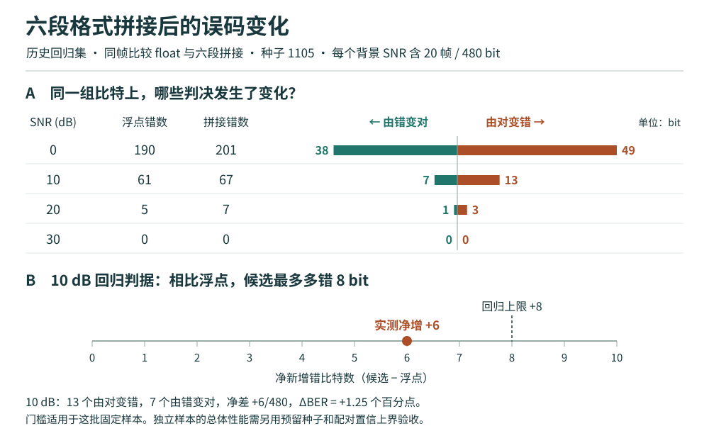

# 分档误码与配对翻转 · 历史 80 帧



**比较对象。** 在种子 1105 生成的相同 80 个四流 64-QAM 检测向量上，比较双精度 float 与六段分别选宽后拼接的定点配置。按 F、I1、I2、I3、I4、R 排列，其 (W,F) 为 (14,10)、(10,6)、(8,4)、(16,10)、(16,10)、(8,4)。四档背景 SNR 各有 20 帧，每帧 24 个调制比特。[历史运行入口](../../../experiments/run_process_joint.m) · [六段配置](../../../experiments/matlab位宽建模实验2_单计算过程协同压窄/result/选择.csv) · [逐帧源表](../../../experiments/matlab位宽建模实验2_单计算过程协同压窄/result/拼接/per_frame.csv)

**怎样复算。** 每行源数据给出浮点错数 $F$、候选错数 $C$ 和两条实现的硬判分歧数 $D$。对于同一真值的二元判决，浮点正确而候选出错的数量为 $(D+C-F)/2$，浮点出错而候选纠正的数量为 $(D-C+F)/2$。按 SNR 汇总两种计数，净差除以每档比特数 480，再乘 100，得到绝对 BER 差的**百分点**。源表支持恢复两种翻转的数量，精确定位到具体的标签位或候选还需逐位 trace。[逐档配对计数 CSV](分档配对计数.csv)

**怎样解释。** 10 dB 档内多错 13 个、纠正 7 个，净增 6 个，满足这 480 bit 上事先规定的上限 8 个。总共 20 个比特改变了判决；这能定位值得追踪的工况，尚不能确定哪个量化节点导致变化。30 dB 观察到 0 个错误，低误码性能仍需更多独立帧。图 B 仅给 10 dB 固定回归标门槛。正式验收按预留种子和按帧配对的置信上界另行报告。[首版验收规格](../../../文档/matlab建模文档/14_首版原型BER吞吐与延迟规格.md)

在 `MIMO_v2_matlab` 根目录运行下列命令，使用 Python 3.9 或更高版本的标准库，从上述历史 CSV 重新生成同目录的 SVG 与汇总 CSV。命令只读取归档记录。

```powershell
python "实验档案/03_图表/历史80帧/复算图表.py"
```
