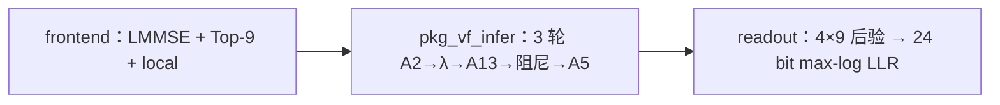

# v2 MATLAB 代码研读（面向 FPGA）

配套物理可视化：[MIMO v2 物理模型交互研究（HTML）](../../../../MIMO_原理可视化/MIMO_v2_物理模型交互研究.html)；详细审计：[数学、物理、位宽与时序](05_1103_数学物理位宽与时序审计.md)。

文件：[`MIMO.m`](../../MIMO.m) 单文件，无 `common/`。权重在 `deployment.mat`。位宽规格在 [`位宽管理.txt`](../../位宽管理.txt)。

本文按[11 论文主稿](11_四流64QAM迭代检测器定点化论文梗概.md)区分 MATLAB 数值语义、早期 FPGA 位宽设想和当前控制器边界。`float` 是参考；`fixed_mvm` **只量化阵列口**；非线性外围不是已完成的 HDL。

## v1 归档与本包 v2 的接口差异

| | v1 归档（10-30） | 本包 v2 |
|---|---|---|
| A2 / A13 / A5 | 324×288 / 576×288 / 324×36 | **216×180 / 468×180 / 216×36** |
| 消息 | 32 口 × 9 = 288 | **20 口 × 9 = 180**（5 组 × 每组 4 变量） |
| 轮次 | 硅上 6 | **`fixed_passes=3`** |
| 阻尼 | 控制器 0.6/0.4 | **`rate=0.3`**，β←(1−r)β+r·raw |
| 控制器字长 | 后锁的 8.2 | 表上阵列 **S24.12**，系数 **S18.14**；排序比较 **S32.12** |
| λ | 端口外 | `pkg_vf_infer` 在浮点路径计算混合高斯；旧规格曾拟用 FP32 |

不能把 v1 的 36 拍 FSM 改几个 generic 当 v2。

## 三截：前端 / 推断核 / 读出

**进核之前（主机 / 每帧一次，1BOX 里 QR 同类）：**

- `frontend`：`y` 8×1、`H` 8×4、`noiseVar`、`impulseExtraVar`。64-QAM 表。`pkg_mimo_candidate_frontend` 做 4×4 `(H'H+σI)\`、每变量 64 点打分、**恰好 9 个候选**，并用比特覆盖补洞（`coverageGap=2`）。
- `vf_infer__receiver_order`：按能量排序再 `correlation_groups` 把 8 根天线分成 **5 组**（一组三根 + 一组两根 + 其余）。`位宽管理` 第 35 条：每帧一次，不每轮重算。

**每轮算法依赖（横跨控制器内外）：** `pkg_vf_infer` 第 112–154 行。

**核内末级：** `readout` 用候选比特标签做 max-log，LLR 限幅 ±20，得到 24 个调制比特的软值，负值判 1。`trajectory` 只给主机调试。

## 一轮推断的操作与硬件分工

对 `task=='mimo'`，`P=20`，`L=9`，`S=180`。

| 顺序 | 代码 | 数据形状 | 将来模块 | 1BOX 对照 |
|---|---|---|---|---|
| 1 | `vf_infer__mv('A2',[beta local])` | 入 216，出 180 | **MVM-A2**（完整功能在核内；去掉 MVM 则端口） | MVM1：内积 |
| 2 | `alpha-max` 按行；`sort(...,'descend')` 稳定 | 20×9 | **NRM+SORT** | 投影/更新前的整理 |
| 3 | `exp/sum`→`prob`；`mu`、`varr` | 20 | **STAT**（均值方差） | 文中没有；这边 λ 的前置 |
| 4 | 8×4 残差 + `vf_infer__mix` | 出 288 | **LAMBDA**（混合高斯 log） | 参考 §III-B 的误差验证方法；核外非线性单独计价 |
| 5 | 排序域 `ai` 的 logsumexp | 代码写出 20×9；权重只接每口第 1 列 | **LSE** | 稳定减峰值，同 Mills 处理 |
| 6 | `mv('A13',[lambda ai])` | 名义入 468；有效 288 个 λ + 20 个 LSE | **MVM-A13** | MVM2：按到达顺序乘加 |
| 7 | 按 `idx` 反排；减最大；阻尼 0.3 | 180 | **UNSORT+DAMP** | UPC 投影+累加 |
| 8 | `mv('A5',[beta local])` | 入 216，出 36 | **MVM-A5** | 最后一次矩阵 |

A2/A13/A5、统计和似然均由核外服务提供，端到端核算覆盖服务、传输、停等及相应能耗。完整功能时三块是 **稀疏 MAC**：非零 900 / 828 / 216。扇入不是三块都取最大：A2 每列恒 5，A5 每列恒 6，A13 按组大小是 6 / 5 / 4（三天线组、两天线组、单天线组）。表 07/12/17 的累加器按最大扇入留成 S45.26。不要按 216×180 稠密乘来报面积。

从 `deployment.mat` 对上代码之后的连线（见 [部署矩阵原件](../../deployment.mat)）：

- 20 个口 = 5 组 × 4 个变量。组是重排后的固定槽：天线槽 0–2、3–4、5、6、7。每帧只重排 `H` 和 `y`，口地址不改。
- A2、A5 只在**同一变量、不同组**之间走，9 个候选槽对角相乘，槽与槽不混。
- A13 的 λ 也是对角。`ai` 的 180 个数里只有每口第 1 列（logsumexp）有系数，另外 160 个是结构零；这一个数用同一个权加到同组另外三个变量的 9 个槽上。
- 核读的是 `profile.runtime`：`rate` 为 float32 的 0.3，温度为 1，prior、alpha、lambda、beta、posteriorBeta、posteriorPrior 的 scale 均为 1（另有软干扰方差 scale=0.5）。`pack.config` 里的阻尼 0.4、温度 0.7 不进这三轮。

`mode='fixed_mvm'`：`pkg_vf_fixed_mvm` 把 x 收成 S24.12、A 收成 S18.14，整数乘加，累加器 ≤53 bit（表上 S45.26），右移 14 再收成 S24.12。这是阵列口黄金，**不是核功耗**。

## 非线性与阻尼的数值风险（对照 1BOX §III-B）

1BOX：Mills 比 0/0 → 三段近似 + LUT；高 SNR 动态范围 → 钳 `σ`、κ 改移位。

这边对得上的三处：

| 运算 | MATLAB 现在怎么写 | 硬件障碍 | 早期位宽清单的设想 |
|---|---|---|---|
| `vf_infer__mix` / 前端 mixture | `log(exp(a-m)+exp(b-m))` | 大负指数下溢；除方差 | 第 29–32 条拟用 FP32；当前控制器将其放在核外 |
| softmax `exp(a/T-max)` | 先减最大 | 仍要 exp | 第 27–28 条 U24.23 概率；exp 未验收 |
| 阻尼 0.3 | 浮点乘加 | 0.3 不是 2 的幂 | 第 25 条：`65536-rate` 凑成精确 1 |

**当前上机顺序。** 重放浮点基线后，先单独扫排序前 alpha，小数位变化需追到 idx、三轮 β 和末轮 LLR，再联合 raw/β 复核。外部 mix/exp 若改 LUT，另做数值与服务延时对照。

## 当前控制器怎样对应源码

|软件运算|控制器边界和证据|
|---|---|
|前端、候选、接收行重排|外部每帧供给先验、候选和标签；核算端到端延迟时记录首笔 y/H 输入。|
|A2/A13/A5、均值方差、λ、logsumexp|核外服务。协议须说明外部如何取得与 idx 对齐的分数和候选，分别记录请求、返回和停顿。|
|减峰、稳定排序、idx 散回、阻尼|核内。现有 RTL 在 20 个口并行排序、β 单数组原址更新；逐口共享一窗与 β 双库为待实现候选。|
|后验和 LLR|原始 MATLAB 每轮计算 A5，末轮输出 24 个 LLR；现有 RTL 只在末轮请求 A5。比较之前先验证 β 和末轮 z/LLR 等价。|

原型建议 40 MHz、持续吞吐至少 20 kbit/s、端到端延迟至多 1.20 ms。持续吞吐为 24×时钟频率/平均帧启动间隔；另测首笔 y/H 接收到第 24 个 LLR 交付的延迟。

## 如何读早期位宽表

原始 fixed_mvm 使用总宽 24/小数 12 的消息、总宽 18/小数 14 的系数，宽累加后检查 45 位范围，再对列输出舍入。新实验还需另测有序逐乘积、逐部分和量化。早期规格的比较通路 S(32,12)、外围 FP32 和阻尼系数 S(18,16) 用于追溯；论文的候选格式按每条边的 W、F、量化点和消费者登记。现有控制器把 307 和 717 的两个乘积分别右移舍入，再相加饱和；先求和后舍入作为另一种数值合同单测。

索引：口 U5（0..19）、候选 U4（0..8）、组 U3（0..4）、迭代 U2（0..3，含完成）。无效状态用 `valid`，禁止用全零表示无效（表 01）。

包内黄金检验各轮轨迹。BER 回归另用相同的 80 帧和真值；10 dB 浮点错 61/480，候选最多错 69/480。预留种子、时序与能量验收见[论文主稿](11_四流64QAM迭代检测器定点化论文梗概.md)。
