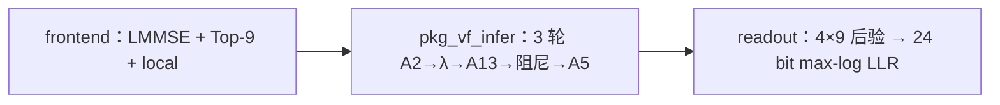

# v2 MATLAB 代码研读（面向 FPGA）

配套物理可视化：[MIMO v2 物理模型交互研究（HTML）](../../../MIMO_原理可视化/MIMO_v2_物理模型交互研究.html)；详细审计：[数学、物理、位宽与时序](05_1103_数学物理位宽与时序审计.md)。

文件：[`MIMO.m`](../../../MIMO_工程管理/MIMO_v2_matlab/MIMO.m) 单文件，无 `common/`。权重在 `deployment.mat`。位宽规格在 [`位宽管理.txt`](../../../MIMO_工程管理/MIMO_v2_matlab/位宽管理.txt)。

包头写明：给 FPGA 翻译用。`float` 是参考；`fixed_mvm` **只量化阵列口**；非线性外围不是已完成的 HDL。

## 和 v1 硅实现不是同一张图

| | v1 归档（10-30） | 本包 v2 |
|---|---|---|
| A2 / A13 / A5 | 324×288 / 576×288 / 324×36 | **216×180 / 468×180 / 216×36** |
| 消息 | 32 口 × 9 = 288 | **20 口 × 9 = 180**（5 组 × 每组 4 变量） |
| 轮次 | 硅上 6 | **`fixed_passes=3`** |
| 阻尼 | 控制器 0.6/0.4 | **`rate=0.3`**，β←(1−r)β+r·raw |
| 控制器字长 | 后锁的 8.2 | 表上阵列 **S24.12**，系数 **S18.14**；排序比较 **S32.12** |
| λ | 端口外 | 仍在 `pkg_vf_infer` 里用 FP32 混合高斯 |

不能把 v1 的 36 拍 FSM 改几个 generic 当 v2。

## 三截：前端 / 推断核 / 读出

**进核之前（主机 / 每帧一次，1BOX 里 QR 同类）：**

- `frontend`：`y` 8×1、`H` 8×4、`noiseVar`、`impulseExtraVar`。64-QAM 表。`pkg_mimo_candidate_frontend` 做 4×4 `(H'H+σI)\`、每变量 64 点打分、**恰好 9 个候选**，并用比特覆盖补洞（`coverageGap=2`）。
- `vf_infer__receiver_order`：按能量排序再 `correlation_groups` 把 8 根天线分成 **5 组**（一组三根 + 一组两根 + 其余）。`位宽管理` 第 35 条：每帧一次，不每轮重算。

**核（每轮，对 FPGA 画模块的对象）：** `pkg_vf_infer` 第 112–154 行。

**出核之后：** `readout` 用候选比特标签做 max-log，LLR 限幅 ±20，得到 24 个信息比特。`trajectory` 只给主机调试。

## 一轮：MATLAB 行号 = 将来的模块名

对 `task=='mimo'`，`P=20`，`L=9`，`S=180`。

| 顺序 | 代码 | 数据形状 | 将来模块 | 1BOX 对照 |
|---|---|---|---|---|
| 1 | `vf_infer__mv('A2',[beta local])` | 入 216，出 180 | **MVM-A2**（完整功能在核内；去掉 MVM 则端口） | MVM1：内积 |
| 2 | `alpha-max` 按行；`sort(...,'descend')` 稳定 | 20×9 | **NRM+SORT** | 投影/更新前的整理 |
| 3 | `exp/sum`→`prob`；`mu`、`varr` | 20 | **STAT**（均值方差） | 文中没有；这边 λ 的前置 |
| 4 | 8×4 残差 + `vf_infer__mix` | 出 288 | **LAMBDA**（混合高斯 log） | §III-B Mills 比：同样是 `log/Φ` 类，要 LUT |
| 5 | 排序域 `ai` 的 logsumexp | 20×9 | **LSE** | 稳定减峰值，同 Mills 处理 |
| 6 | `mv('A13',[lambda ai])` | 入 468，出 180 | **MVM-A13** | MVM2：按到达顺序乘加 |
| 7 | 按 `idx` 反排；减最大；阻尼 0.3 | 180 | **UNSORT+DAMP** | UPC 投影+累加 |
| 8 | `mv('A5',[beta local])` | 入 216，出 36 | **MVM-A5** | 最后一次矩阵 |

去掉 MVM 时 1/6/8 变成握手等待，能量不算空转漏电。完整功能时三块是 **稀疏 MAC**：非零 900 / 828 / 216，扇入 5 / 6 / 6（表 07、12、17）。不要按 216×180 稠密乘来报面积。

`mode='fixed_mvm'`：`pkg_vf_fixed_mvm` 把 x 收成 S24.12、A 收成 S18.14，整数乘加，累加器 ≤53 bit（表上 S45.26），右移 14 再收成 S24.12。这是阵列口黄金，**不是核功耗**。

## 数值上会炸、必须先改算法再画电路（学 1BOX §III-B）

1BOX：Mills 比 0/0 → 三段近似 + LUT；高 SNR 动态范围 → 钳 `σ`、κ 改移位。

这边对得上的三处：

| 运算 | MATLAB 现在怎么写 | 硬件障碍 | 包里已给的规格 |
|---|---|---|---|
| `vf_infer__mix` / 前端 mixture | `log(exp(a-m)+exp(b-m))` | 大负指数下溢；除方差 | 第 29–32 条 **FP32 语义**，尚未 LUT |
| softmax `exp(a/T-max)` | 先减最大 | 仍要 exp | 第 27–28 条 U24.23 概率；exp 未验收 |
| 阻尼 0.3 | 浮点乘加 | 0.3 不是 2 的幂 | 第 25 条：`65536-rate` 凑成精确 1 |

**面向硬件改 MATLAB 的顺序（今天只立项，不改代码）：** 先给 mix/exp 做和 Mills 一样的「饱和 + LUT + BER 叠图」，再锁比较通路字长（表 23 的 S32.12），最后才缩阵列口。禁止先砍成 8.2 再补误码。

## 核边界（开篇就要写死）

| 块 | 完整功能数字 IC / FPGA | 去掉 MVM |
|---|---|---|
| 前端 LMMSE、Top-9、天线分组 | 核外（每帧一次） | 同左 |
| A2/A13/A5 | **核内稀疏 MAC + 系数 ROM** | 端口，阵列在外 |
| 排序、减最大、阻尼 | 核内 | 核内 |
| λ / logsumexp | 核内（先 FP32 规格，后 LUT） | 核内或端口；与 1BOX 的 FTF 同类，**拆不掉就不要从面积里假装删掉** |
| readout max-log | 核内末级或主机 | 同左 |

K=24。吞吐以后用 `24 / (D×3 / f)`，`D` 是一轮拍数，必须和甘特同一条式子。

## 位宽：从表出发，不从 v1 的 8.2 出发

表是 **混合精度规格**，不是已经全定点验收。已验证的只有：系数 ROM、矩阵整数 MAC、舍入饱和边界。

分四层写进将来的 §IV-D，不要合成一个 W：

1. **阵列数据** S24.12；**系数** S18.14 或 4 bit 码本索引 + mask。
2. **MAC**：乘积 S42.26；累加 S45.26；输出右移 14。
3. **排序/反排/阻尼**：比较用 S32.12（表 23）；阻尼整数补系数（表 25）；回阵列再 S24.12 并计饱和。
4. **λ / 前端 / 方差**：FP32，直到做出 LUT 并用 BER 证明。

索引：口 U5（0..19）、候选 U4（0..8）、组 U3（0..4）、迭代 U2（0..3，含完成）。无效状态用 `valid`，禁止用全零表示无效（表 01）。

收口条件与 1BOX 相同：定点曲线叠在浮点 BER 上。本包黄金只保证 `MIMO()` 样例 `error<1e-9`，**不是字长停手**。
