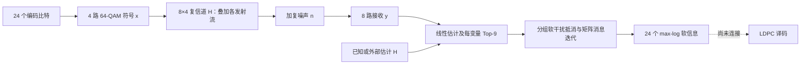
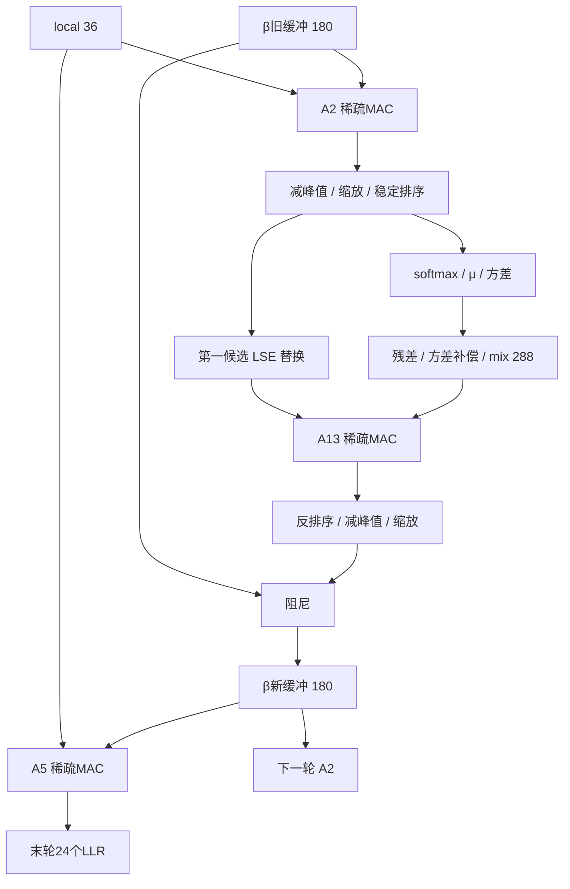

# 2026-11-03 MIMO v2：数学、物理、位宽与时序审计

物理部分的详细扩展与交互图：[MIMO v2 物理模型交互研究](../../../MIMO_原理可视化/MIMO_v2_物理模型交互研究.html)。包括连续时间到离散基带、信道可分性、混合噪声、软干扰抵消及星地应用边界，附在线原始资料与阅读深度。HTML使用合成教学数据，不是部署包复现。浏览器检查通过：无脚本错误；ρ=1显示秩1；无噪声、已知其他流的理想条件下真值排名第一；390px宽页面无整体横向溢出。

本记录直接研读 `MIMO_v2_matlab/MIMO.m` 与 `位宽管理.txt`，并对照本目录既有研读。未修改算法。标记：**代码确定**、**规格**、**推导**、**待验证**。既有文档的部署矩阵统计尚未在本次独立读取 deployment.mat 复核。未运行 MATLAB 黄金、FP32 全链路或 RTL 仿真。

## 1. 文件夹与版本边界

总目录以 01_MIMO 检测、02_LDPC 译码构成链路，03–05 是预留任务。各任务分工程管理、文档、原理可视化、参考文献、AI_declaration。MIMO 工程包括 v1 MATLAB、FPGA、数字 IC，以及本次 v2 MATLAB 和 1102 更新矩阵包；本次不把 v1 实现当成 v2 验证。LDPC 有多个 FPGA 版本，但根目录说明检测 LLR 尚未接入译码器。

v2 包只有主程序、deployment.mat、阅读说明和位宽管理。MIMO.m 是算法；deployment.mat 是参数、矩阵、例子和黄金值；位宽管理是混合精度规格。旧文档称 20 端口、3 轮、rate=0.3，须以实际部署包复核后冻结。主程序轮数来自 profile，不能仅凭循环代码断言固定为 3。

## 2. 物理含义与适用边界

### 2.1 先理解64-QAM：比特怎样变成电波（2026-11-04补充）

64-QAM 是正交幅度调制。发送端把每6个编码比特分为两组，每组3比特，分别选择I（同相）和Q（正交）支路的8个有符号幅度之一。两路分别乘以同频率、相差90°的载波，再相加成为一条射频波形。I/Q是同一信号的正交分量，不是两根天线或两条传播路径；也不是每路单独承担3个“幅度比特”和3个“相位比特”。

在一个符号内暂时忽略脉冲成形与功率缩放，可写为：

$$s(t)=I\cos(2\pi f_ct)-Q\sin(2\pi f_ct)=A\cos(2\pi f_ct+\phi),$$

$$x=I+jQ,\quad A=\sqrt{I^2+Q^2},\quad \phi=\operatorname{atan2}(Q,I).$$

星座点的横坐标是I、纵坐标是Q，距原点的距离对应载波幅度，方向对应相位。负电平表示相应支路反相，不是负的物理功率。64种I/Q组合对应64种符号状态，因此每符号承载log₂64=6比特；并非64个幅度各配64个相位。

当前 `qam64_table` 使用以下Gray映射，两路一致：

|3比特标签|000|001|011|010|110|111|101|100|
|---|---|---|---|---|---|---|---|---|
|未归一化电平|−7|−5|−3|−1|+1|+3|+5|+7|

前3位是I，后3位是Q。例如 `110 010` → I=1/√42、Q=−1/√42 → x=(1−j)/√42，幅度A=√(1/21)≈0.2182，相位−45°。Gray标签使水平/垂直相邻点仅差一位；它本身不增加星座间距，也不保证没有误码。

为什么除以√42？均匀选择时，每个实轴的平均平方是21，两轴合计42；归一化后每流E|x|²=1。相邻点距离2/√42≈0.3086。相比低阶方形QAM，在相同平均符号能量下，高阶QAM的点更密，对噪声、相位误差和非线性更敏感。实际连续波形还要将符号序列与成形脉冲卷积，不能把网页中单符号正弦图当成完整带宽受限发射波形。

接收端通常通过同频正交下变频、低通/匹配滤波和定时采样恢复I/Q观测。单径复信道h=|h|e^{jθ}会使星座缩放|h|、旋转θ；MIMO中每根接收天线还叠加其他流，所以接收y通常不落在原始64点星座上。当前检测器处理的是这些前置步骤之后的y与H，没有实现射频调制器。

本工程四个变量各承载一个64-QAM符号，每次共24个编码比特；每个变量同时具有I和Q，不能把4路MIMO误解成两对I/Q。8路接收是对四路混合信号的8次空间观测，不将承载比特数变成8×6。

单流调制比特率为6Rₛ；四个独立空间流在同一符号率下合计24Rₛ。净信息速率还要乘码率并扣除导频、保护间隔等开销。例如仅作算术示例，Rₛ=1 Mbaud时单流为6 Mbit/s，四流为24 Mbit/s；这不是本工程已经设定或测得的速率。

用户提供的百科摘录中的“200公里以内、600 Gbps”未提供原始文献上下文，不能写成64-QAM通用距离或速率。OSNR指光信噪比；这些数值应待核对相应光通信系统的符号率、极化/波长复用、功率和误码指标后再引用。64-QAM的6比特/符号本身不限定传播距离，也不能直接给出本项目吞吐率。

交互演示：[HTML中的64-QAM基础：选择6比特，观察I/Q、幅度、相位与载波](../../../MIMO_原理可视化/MIMO_v2_物理模型交互研究.html#qam-basics)。

### 2.2 当前检测器的物理模型

代码对应一次复基带观测：y=Hx+n，y∈C⁸，H∈C⁸ˣ⁴，x∈C⁴。4 个发射变量各携带一个 64-QAM 符号；输出 24 个编码比特的软信息及硬判决，不能直接称为 24 个净信息比特。H 是接收机输入，不在本检测器内估计。

星座 c=(a+jb)/√42，a,b∈{−7,−5,…,7}；均匀输入时 E|c|²=1，单分量最大 7/√42≈1.08012，幅值最大 √(7/3)≈1.52753。I、Q 各用 3 位 Gray 标签。

标量残差似然使用两分量圆对称复高斯：

`p(r)=(1−ε)/(πv₀) exp(−|r|²/v₀)+ε/(πv₁) exp(−|r|²/v₁)`。

此处 v 是复噪声功率；若按圆对称模型解释，实部、虚部方差各 v/2。代码把各接收观测似然分开处理，未建模跨接收支路的联合有色噪声。

**接口歧义：** input.impulseExtraVar → d.impulseVar → 似然第二分量方差。代码用 iv，不是 nv+iv。必须先核对数据生成方约定，再决定改名或改公式，不能凭变量名改变黄金。

“星地通信”是项目背景，不等于当前包已建模卫星链路。代码没有轨道、距离、载频、多普勒、传播时延、雨衰、同步、频率选择性或导频估计过程。它可以作为同步、均衡/信道估计之后的一次平坦信道 MIMO 检测；能否代表实际星地链路，取决于外部 H、噪声和采样构造。4 路空间流的可分辨性还受 H 的秩及条件数影响，不能假设视距场景自然有 4 个独立自由度。

## 3. 前端：每帧一次的计算顺序

1. 构造 G=HᴴH+nv I₄，b=Hᴴy。这里是共轭转置。
2. 解 G x̂=b，同时解 G C=I，取 v=max(real(diag C),10⁻⁸)。硬件可以共用一次分解、求解 5 个右端，但须与 MATLAB 结果比较。不要为了实现方便显式求逆后乘 b。
3. 每变量对 64 点计算 sL(c)=−|c−x̂v|²/(2vᵥ)，减本变量最大值。
4. 计算 r₋ᵥ=y−Hx̂+H[:,v]x̂v；每点算 r=r₋ᵥ−H[:,v]c，在 8 个接收观测上累加混合对数似然，再减最大值。
5. s=sL+residualWeight·sR。按降序取 9 点，按 coverageGap 检查是否应补入缺失比特值；最多 6 遍，每遍检查 6 位。补点会保护已有比特覆盖，但门限可能阻止补点，不能承诺两种比特值总齐全。
6. local=s(keep)−max(s(keep))，保存候选坐标和比特标签。
7. 推断前排序 H 的接收行并同序重排 y。相关性分组先在排序后的行上选三元组，再选二元组，余下单独分组。候选变量索引不随接收行变化。

注意 C=G⁻¹ 的对角在这里是打分尺度。代码没有计算通常线性 MMSE 误差协方差中的 nv·G⁻¹，且 scoreL 使用 2v 分母；不能未经训练/标定背景就将其称为严格后验概率。

前端固定产生 4×64×8=2048 次标量混合似然，尚未计线性求解及排序。这部分不能从“完整检测器”的总时延和功耗中漏掉。

## 4. 每轮：数据形状、数学与依赖

按既有部署说明 P=20、L=9、S=180；端口是组×变量的消息副本，并非 20 根物理天线。矩阵方向是行向量 xA，因此输出扇入按矩阵列统计。

|阶段|严格计算顺序|输入→输出|
|---|---|---|
|A2|[β,local]A2；每端口减最大；乘 AlphaScale|216→180→20×9|
|SORT|每行降序，保存 idx；候选 cs 必须同步重排|20×9 分数和索引|
|STAT|p=softmax(a/T)；μ=Σp c；v=Σp|c−μ|²|180 概率→20 复均值及20 方差|
|残差|rᵣᵥₖ=yᵣ−ΣⱼHᵣⱼμgⱼ+Hᵣᵥ(μgᵥ−cᵥₖ)|8×4×9=288 复残差|
|等效方差|eᵣᵥ=max(0,Σⱼ|Hᵣⱼ|²vⱼ−|Hᵣᵥ|²vᵥ)·VarianceScale|每接收×变量一个值，共32个|
|LAMBDA|mix(r,nv+e,iv+e,ε)，再乘 LambdaScale|288 实分数|
|LSE|ai=a，仅第一列替换成 logΣexp(a)|20×9；不是所有列都替换|
|A13|[λ,vec(ai)]A13|468→180|
|UNSORT|raw(j,idx(j,:))=score(j,:)；再减最大、展平、乘 BetaScale|恢复候选原顺序的180分数|
|DAMP|βnew=(1−rate)βold+rate·raw|180反馈状态|
|A5|[PosteriorBetaScale·βnew,PosteriorPriorScale·local]A5|216→36 后验分数|

residual 的等价式为 yᵣ−Σⱼ≠ᵥHᵣⱼμgⱼ−Hᵣᵥcᵥₖ，但浮点重排会改变舍入。可共享 y−Hμ 和每接收支路的 Σweighted，属于硬件优化，必须单独验证。

读出：每变量每比特分别取标签0和1的最大分数，相减，限幅 ±20；LLR<0 判1。MATLAB 用 −10⁶ 填无效候选。硬件应保存 valid，不能把 −10⁶ 强行装入 S24.12；若单侧无候选，应复现限幅后的结果。输出按每变量连续6位排列。

## 5. 位宽：确定的部分和不能直接定论的部分

S W.F 的 W 包括符号。MATLAB double 的存储是64位浮点，不等于硬件64位定点；fixed_mvm 使用 double 容纳整数乘加，接口模拟量化。其它外围仍是 double。

|运算边界|输入|全精度临时量/输出|结论级别|
|---|---|---|---|
|阵列输入量化|double|S24.12，最近舍入、半值远离零、饱和|代码确定，默认宽度可被profile覆盖|
|权重量化|double|S18.14|代码确定|
|实乘|S24.12×S18.14|S42.26|推导，与表一致|
|5或6项累加|S42.26|S45.26|保守全范围推导；实际扇入待包复核|
|回阵列口|S45.26|除2¹⁴后按符号舍入、饱和至S24.12|代码确定|
|两个24位分数相减|S24.12、S24.12|S25.12，再扩至S32.12可无损|推导|
|两个32位分数相减|S32.12、S32.12|S33.12|推导；收回32位仍需定义溢出|
|增益乘法|S24.12×S18.16|S42.28；回目标格式需舍入|规格推导|
|32位raw乘增益|S32.12×S18.16|S50.28|推导，不能仍按42位|
|阻尼两项和|24位β、24位raw、18位系数|S42.28乘积、S43.28和|仅在raw先转24位时成立|
|保留32位raw的阻尼|24位β、32位raw|对齐为S50.28，再S51.28求和|保守推导，建议首版保留再末端量化|
|exp输出、概率|非线性输出|U24.23|规格；可精确表示1|
|9项指数和|U24.23|U28.23|通用累加安全；用exp≤1的域约束可缩到U27.23|
|复残差、复均值|FP32×2|实虚各32位，逐算术舍入|实施规格，非现有MATLAB行为|
|平方、方差、倒数、log、mix|FP32|每步FP32，FMA另定|待全链路验证|
|LLR相减|S32.12×2|S33.12，限幅后S24.12|规格推导|
|候选索引/星座索引/端口|—|U4/U6/U5|部署尺寸成立时确定|

定点一般规则：先把两数对齐到 F=max(Fa,Fb)，**各操作数宽度须先增加 F−Fi**，再取 max(对齐后宽度)+1 做加减。原表的 max(Wa,Wb)+1 只有相同F时可直接用。

若把复乘也改为定点：两个 S24.12 实数相乘得 S48.24；复乘实、虚各做两项加减得 S49.24；4项复和保守 S51.24。这是替代设计的推导，不是目前 FP32 规格已实现。

量化 rate=0.3 时 r_int=19661，补系数=45875，和恰为65536；实际 r=0.3000030517578125。不得把0.7和0.3独立舍入后不检查系数和。

### 局部误差如何影响最终判决

无饱和的 S24.12 量化误差≤2⁻¹³，S18.14 权重误差≤2⁻¹⁵。单输出含K项时：

`|δy| ≤ Σ(|wᵢ|εx+|xᵢ|εw+εx εw)+εout`。

该式需要实际输入界、权重和；不能仅由24位得出 BER。排序分数间距≤2ε时次序可能翻转；Top-9 边界和覆盖门限附近会改变候选集合。方差倒数在小分母时尤其敏感。排序及候选裁剪使全链路误差不能简单按线性增益估计。

若两侧候选集合不变且每个后验分数误差≤ε，则 max-log LLR误差≤2ε；|LLR|>2ε时符号稳定。候选丢失、集合变化或饱和时不能沿用该保证。高斯输入无有限理论幅值上界，零饱和样例不能证明所有输入永不饱和。

## 6. FPGA 架构与可执行时序草案

首版划分：输入缓存→前端线性求解/候选引擎→分组与映射ROM→迭代核→读出。若前端留在主机，应明确产品是“prepared输入推断核”，不能称作完整原始观测检测器。

核内配置一组可复用稀疏MAC、双缓冲β、local RAM、candidate/bit ROM或RAM、排序索引RAM、统计引擎、混合似然引擎和读出比较树。按输出列压缩矩阵，ROM保存输入地址、权重及列结束标记，避免把稠密零项当成MAC。矩阵系数是否能由4位码本重建，需核验包内码本，不能仅凭位宽表假定。

按既有矩阵统计：A2/A13/A5 非零数900/828/216，最大扇入5/6/6。采用 Q 路MAC、每列一条lane顺序累加且禁止列内并行的简单调度：

`C_A2 ≤ ceil(180/Q)·5`，`C_A13 ≤ ceil(180/Q)·6`，`C_A5 ≤ ceil(36/Q)·6`。

这里是MAC发射槽上界，需额外加ROM读取、乘法管线、累加反馈间隔及输出量化；不是综合后实际周期。单lane且按非零紧凑调度，每轮共1944个MAC项，3轮5832项。Q=4按列槽调度为225+270+54=549槽/轮；不能当作整轮549拍。

|时段|必须完成的前置|可并行/实现注意|
|---|---|---|
|F0 接收输入|有效y/H/方差|双帧缓存可与上一帧读出重叠|
|F1 前端|F0|Gram与Hᴴy可并行，求解后才能评分|
|F2 接收分组|H就绪|可与前端候选评分重叠；最终映射必须一致|
|I0 A2|βold与local|首轮β置0|
|I1 归一化、排序|对应端口9个输出齐备|端口间流水；相等分数按原索引稳定排序|
|I2 概率统计及LSE|排序结果|LSE与统计可分支并行|
|I3 residual/mix|该组4个μ/方差齐备|32组方差供每组9候选共享|
|I4 A13|对应λ、ai就绪|首版采用整阶段屏障，后续才流式优化|
|I5 反排序、归一化、阻尼|A13端口结果|按idx散写，需要地址冲突管理|
|I6 A5/下一轮|βnew完成|A5不反馈下一轮；独立MAC时可重叠，共用MAC时排队|
|R 读出|最后一轮A5|按6个标签归约、相减、限幅|

令每阶段完整延迟为 D，首版屏障调度：

`Citer=D_A2+D_norm_sort+max(D_stat,D_LSE)+D_mix+D_A13+D_unsort_damp+D_A5`。

`Cframe=D_input+max(D_frontend,D_group)+3·Citer+D_readout`（前端和分组确实并行才用max）。

单引擎混合似然每轮288点，若启动间隔 II_mix，则点流时间≥287·II_mix+L_mix，另加残差前处理。前端2048点的同一引擎至少2047·II_mix+L_mix。log/exp不能按1拍无成本估计。

可用插入排序作易验证基线：9元素最多36次比较移动，20端口最多720次；若单次操作一拍才可解释成720拍。排序网络可提高并行，但填充到16项时必须用valid屏蔽填充值。

β双缓冲最低2×180×24=8640 bit；local为36×24=864 bit；排序索引180×4=720 bit；候选实虚36×48=1728 bit；标签36×6=216 bit。这些是有效载荷，不是BRAM物理占用，亦未含FP32中间缓存、H/y和矩阵ROM。

时钟频率、DSP数量、BRAM端口、非线性IP延迟/II、跨时钟接口均未给定，所以目前不能确定 ns、帧/s、资源和功耗。吞吐用24·f/帧启动间隔；串行单帧结构才可把启动间隔等同Cframe。

## 7. 需要解决的实现歧义与验证顺序

1. 独立读取 deployment.mat，导出全部config、groups、维度、非零数、扇入、系数范围和文件哈希；核验与旧文档一致。
2. 运行 MIMO() 浮点黄金。fixed黄金要调用 MIMO(pack.example,'fixed_mvm') 并显式对照 expectedFixed；传入空输入不等于运行demo。
3. 同一原始y/H与prepared输入对照，确认前端、排序和标签布局；核对 impulseExtraVar 语义。
4. 增加逐阶段trace：量化前后极值、饱和、最小方差、Top-9边界间距、排序翻转、覆盖变化、LLR翻转。现有audit是累计统计，且未向顶层汇总权重饱和。
5. 逐运算FP32黄金：固定乘加顺序、FMA策略、零/非有限处理。再决定采用32位raw反馈还是提前24位量化，二者必须分别对照。
6. 单模块位宽扫描与多模块联合扫描，覆盖低/高噪声、脉冲噪声、近奇异H、近判决边界；报告BER及置信区间、LLR误差和候选召回，不仅报告单黄金误差。
7. 冻结FPGA型号/时钟/资源预算、IP延迟和RAM端口后填实逐拍表，再写RTL和逐模块对拍。综合/布局布线后才给最终资源、频率和功耗。

本次环境验证：PATH未找到MATLAB或Python；发现 MATLAB/R2021b 目录但预期bin/matlab.exe不可执行；内置Python可用但无scipy。因此本记录不声明重新跑通黄金，也不将原文档验证声明当成本次实测。
