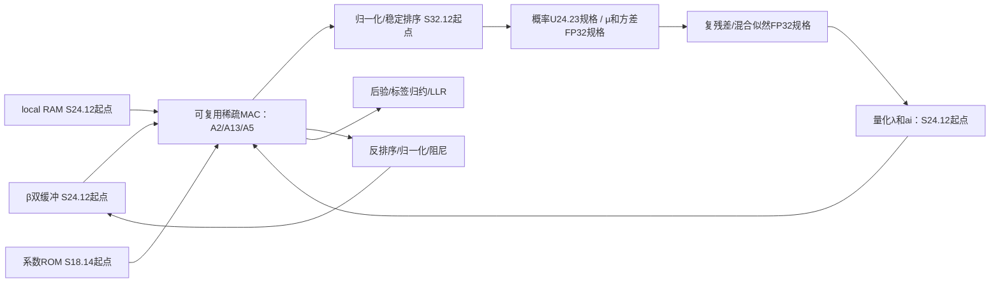

# MIMO v2：System Model、Architecture Details 与定点验证设计

日期：2026-11-04。本文确立本项目从 MATLAB 到 HDL 的设计依据。参考本地 [1BOX 译注](../../../参考文献/FPGA/05_2020_OneBit_Massive_MIMO_VLSI_中英对照.md) §II、§IV-B/C/D；沿用其分析方法，不移植其1-bit ADC、OFDM、FFT、Mills比或位宽数值。算法依据为 [MIMO.m](../../../MIMO_工程管理/MIMO_v2_matlab/MIMO.m)，初始格式依据为 [位宽管理.txt](../../../MIMO_工程管理/MIMO_v2_matlab/位宽管理.txt)。

本文是设计与实验合同，尚不是仿真验收报告。教学可视化见 [物理解释HTML](../../../MIMO_原理可视化/MIMO_v2_物理模型交互研究.html)。

交互设计入口：[系统模型—运算—数据流—位宽—时序实验台（HTML）](../../../MIMO_原理可视化/MIMO_v2_硬件数据流实验台.html)。页面包含逐运算台账与可下载配置，所有未验证的压缩格式明确标记为候选。

## I. 目标和交付链

具体执行方案见[MATLAB位宽、数据流与存储实验方案](07_MATLAB位宽数据流实验方案.md)：时间阶段、运算分类、逐次实验报告、存储容量及硬件候选资源均在该文档中展开。

System Model → 数学算法 → 运算与数据流图 → 存储/计算/控制微结构 → 带字长的边界 → MATLAB量化模型 → 位宽敏感性与联合验证 → 周期模型 → RTL逐拍对照 → 综合与实现。

目标是满足系统精度约束下减少硬件成本。压缩总位数只是手段，不能直接等同于减少DSP数量或BRAM块数。设计须同时满足吞吐/延迟要求，并使用目标器件的实际资源粒度评估。

最终每个数据流至少记录：名称、数学定义、生产者、消费者、数量及排列、实/复、符号、W/F、量化点、舍入/溢出、存储、valid/tag、产生时刻、使用时刻、试验编号。每个最终W/F必须能追溯到通过的实验。

## II. 本项目 System Model

考虑一个由四路同时发送的64-QAM流和八个集中可用接收观测构成的检测系统。每次调用处理一个离散复基带向量：

$$y=Hx+n,\qquad H\in\mathbb C^{8\times4},\quad x\in\mathcal X^4,$$

$$\mathcal X=\{(a+jb)/\sqrt{42}:a,b\in\{-7,-5,-3,-1,1,3,5,7\}\}.$$

均匀输入时每流平均能量为1。I/Q各采用3位Gray映射，每个向量对应24个编码比特。发射源可为四流单用户或四个单流用户；现有接口不能确定实际部署是哪一种，因此首先验证不绑定轨道的等效检测系统，再接场景生成器。

**检测接口假设：** 输入已完成所需的时频同步，H在一次检测期间保持不变；所有八个复观测集中可用。当前程序把输入H当作推断所用信道，没有显式信道估计误差概率模型。系统级仿真必须分别保存生成y的Htrue与检测输入Hhat，完美CSI时二者相等，失配实验时分别记录。

检测似然采用独立接收分量的两状态圆对称复高斯模型：

$$p(n_r)=(1-\epsilon)\mathcal{CN}(0,v_0)+\epsilon\mathcal{CN}(0,v_1).$$

独立性是检测模型的假设，物理干扰是否独立需要另外验证。代码中v₀=nv，v₁=iv，`impulseExtraVar`实际直接作为v₁；若数据生成采用背景噪声加脉冲增量，则第二状态总方差必须是两者方差之和。

平均接收SNR定义为 E‖Hx‖²/[8((1−ε)v₀+εv₁)]；另报背景SNR时明确分母为8v₀。信道归一化、发射功率、噪声生成随机种子必须写入测试配置。不可通过逐帧依赖发送真值的归一化改善检测结果。

若实际链路为频率选择性OFDM，可将本模型用于完成FFT后的一个子载波，但子载波独立性需要足够CP和已补偿频偏等条件。本工程目前不包含OFDM、1-bit ADC、信道估计、卫星传播几何或LDPC闭环，不能直接写入系统已实现部分。

### 系统图及两级硬件边界

边界E2E：原始y/H/方差到LLR，包含前端。边界CORE：prepared候选/local/H/y到LLR，仅推断核。二者分别报告延迟与资源；此前提纲中“完整功能”实际指含MVM的CORE，不能误称包括全部前端。

## III. 数学抽象与HDL模块对应

本节对应[HTML运算图](../../../MIMO_原理可视化/MIMO_v2_硬件数据流实验台.html#graph)。英文标识用于关联代码/HDL，中文采用功能意译。机器可读台账：[33个运算的数据流JSON](../../../MIMO_原理可视化/MIMO_v2_数据流台账.json)。

HTML点击节点可查看输入/输出、数量、格式与上下游；位宽实验按MATLAB半值远离零的舍入规则执行饱和量化。默认探针不是MATLAB实际轨迹，不能当作该节点的范围统计。时序采用独立资源的DAG事件模型，反馈轮次、共享MAC/RAM冲突及背压仍待周期仿真实现。求解器及非线性IP内部寄存器尚未展开，33个节点是算法运算级台账，不等于最终RTL寄存器级覆盖。

令cᵥₖ为候选、l为36项local，p为组×变量端口，β为反馈消息。以下20端口/3轮采用既有部署说明，冻结前仍需读取deployment.mat复核。

|模块|数学合同|不能省略的语义|
|---|---|---|
|线性初估 / Linear estimate · FE_SOLVE|G=HᴴH+nvI，Gx̂=Hᴴy，GC=I|共轭、求解次序、C对角下限10⁻⁸|
|候选筛选 / Candidate selection · FE_CAND|线性距离分数+残差混合似然分数，64→9|覆盖门限、补点顺序、Gray标签、local减峰值|
|接收分组 / Receiver grouping · GROUP|行能量排序、相关性与能量组合代价|y/H同行重排；仅每帧一次|
|先验消息合成 / Prior message mixing · A2|α=reshape([β,l]A2)，减峰值、缩放|MATLAB列主序展平；输出按端口/候选重排|
|排序与软统计 / Sort & soft statistics · SORT_STAT|排序后p=softmax(a/T)，μ=Σpc，v=Σp abs(c−μ)²|稳定排序及idx；softmax分母；概率非负|
|干扰抵消 / Interference cancellation · LAMBDA|r=y−Hμ+Hᵥ(μᵥ−cₖ)，e=scale·Σⱼ≠ᵥ abs(Hⱼ)²vⱼ|用相同组的μ/v；e数值误差负值按代码截到0|
|混合似然 / Mixture likelihood · MIX|log[(1−ε)CN(r;0,nv+e)+εCN(r;0,iv+e)]|减峰值稳定logsumexp；非有限处理|
|证据合成 / Evidence combination · LSE_A13|ai仅第一列换成LSE；[λ,vec(ai)]A13|λ排列rx→变量→候选；idx保持到反排|
|还原顺序与阻尼 / Unsort & damping · UNSORT_DAMP|raw(idx)=score；归一化缩放；βnew=(1−r)βold+r·raw|读旧β，写新β；不能原地污染未读数据|
|后验与软比特 / Posterior & soft bits · A5_READ|[βnew·gain,l·gain]A5；按标签分组max差|正LLR判0；限幅±20；缺失标签需valid|

H是物理信道；A2/A13/A5是消息计算矩阵。两类矩阵的存储寿命、位宽敏感性和更新频率不同，不能共用一个“矩阵位宽”参数覆盖。

## IV-A. 架构概览

首版采用单帧、阶段屏障、复用稀疏MAC；优先保证逐步可对拍。前端、非线性引擎和MAC分开配置。之后根据吞吐瓶颈选择端口并行或多帧交错。

图上格式是初始规格，所有外围尚需在MATLAB逐算术模拟；现有fixed_mvm并不覆盖它们。

## IV-B. Architecture Details

**CTRL与存储。** 每帧锁存H、y、噪声参数、组映射、候选和标签；epoch/frame_id用于防止跨帧错配。状态机按FE→A2→SORT→STAT/MIX→A13→DAMP→A5循环，末轮READOUT。β采用读写分离缓冲，全部180项更新完成才交换bank。首轮读路径选择0，不要求物理清空RAM。valid与数据独立。

**稀疏MAC。** 对于y=xA，输出j累加ΣᵢxᵢAᵢⱼ，因此按输出列组织非零项ROM，列内存输入地址和系数。推荐首版单lane、单输出累加，以避免散写多累加器的读改写冲突。输入RAM读、系数ROM读、乘法、累加、舍入分别打拍。若MAC累加反馈II>1，插入间隔或交错独立输出，不假定每拍能累加同一结果。

**SORT/STAT。** 每端口缓存9个数与4位候选索引。稳定排序按(分数降序，原始索引升序)比较。先求峰值再遍历减峰值；候选坐标跟随idx读取。exp结果写临时缓冲，求和完成后才能归一化；μ完成后再遍历计算|c−μ|²。用Σp|c|²−|μ|²替代是数值变换，必须另建实验，不能静默替换。

**LAMBDA。** 等待组内4个μ/v有效。每接收行共享y−Hμ及Σ|H|²v，再遍历4×9候选。32个有效方差组合服务288个候选残差。倒数和log方差可按接收×变量缓存；exp/log近似的地址位宽、输入截断域和输出精度都是独立变量。首版保持代码公式，优化共享计算后重新对拍。

**UNSORT/DAMP。** 索引RAM存180×4位；按idx将分数写回原候选地址。先统计端口峰值，再做减法与缩放。原表raw为S32.12而反馈乘积列S42.28：必须明确raw先量化S24.12，或保留32位raw并采用S50.28乘积、S51.28求和。两方案分别评估，不能截断高位掩盖冲突。

**READOUT。** 36分数结合36×6标签生成24个LLR。每比特两组max各有valid，不能将代码−10⁶哨兵直接塞入24位定点。仅一侧有效时按代码语义生成限幅结果；两侧都无效视为输入异常。保留限幅前值用于误差分析，避免±20掩盖精度损失。

## IV-C. Timing Schedule：先定可验证的事件，再填实际周期

定义L为首项输入握手到对应结果有效的延迟，II为可接受相邻输入的间隔，N为本阶段事务数。流水阶段从起点s开始，结果k有效时刻为s+L+k·II；阶段完成时刻为s+L+(N−1)II。RAM读延迟及输出回写必须包含在L内。所有式子仅对无背压情形成立；背压时以实际握手计数。

|阶段|事务与依赖|首版排程规则|
|---|---|---|
|先验消息合成 / Prior message mixing · A2|180个输出，每列fan-in按包统计|输出列j首发aⱼ；最后乘积累加/量化完成才valid|
|SORT|20×9个消息|端口9项到齐后处理；排序输出必须同时发idx|
|STAT|20端口|exp→sum→normalize→μ→variance，多遍依赖不能合成单遍假时序|
|混合似然 / Mixture likelihood · MIX|8×4×9候选|组内4端口统计齐备后启动，32组方差预计算|
|A13|180输出，输入468项|首版等λ和ai均就绪；后续才按依赖列提前发射|
|DAMP|180状态|每端口9个score齐备再归一化；βold读取先于写入|
|A5|36输出|βnew可读后启动；共享MAC时阻止下一轮A2抢占|
|READ|24个LLR|末轮后验及标签齐备|

一个明确的MAC时序合同：列j有Kⱼ项，aⱼ为首项发射周期；第k项在aⱼ+k·II_mac发射，末项输出于aⱼ+(Kⱼ−1)II_mac+L_mac+L_requant；为避免单累加器污染，下列aⱼ₊₁至少为该输出周期+1。总周期由每列Kⱼ逐项求和，不能仅以总非零数除lane数量代替。

首版Citer=C_A2+C_SORT+C_STAT_MIX_LSE+C_A13+C_DAMP+C_A5；Cframe=C_input+C_FE_GROUP+T·Citer+C_read。FE与GROUP确实采用不同资源并行时才取max；否则相加。A5不反馈下一轮，可在独立MAC版本重叠，或仅计算末轮A5，但需确认不要求中间trajectory并重新对照末轮输出。

逐拍CSV应含cycle、module、frame、iteration、port、candidate、rx、read_addr、write_addr、valid/ready、data_format。调度检查必须发现端口冲突、未就绪读取、重复/遗漏事务和跨帧污染。没有器件/时钟/IP延迟/并行度约束前，最终周期与资源不能锁定。

## IV-D. Fixed-Point Parameters：以试验确定，不预写结论

### 量化规则与插入点

S W.F：总宽W含符号，整数存储q=clip(round_away(x·2^F))，表示值q/2^F。每个寄存器写入边界独立配置；不能只在最终LLR量化。乘法全精度W=W₁+W₂、F=F₁+F₂；加法先对齐小数位并扩位，累加保护位按实际扇入推导。

|实验组|数据流|初始格式/需覆盖的量化点|
|---|---|---|
|Q0 输入|H、y、候选坐标|S24.12，实虚分别量化；H与y联合缩放规则固定|
|Q1 前端|Gram、求解、初估、分数|FP32逐算术基线；先证FP32误差再讨论定点求解|
|Q2 A2|输入、系数、乘积、累加、输出|24.12/18.14/42.26/45.26/24.12|
|Q3 排序归一化|α峰值、差值、gain输出|S32.12起点，减法保护位、稳定tie-break|
|Q4 统计|exp、sum、prob、μ、v|U24.23/U28.23/FP32规格；概率和偏差单独记录|
|Q5 似然|residual、平方、e、倒数/log/exp、λ|FP32起点，λ进入矩阵时S24.12；LUT误差单列|
|Q6 A13|输入、权重、MAC、输出|同Q2，按实际列扇入|
|Q7 反馈|raw、rate、互补系数、乘积、和、β|raw32/24两方案；互补整数确保系数和为1|
|Q8 A5与读出|后验、max0/max1、差值、限幅输出|矩阵24.12，差值扩位，最终±20|

W和F分别扫描：减整数位检验动态范围/饱和，减小数位检验量化误差；二者不可同时变化后无法归因。每组先单独注入，回到完整推断末端评估，不能只计算该模块局部RMSE。

### 对照层级

G0原始float；G1原始fixed_mvm；G2所有规定外围逐算术FP32；G3各模块单独定点/查表；G4候选格式全模块联合。G1不是G2的替代。G3逐组通过不推出G4通过；循环反馈会放大或改变误差传播。

每次实验使用同一组输入/真值/随机种子，使参考与试验成对比较。prepared输入用于隔离核误差；raw输入用于前端与全系统联调。调参集、验证集、最终保留测试集分离，禁止在同一批随机样本上不断调参后宣称泛化通过。

### 必须报告的指标

- 局部：最小/最大/分位数、饱和次数、零下溢、非有限数、误差最大值/RMSE；LUT输入越界率。
- 离散决策：候选集合变化、真值候选召回、排序翻转、比特覆盖、各轮硬判变化。
- 系统：相对float和fixed_mvm的LLR误差与硬判不一致率；有发送真值时报告BER/SER；接入实际译码与码块映射后才报告BLER。
- 资源：寄存器与RAM有效bit、ROM深度/宽度、乘法器输入宽度、DSP打包、BRAM物理块、时序与吞吐。不只按总位数排名。

硬判不一致率不是BER：两个实现可能同时判错，也可能压缩版纠正参考的错误。LLR最大误差小也不必然保证低置信度比特符号一致。

### 验收的数学边界

**用户已确认（2026-11-04）：允许LLR小幅变化，最终BER/BLER劣化受限。** 不要求最终LLR逐位一致，也不以测试集硬判全部一致作为唯一通过条件。float为算法性能基线，当前fixed_mvm为已有量化实现对照，两者均保留。

验收分两级：检测器独立阶段报告有发送真值的BER/SER、LLR误差和硬判不一致率；连接实际译码器并固定编码、码块映射与LLR接口后，再验收译码后BER/BLER。未接译码时BLER标记“未评估”，不得用检测向量出错率代替码块BLER。

各工作点应成对比较相同输入下的参考与量化实现，报告BER/BLER绝对差及统计置信区间；参考误码率接近零时避免仅用比值。可另报目标BER/BLER处的SNR损失，但需实际曲线覆盖目标区间。具体LLR误差限、BER/BLER劣化限、置信水平与工作域尚未确定，当前不设置自动PASS阈值。先采集敏感性与资源代价，形成候选方案供冻结验收参数。

“完全相同”需要明确是所有最终LLR逐位相同，还是测试集硬判相同。“性能可接受”需要给定工作域、BER/BLER劣化限和置信水平。两者不能混称为“不影响”。正式阈值待确认，不擅自宣布通过。

若候选集合不变且后验每项误差≤δ，则每个max-log LLR误差≤2δ；|LLR_ref|>2δ保证该位符号不变。候选变化或饱和后此保证失效。噪声无界时有限位宽不可能对任意输入保证无溢出。

样本中零不一致只能支持统计上限；独立Bernoulli假设下N次零事件的95%单侧上界为1−0.05^(1/N)，约3/N。帧内比特相关时不能把24N位简单当独立样本，应以独立帧成组统计或采用相应置信区间。最终结论写成“在指定测试域和统计置信度下通过”，不能说数学上对所有输入证明。

## V. 当前状态与下一步执行条件

已完成：源码与位宽规格审读、1BOX方法对照、本项目模型/模块/调度合同和验证流程。未完成：部署包独立核验、MATLAB多样本仿真、逐算术FP32/定点实现、逐拍仿真及RTL。

本机当前可见MATLAB/R2021b目录但未找到MATLAB.exe，尚不能执行MATLAB实验。先提供部署审计脚本，待可执行环境就绪后核验黄金及参数；未执行脚本不计为通过。

后续需冻结三项外部条件：系统可接受误差阈值；实际场景/输入工作域；FPGA器件、目标时钟和吞吐预算。它们不妨碍先抽取代码数据流，但决定最终位宽与架构取舍。
