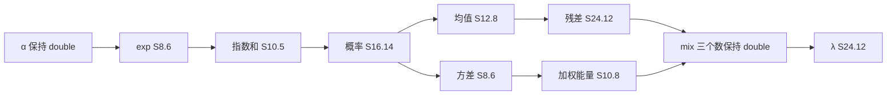

# 单计算过程协同压位宽

本文区分两种协同量化：第 1–5 节保留 2026-11-05 提出的段内异格式方案；第 6 节列出后来实际运行的段内统一格式与拼接结果。当前单边与联合回归按 [11 主稿](11_四流64QAM迭代检测器定点化论文梗概.md) 执行。已知 10 dB 固定回归为 480 bit、浮点 61 错、候选至多 69 错；保留集与板级测量另行验收。单边报告见[历史试验](实验报告/20261105_单边控制变量位宽.md)。

## 1. 一条计算过程指哪一段

一条计算过程就是一帧六段里的一段。段内每个已经插桩、并且在单边实验里有「硬判差 0 且饱和 0」起点的数，同时改成那个起点。其余段保持 double。前端、下游和 3 轮反馈都重算。

六段的进入条件和参与数沿用单边报告里的那张表。I1–I4 仍重复 3 轮。不把 A2、A13、A5 合成一条，它们分属 I1、I3、I4，中间隔着统计和阻尼。全 46 边同时量化是历史方案 07 里的 E11；已有统一格式实验将六段分别评估后拼接重跑。

同一个数只量化一次。I2 协同量化本段写出的 λ。I3 协同时，λ 和 ai 的产生保持 double，只在进入 A13 的 `A13_x` 量化。不要两段各量化一遍再串起来。

## 2. 先做 I2

I2 的方差、exp、均值、指数和、加权能量在单边上已经短于消息口，而且排成一条链：exp → 分母 → 概率 → 均值 / 方差 → 残差 / 加权能量 → mix → λ。单边误差到了协同会叠在同一条似然上。先看这条链，能判断「各自对齐」进到「一起算」之后还剩多少。

mix 三个数不进第一组。S32.8 单独已经翻硬判，放进来之后分不清是统计链还是 8 个小数位。ai 整列也不进第一组。A13 只读每口第 1 列，现有插桩量化整列时，饱和主要来自不连接的 160 个数。第一组把 ai 留在 double。若要压 logsumexp，先把插桩改成只量化第 1 列，再单开一条边。

概率的单边梯子只有 S16.14 是对齐档，下一档直接是 S10.8。第一组用 S16.14，不把没测过的中间档写进起点。

## 3. 第一组格式

**异格式设想，待专门驱动验证。** 原计划的函数形态：一个格式结构里同时写入下表，调用现有 `run_quantized`。`run_edge_experiment` 一次只收一个边界，需要一层新的驱动，比较和存档沿用它：同一 80 帧、float 与 `fixed_mvm` 两条基线、`per_frame.csv` 加总硬判差和各边饱和。当时草拟的驱动名为 `run_stage_joint`。已有的段内统一格式驱动与结果列于第 6 节。

| 边界 | W | F | 单边依据 |
|---|---:|---:|---|
| `exp` | 8 | 6 | 再窄的 S6.4 在 0 dB 差 8 bit |
| `sum_exp` | 10 | 5 | 再窄的 S8.4 差 1 bit，饱和 2 |
| `prob` | 16 | 14 | 本梯子唯一的对齐档 |
| `mu` | 12 | 8 | 再窄的 S10.6 为 9/0/1/0 |
| `var` | 8 | 6 | 再窄的 S6.4 为 10/1/2/0 |
| `weighted` | 10 | 8 | 再窄的 S8.6 为 5/0/1/0 |
| `residual` | 24 | 12 | 再窄的 S16.10 在 0 dB 差 1 bit |
| `lambda` | 24 | 12 | 再窄的 S16.10 在 0 dB 差 1 bit，饱和 3 |

不写入格式结构的边界保持 double，包括 `mix_a`、`mix_b`、`mix_output`、`ai`、全部 A2 / A13 / A5、β、前端和 LLR。

假设：这一组一起量化后，硬判差会大于任何单边在自己对齐档上的 0。差若出现，先看 0 dB；若 10 dB 或 20 dB 出现，优先怀疑方差、加权能量、均值，这三处单边的下一档已经伤到中等 SNR。30 dB 的 float 误码是 0，这一档只要出现硬判差，该组合停止下探。

量化器、信道和种子与单边相同：`make_cases(20,1105)`，有符号、`.5` 远离零、饱和、实虚分开。方差非正记 ERROR，不夹紧。乘加顺序这一组碰不到，因为三块矩阵保持 double。

## 4. 记录和回退

每个组合一个 run。帧表至少保留背景 SNR、float / fixed_mvm / 候选误码、相对 float 的硬判差、相对 float 的最大 LLR 差，以及本组合里每个边界自己的饱和次数。汇总按 0 / 10 / 20 / 30 dB 分桶。失败的输入和 MATLAB 报错一起留下。

硬判差不为 0 时，一次只放宽一个数，放回它在单边梯子上的上一档，然后重跑：

1. `var`：S8.6 → S10.8
2. `mu`：S12.8 → S16.10
3. `exp`：S8.6 → S10.8
4. `weighted`：S10.8 → S12.10
5. `sum_exp`：S10.5 → S12.7
6. `residual`、`lambda`：已经是梯子最上档 S24.12。前五步之后仍有硬判差，再给这两个数加一档新格式 S24.16，不直接判这段失败。

`prob` 没有更宽的已测档。前六步仍有硬判差时，把 `prob` 暂回 double，用来区分是概率字长还是它前面的 exp。位宽影响在单边里已经不单调，这里不用二分。

回到硬判差 0、且本组合各边饱和为 0 的那一档就停。这个停点仍然只代表这 80 帧。更大样本、分桶和译码 BLER 按方案 07 的 E11、E13，不在这一轮做。

## 5. 之后各段的起点

I2 的第一组有了帧表之后再开下一段。每段都用单边报告里「仍对齐且无饱和」的档，别段保持 double。

| 顺序 | 段 | 一起改的数 | 先不要放进去的数 |
|---|---|---|---|
| 2 | I1 | `A2_x` S24.12，`A2_w` S12.10，`A2_product` S20.12，`A2_acc` S20.12，`A2_out` S24.12，`alpha` S24.12 | 排序索引。A2 输出的 S20.12 是冒烟观察，不在阶梯 clean 列里，本段不用它做起点 |
| 3 | I3 | `A13_x` S24.12，`A13_w` S14.12，乘积和累加 S20.12，`A13_out` S24.12，`raw` S24.12，`rate` S12.10，`damp_product_old` S16.10，`damp_product_new` S24.12，`damp_sum` S24.12，`beta` S24.12 | ai 整列。S16.10 上输出和 raw 的硬判虽齐，但已有饱和，起点仍用无饱和的 S24.12 |
| 4 | I4 | `A5_x` S24.12，`A5_w` S10.8，乘积和累加 S20.12，`A5_out` S24.12 | S16.10。该档硬判仍齐，饱和已经出现；S12.8 会在 10 dB 和 20 dB 翻比特 |
| 5 | F | `input_y` S24.12，`frontend_gram` S24.12，`frontend_rhs` S16.8，`frontend_center` S24.12，`frontend_cov` S24.12，`frontend_variance` S16.12，`frontend_score` S24.12，`frontend_local` S24.12，`input_nv` S12.10，`input_iv` S12.6 | `input_H`。S24.12 单独已差 5 bit。求解器内部分解和除法保持 double |
| — | R | 只有 `llr`，单边已到 S16.10 | 不再单开协同 |

F 之前先补 H 的小数位：S28.16、S24.16、S24.14，仍是单边。补到出现硬判差 0 且饱和 0 的一档，H 才进入 F 的协同。mix 同样先单边加小数位：S32.16、S24.16、S24.12、S20.12。出现对齐档之后，再把三个 mix 并进 I2 的第二组。两组的差别只有 mix 的格式，用来看似然对数的小数位和统计链是不是两件事。

I1 等矩阵阶段需按实际算术归档。启用 product/acc 格式时，experiment_mvm 按非零项形成乘积并量化、加入部分和后逐项再量化；double 只是这些运算的数值载体。原始 fixed_mvm 走宽累加、最后再量化的独立路径。落到整数 RTL 时应另外对拍输入、每一项、末项与溢出。

## 6. 已运行的统一格式实验与重放入口

`run_process_joint` 给一段内所有列入表的插桩边界同一组 W/F，其余五段保持参考精度；这与上文为各条边分别指定 W/F 的草案不同。历史驱动先按 80 帧总误码选段内候选，同误码倾向较窄总宽，并对 30 dB 零误码作回退。每一段单独选出的格式拼起来后，驱动重新运行整个三轮检测。存档格式（W.F）依次为 F 14.10、I1 10.6、I2 8.4、I3 16.10、I4 16.10、R 8.4。[实验 2 驱动](../../experiments/run_process_joint.m) · [分段选择 CSV](../../experiments/matlab位宽建模实验2_单计算过程协同压窄/result/选择.csv)

|同一批 80 帧上的实际配置|0 / 10 / 20 / 30 dB 误码，各 480 bit|合计 / 1920 bit|如何解读|
|---|---|---:|---|
|float|190 / 61 / 5 / 0|256|参考输出与已知发送真值比较|
|六段独立选择后拼接|201 / 67 / 7 / 0|275|段内最优候选拼接后，10 dB 增错 6；须另看其余工作点|
|只将整个 I2 从 S8.4 放宽至 S10.6|177 / 61 / 5 / 0|243|该段 12 个插桩边界一起变化；相对 float 有 103 个硬判不同，需再做单边归因|
|较宽的 mild|181 / 61 / 5 / 0|247|相对 float 有 13 个硬判不同，作为下一次工作站回归的候选起点|

10 dB 的固定回归门槛只用于本批 480 bit，需分开报告其余 SNR、硬判分歧与饱和。查验每条边的 W/F 与汇总数据见 [拼接配置定义](../../experiments/run_stitch_variants.m) · [拼接对照汇总](../../experiments/matlab位宽建模实验2_单计算过程协同压窄/result/拼接对照/summary.csv) · [首次拼接逐帧 CSV](../../experiments/matlab位宽建模实验2_单计算过程协同压窄/result/拼接/per_frame.csv)。工作站应先复制运行副本，脚本会重写对应 result 文件。

## 7. 下一阶段如何使用这批数据

把 E2 单边扫宽和 E3 联合配置分开记录。先用同帧轨迹定位第一次新增并列和 idx 变化，再判断三轮 β 与末轮 LLR 是否受影响。若需要验证上文的段内异格式方案，保存每条边独立 W/F 与三轮输出，同统一格式的结果配对比较。正式验收使用预留样本，交给 FPGA 实现之前需明确外部服务边界、字长与资源绑定。[11 主稿](11_四流64QAM迭代检测器定点化论文梗概.md)
