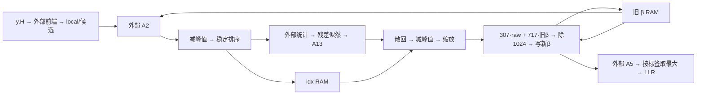

# MIMO v2 从 MATLAB 到 FPGA 的定点量化实验 SOP

执行口径见[论文 11 第三至五节](11_四流64QAM迭代检测器定点化论文梗概.md)。E0–E5 是实验编号，P0–P4 是部署前的工程交付阶段。以 MIMO_v2_matlab 为工程根目录；预登记、图表和报告按 11.md 第四节及实验档案执行。

## 1　交接位置与证据

系统输入满足 y=Hx+n，H 有 8 行、4 列，每次检测四路 64-QAM，共 24 个比特。每路从 64 点缩到 9 个候选。内部消息经过 20 个端口、每口 9 项、3 轮更新，最终按每个候选的 Gray 标签求六个比特的软值。20 是内部消息端口数，8 是接收观测数。核的任务是保留候选身份、反馈消息和最终判决。链路误差仍须从 y、H 一直算到输出。

|已有证据|可以据此决定什么|
|---|---|
|80 个样本，种子 1105，0/10/20/30 dB 各 20 个，每点 480 bit。浮点错 190/61/5/0，共 256/1920|作为可重放的回归集。30 dB 的 0/480 不能确定低误码率。|
|各步骤单独压缩后拼接，错 275 bit；把 I2 从 S8.4 放宽到 S10.6 后错 177/61/5/0，共 243 bit；与浮点有 103 个硬判决不同|单点可接受的误差会沿反馈环叠加。243 相比 256 的净减少全部来自 0 dB；必须保留逐样本、逐 SNR 的配对比较。|
|逐线范围脚本在有序双精度计算下，相对浮点最大 LLR 差约 1.24×10⁻¹⁴，错误数相同|可从这条观测路径加量化开关。此结果只验证插桩和运算顺序。|
|旧全功能核在 xc7k325tffg900-2、10 ns 约束下 WNS 为 −41.529 ns，最长路径 51.051 ns，位于混合似然的除法|重做采用已划定的小控制器边界。其频率、吞吐、资源须另行综合和布局布线。|

[边界和算术口径](09_边界与算术锁定.md) · [已有硬件映射图](09_FPGA硬件映射与时序推演.html)

## 2　从文献取什么方法

|原文定位|在本项目的做法|留下的证据|
|---|---|---|
|Jiménez-Pacheco 等，MIMO Decoding，PDF 第 5–6 页，§5。先观察动态范围，再联合看量化噪声和误码表现|对每条边分轮、分 SNR 记峰值、直方图、饱和率；用局部 SQNR 排查，最终由 LLR、BER 和有译码器时的 BLER 验收。文中具体 SQNR 数字只适用于其设计。|线级范围表、误差传播表、端到端曲线。[原文](../../../../参考文献/FPGA/定点化方法_文献/04_2008_JimenezPacheco_MIMODecoding4G_FixedPoint_VLSIDesign.pdf)|
|Constantinides，Perturbation Analysis，§5.1–5.3，PDF 第 4–7 页。观察局部扰动向输出的传播|一次只打开一处量化，在相同输入上计算输出偏差；排序交换、饱和、标签分组等跳变单独计数，再组合重跑。|逐边敏感度表和首次分歧所在的轮、口、候选。[原文](../../../../参考文献/FPGA/定点化方法_文献/08_2003_Constantinides_PerturbationAnalysis_WLO.pdf)|
|Hervé、Ménard、Sentieys，Data Wordlength Optimization，§III–VI，PDF 第 3–6 页及图 2、4。字长选择联系调度、运算单元绑定与硬件代价|每个候选字长同时记录 RAM 深宽与端口数、算子复用、II、延迟；对最终候选综合。省 1 bit 是否能减少 DSP 或 RAM 块要实测。|精度、资源、时序共用一张决策表。[原文](../../../../参考文献/FPGA/定点化方法_文献/03_2005_Sentieys_DataWordlengthOptimization_FPGA_SiPS.pdf)|

## 3　按时间读数据流，按运算类型分硬件

下表按逐口复用排序窗、双 β 库、逐轮回读 z 的候选排程。现有控制器使用 20 口并行排序、β 原位写回及末轮 A5。比较时先统一算术与 A5 调用策略。

|阶段 / 数据方向|计算种类及数据依赖|微架构草案|
|---|---|---|
|T0 帧输入 → local、候选坐标、标签|外部前端求解、复乘累加、距离、似然和候选选择；本帧初始化 β|保存候选到标签的映射；第一轮用清零状态读 β|
|T1 β 和 local → A2_x → 外部 A2 → A2_out → alpha、idx|稀疏 MVM；控制器逐口减最大、按分数稳定降序|9 项寄存器、峰值寄存器、比较交换单元；同分保留原候选顺序，idx 随分数移动|
|T2 排序分数、候选 → 外部统计/残差/似然 → A13_x → 外部 A13 → A13_out|softmax、加权矩、复数乘加、exp/log、稀疏 MVM。λ 和 ai 必须按 MATLAB 次序拼接|A13_x 为外部逻辑载荷。约定有序分数的传递或重建方式，再以事务重放；记录字序、增益、轮号和接受条件|
|T3 A13_out、idx → raw → β_new|按 idx 散回，逐口减最大，按部署增益缩放，旧 β 和 raw 阻尼|9 项暂存、最大值、两路常数乘法、对齐加法、舍入饱和；旧 β 读、新 β 写，整轮完成再交换存储体|
|T4 β、local → A5_x → 外部 A5 → z|稀疏 MVM，MATLAB 每轮计算 z，末轮将 z 交给 LLR|按参考口径记录三轮返回；仅保留末轮 A5 时，对拍三轮 β、末轮 z/LLR 和接口计数|
|T5 末轮 z、Gray 标签 → 24 个 LLR → bits|每流每比特分别求两组最大值，相减，限幅 ±20；负值判 1|每次读一个候选并更新分组峰值与有效标志；缺组分支按原代码重放，标签和分数共用地址|

**算术合同。** S(W,F) 指有符号总宽 W、小数位 F。量化至最近，半格远离零，随后饱和。加减前对齐小数位；同格式两数相减全精度多 1 位。外部稀疏 MVM 按已锁定的非零项次序逐乘积量化、逐部分和量化；必须记下乘积和累加两处峰值。求和后统一舍入的候选阻尼先将两输入对齐到共同 F，乘以 307/717 后相加，除 1024 并舍入饱和。现有 RTL 对每一项分别 rsh10、饱和，再加和饱和。两者分组对拍，例如 raw=−1、旧 β=−2（同尺度整数码）分别得 −2 和 −1。若输入同为 W 位，直接按正整数 307、717 乘的保守有符号乘积宽分别为 W+9、W+10；因权重非负且和为 1024，加权和有符号 W+10 位足够。此界仅适用于已对齐、无额外增益的两个 W 位输入。增益乘法及对齐前后的寄存器分别建模。

**存储和时序预算。** β 双缓冲各 180 个字，合计 360W bit（W=16 时 5760 bit），每拍读旧、写新各一项；idx 取值 0…8，用 180×4=720 bit；4 路候选标签 36×6=216 bit。9 项并行比较暂存在寄存器；标签和索引先比较 LUTRAM 与寄存器实现；β 比较双 bank 的 LUTRAM/BRAM 实现。物理 RAM 块数依赖端口、深宽配置和读延迟。外部矩阵按部署包统计行 R、列 C 和非零数 K。09 的映射采用按输出列压缩，值+行址+列指针占 K×(系数宽+行号宽)+(C+1)×列指针宽，行号至少 ceil(log2 R)，指针至少 ceil(log2(K+1))。采用码本时另计码字索引与小表，比较实际带宽、端口与复制开销。乘加数为 K，单通道理想每拍取一项；累加反馈延迟和存储端口可能限制 II。

首版按单帧、口串行排程。以 T1 的一个口为例，假定输入已就绪、无停顿、单拍比较可收敛：相对拍 0–8 收 9 项并求峰值；9–17 每拍归一化一项；18–26 进行 9 轮奇偶相邻比较，每拍最多 4 对；27–35 每拍发一项及索引。即 36 拍/口，720 拍/轮，三轮共 2160 拍仅属于 T1 的这段调度。T3 每口先 9 拍散回并求峰，再按原地址发起 9 次阻尼更新；从最后一次发起到写回需另加流水尾延迟。T5 若 6 比特分组并行，每流扫描 9 项；输出串行化和差值流水另计。全帧以各阶段首个输入握手到最后一个 LLR 握手计时，分别记录核工作、外部等待、反压和流水排空；重叠区间按同一时钟轴只计一次。下一阶段用 RTL 计数器验证这些假设。

## 4　工作站执行顺序与放行条件

1. **E0 重放基线。** 按 11.md 的 E0 命令使用 new_run 建档，将 run_wire_range 和 run_stitch_variants 的输出分别定向本次 raw 目录，重放参考与联合候选。`mild` 应为 181/61/5/0，共 247 错，13 个硬判与浮点不同；I2_S10_6 是另一个配置。新归档模式的 stitch/per_frame.csv 保留同帧 float、fixed_mvm 与候选误码及两向翻转，按配置逐档核对。逐项 LLR 与 idx 轨迹按 11.md 第五节补录。若同一输入不复现，先记录首个差异，暂停扫宽。
2. **E1 范围与整数位。** 复用 E0 的 H、噪声、发送比特、真值和候选。每线记录尺寸、符号、最小/最大、分位数、每轮峰值、越界数。已有 alpha 最小 −113.9383、最大 0，样本需 8 个含符号整数位；β 最小 −28.6342，样本需 6 位；raw 最小 −43.7667，样本需 7 位。三者分别用 9/7/8 位作为首扫起点。限幅后 LLR 的 ±20 是确定性界，6 个含符号整数位足够；限幅前差值另测。对病态 H、冲击噪声、同分排序和临近零 LLR 单列压力组。
3. **E2 单边扫小数。** 在 experiments 运行 `runs=exp_sort('alpha',[21 12;19 10;17 8;15 6],make_cases(20,1105));`。现有入口只量化一个点，其余矩阵走默认浮点路径；若切换为有序逐项 MAC，另设实验版本。每档检查 runs 内的 status/error、per_frame.csv 与 summary.csv，结果标为 UNVERIFIED 时依门槛判定。示例 alpha 保持 9 个整数位，依次运行 S(21,12)、S(19,10)、S(17,8)、S(15,6)。对六个 MVM 接口、alpha、raw、两阻尼乘积、和、β、LLR 分别做同类实验；乘积和部分和用彼此独立的开关。对每档同时记录局部峰值误差、饱和、排序变化、下一级误差、LLR 差、硬判翻转、逐 SNR 错误数。再固定 F，单独减整数位，识别削顶代价。
4. **E3 算术替换与联合压缩。** 独立比较浮点阻尼与 307/717，宽中间结果与逐步截位；随后固定算术，按阶段加入 E2 入围格式，每次只改一条边。记录第一个变差的轮和口。若联合方案超限，逐边回退 1–2 位，按恢复的系统性能与硬件代价取舍。保留通过和失败两侧的相邻格式。
5. **E4 独立验收。** 按 11.md 第四节的预设冻结单个候选，四档各 4,096 个独立向量、主档 10 dB、预留种子 9110527。按帧配对计算经验 Bernstein 95% 单侧上界，与绝对差 8/480 比较，其余档随同描述。缺帧只登记进度，完成后一次判定。0 次观测错误照实报告分母；有译码链再登记码块与 BLER 协议。
6. **E5 RTL 对拍与实现。** 导出带 frame/round/port/candidate/valid 的定点整数向量，逐边核对整数码和次序，再测连续帧、复位、并列分数、反压。资源与时序表记录器件、约束、实际 WNS、DSP/LUT/FF/BRAM、有效拍、等待拍、首末握手与帧间隔。只有 E4 通过且 E5 功能、时序均达标才冻结字长。

**每次运行一份报告。** 文件名用“实验号_边名_W_F_种子”。写明目的与唯一自变量、固定配置及文件摘要、执行入口、样本统计、逐 SNR 结果、最早分歧、结论与下一组参数。保留逐帧结果和配置以便重放；漏测项标“待测”。E2–E5 是下一轮实施和验收规程，本版没有产生新的仿真结果。

**下一次上机的最小交付。** 先交 E0 基线比对表，再交 E2 的 alpha 四档单边报告。用这五份报告核实“该边误差 → 排序变化 → 末轮 LLR → BER”能够逐帧追踪，之后再批量扩到其余数据流。

## 5　E3-H（可选尝试）用前瞻试探选择下一条减位通路

**实验目的。** 与 E3 的固定阶段顺序做一次配对比较：在相同仿真次数预算内，按预计硬件收益选边，能否找到误码约束合格、数据搬运量更小的格式组合？本次只改变选边策略。方法取自 WLOptHeur 的“逐边试探、每轮只减一位”；本实验用整链回放检验排序和反馈的离散变化。[原文第 V 节 Algorithm 2](../../../../参考文献/FPGA/定点化方法_文献/01_2003_Constantinides_WordlengthOptimization_TCAD.pdf)

1. **准备对照。** 完成 E0–E2，固定 E3 的阻尼算术与架构，加载通过回归的整套宽精度配置（首选复查 mild），只覆盖被试边，并保存修改前后的格式表；记下每条边的 W/F、每个 SNR 的容差、种子、搜索预算和独立验收集。固定顺序组与启发式组共享这些设置，前瞻试跑也计入预算。
2. **先用 alpha 检查追踪能力。** 复用 E2 的四档报告（9 个含符号整数位，F=12、10、8、6）。在联合起点上重放有差异的档位，只改 alpha，补测相邻 1 bit。记录新增并列、首次 idx 改变的帧/轮/口、β 偏差及末轮 LLR 过零情况。能复现并定位差异或确认该批输入零分歧后，再把 raw 和 β 纳入候选。
3. **每轮试多条，只接受一步。** 从同一当前配置分别试探各边减位后的可行档位。MATLAB 阶段预先约定以指定存储和接口每检测向量的逻辑搬运量 Σ(读写字数×字宽) 排序，越少越好；比较器位宽、RAM 深宽另记。优先选择前瞻中可行档位搬运节省最多的边，平局取最差 SNR 误码裕量较大者。在选中边上只提交减 1 bit 的候选，然后重跑整链。超限则回退并试下一条；置信区间不足以判定则记“待定”。每次接受后从新的联合配置重新试探。
4. **停机与判断。** 达到预算或无可行改进时，保留两组各自最佳可行配置。按 E4 在相同预留样本上复验；比较误码、搬运量和仿真次数，决定是否扩展至 MVM 接口。搬运量只能筛选候选，最终 bit/J、吞吐与时序由 E5 的同平台实现和能量评估判定。

**单次报告。** 以“E3-H_轮次_通路_W_F_种子”命名，分别填写实验目的、控制变量、结果、结论分析。结果表记录起点配置、试探格式、实际提交格式、分 SNR 配对误码差及上界、搬运 bit/向量、接受或回退理由。汇总报告并列两种策略的最佳配置和预算消耗。当前状态为待上机。

## 6　E2-M（可选尝试）统一字长与逐信号字长的配对实验

**目的。** 在同一架构、同一精度约束下检验：允许各信号使用不同总字长，能否降低每个检测向量的存储与接口搬运量？第 02 篇 §3.1–3.3 依次讨论格式传播、量化噪声传播和字长选择。E2-M 检验开放逐边字长这一设计自由度的价值；E3-H 可以帮助选择格式。[文献 02 原文](../../../../参考文献/FPGA/定点化方法_文献/02_2001_Constantinides_MultipleWordlengthParadigm_FCCM.pdf)

**实验设计。** 首轮只选 alpha、raw、β 三条有符号实数边。用 E1 的范围与保护位为每条边预先固定含符号整数位 Iₑ（初扫取 9、8、7），数值解释为“整数码 × 2⁻ᶠ”，总字长 Wₑ=Iₑ+Fₑ。注意表中整数位来自样本预算，须监测溢出。对照 U 允许各边独立缩放，但要求 W 相同；试验 M 解除共用 W 的限制。这样，两组都享有独立缩放，比较专门反映总字长自由度。其余边格式、量化位置、舍入饱和、迭代与并行度固定。地址、idx、标签和 valid 按语义精确编码。

1. **建表并传播格式。** 每条边记录产生者、全部使用者、W、F、峰值与量化点。乘法自然小数位为两输入 F 之和；加法先对齐再按范围留进位。相同数值只靠补零扩宽无法恢复已丢失的精度。每次遇到扇出标明在共享寄存器前统一量化，还是在某条分支入口再量化。首轮固定为前者，两组保持一致。
2. **跑配对网格。** 示例候选 W∈{15,17,19,21}。U 跑 4 个共同宽度；M 对三条边枚举 4³=64 个组合，其中 4 个对角组合直接复用 U 的结果。相同种子、工况、输入样本和验收口径下，先剔除精度超限项，再分别取两组搬运量最低的可行项。若 U 全部超限，先扩大宽度范围建立可行对照。小网格也可作为 E3-H 的校准题，观察启发式用多少次试跑能接近枚举结果。
3. **测量两种影响。** 数值侧记录饱和、首次 idx 分歧、三轮 β 误差、末轮 LLR 和分 SNR 配对 BER；接入译码后再比 BLER。硬件侧按已声明的存储与接口事务计数，计算 Σ(实际搬运字数×物理传输位数)。例如 β 双 bank 的逻辑容量为 360Wβ，少 1 位等于少 360 个逻辑存储位；如果端口仍按原宽传输，则该接口搬运节省记零。额外转换器、共享算子按最宽输入实现等开销一并记录。
4. **报告和去留。** 各写出 U 与 M 最佳可行项的三边 W/F、误码置信上界、搬运量和资源代理；在 E4 预留样本上复验，E5 再用同平台综合和活动数据比较能效。M 的候选集合包含 U，搜索集上出现更优组合本身不能证明部署收益。保留精度相当但物理代价相同或变大的结果。首轮结论仅覆盖这三条边和给定候选集。

**状态：待上机。** 每次运行沿用第 4 节的实验报告格式，配置名含 U/M 和三条边的 W/F，确保可以重放。
10 dB 固定 480 bit 以浮点 61 错为参照，候选最多 69 错；本轮正式 E4 按预设的独立样本计算 95% 单侧配对上界，与绝对差 8/480 比较。首版实时性建议在 XC7K325T-2、25 ns 下核验完整链路：持续 ≥20 kbit/s、端到端 ≤1.20 ms、稳态启动间隔和单帧延迟分别 ≤48,000 拍。10 ns 旧探针单独归档。见[首版原型验收规格](14_首版原型BER吞吐与延迟规格.md)。
