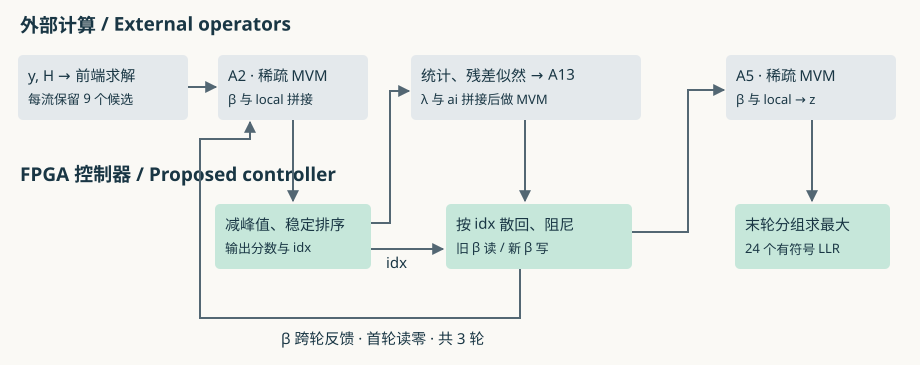
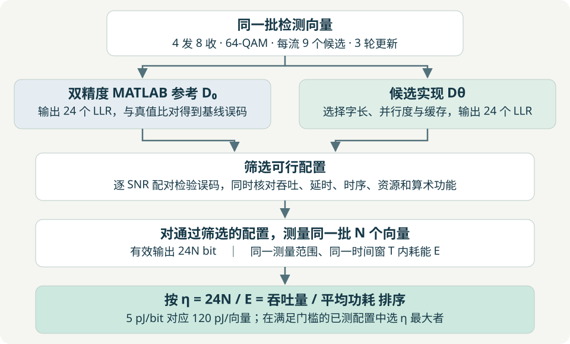
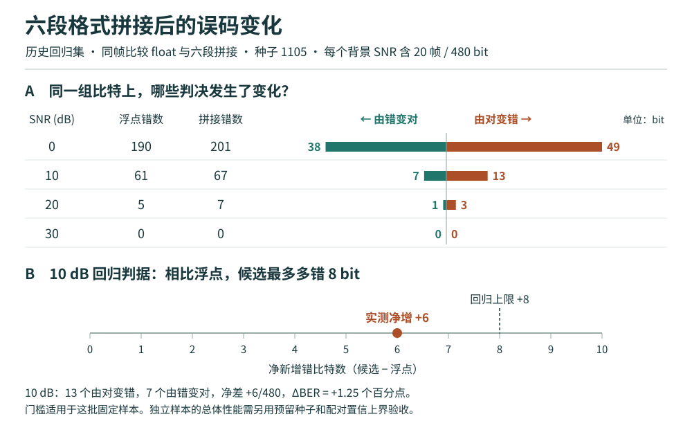

# 面向 FPGA 的四流 64-QAM 迭代 MIMO 检测器逐通路定点量化与反馈控制器设计

**Per-Path Fixed-Point Quantization and FPGA Feedback Controller Design for a Four-Stream 64-QAM Iterative MIMO Detector**

论文梗概 · 初稿 2026-11-06，建模文档对校 2026-11-09

**当前阶段怎样使用本文。** 第三节给出一帧 T0–T5 的数据流、计算规模和候选架构。第四节规定 E0–E5 每项比较的图、数据表和结论判据，每个数据点都能追溯到运行记录。第五节把阶段计划 13 并入实施顺序，列出工作站命令、微架构与周期预算、黄金向量和放行条件。第六节逐篇列出定点化文献 01–10 的原文位置、可借用的方法及对应交付。若本次只做一次 MATLAB 实验，先完成第五节 P1 的 alpha 单边回放。

## 摘要 / Abstract

本工程以 MIMO.m 的 MATLAB 双精度浮点仿真为数值基线，以 5 pJ/bit 为待验证的检测能效目标。四路符号经信道混合后，接收机要从八个复观测中给出 24 个比特各自的可信程度。将 MATLAB 检测程序移植到 FPGA 时，候选分数的小数位数会同时影响比较、存储和下一轮反馈。本文拟在同一批输入上逐处注入舍入与饱和，记录最早发生差异的候选、轮次和最终比特，再将通过链路验证的格式映射为寄存器、比较器和存储体。已有 1,920 bit 回归数据表明，分别压缩后拼接的格式产生 275 个错误，浮点基线为 256 个；放宽一处格式后得到 243 个错误。本文将用独立样本检验这一差异，并以逐拍对照和布局布线报告评价控制器。

The project starts from a double-precision MATLAB reference and targets 5 pJ per detected bit. Four transmitted 64-QAM symbols produce eight complex observations and 24 soft bit decisions. Rounding a candidate score can create a tie, alter its position in the sorted list, and change the feedback used in the next iteration. We propose to quantize one data path at a time, trace the earliest divergence, and map the accepted formats to registers, comparators, and memories. On an existing 1,920-bit regression set, independently narrowed formats produced 275 bit errors when combined, versus 256 in floating point. Widening one path reduced the count to 243. Independent trials, cycle-level RTL comparisons, and post-route timing are planned to evaluate the proposed design.

## 工程起点：读懂双精度 MATLAB，再定义硬件

本研究从一个可运行的数值参考函数开始。入口是 `[result,audit] = MIMO(input,mode)`。省略 mode 时执行 `float`；调用 `MIMO()` 会加载随工程交付的样例并与预存轨迹核对。实际接收输入包括 y、H 和两类噪声参数。程序显式把 y、H 转为 double；实数分量按 64 位双精度计算，一个复数对应两个分量。若输入已含 local，程序直接进入推断。重放时要从相同作用域读参数：原始前端读取 `pack.config`，迭代核读取 `pack.profile.runtime.config` 和 `pack.profile.runtime.rate`。当前部署的迭代阻尼约为 0.3，软抵消温度为 1，方差缩放为 0.5。包顶层的相似字段取值可能不同。无参自测核对三轮 z 与预存轨迹；BER 另用含发送真值的样本计算。这个入口使我们可以固定同一帧，分别检查前端误差和迭代误差。[原始 MIMO.m](../../MIMO.m) · [部署参数与样例](../../deployment.mat) · [位宽管理原文](../../位宽管理.txt) · [部署审计](../../audit_results/deployment_audit.json)

**[打开原始 MATLAB 计算流程 HTML，按阶段展开实际代码和行号](12_MIMO原始代码计算流程.html)**

|读码顺序|一帧数据怎样变化|
|---|---|
|第 25–35、184–229 行，前端|用 HᴴH+σ²I 求解线性估计与协方差，对每路 64 个点计算距离及残差混合似然，结合标签覆盖留下 9 点。4 路产生 36 个 local 分数。|
|第 102–119 行，消息展开|旧 β 的 180 项与 local 的 36 项拼成 216 项，右乘 A2 得 180 项。按 20 口×9 项减峰、缩放、降序排列，索引随候选保留，再计算软概率与矩。|
|第 120–151 行，似然与反馈|8 个观测×4 路×9 点形成 288 个 λ；拼接 180 项 ai，右乘 A13。输出按 idx 散回原位，减峰、缩放，与旧 β 阻尼融合。|
|第 152–155、43–55 行，读出|每轮右乘 A5，得到 4×9 个 z；三轮中的末轮按每个 Gray 比特取两组最大值之差，限幅后输出 24 个 LLR 及判决。|

### 为什么原样执行不能作为 5 pJ/bit 的实现依据

**模型规定了数值，却把硬件成本留给了实现者。** 第 159 行的一次矩阵表达式没有规定乘法器个数、累加顺序、RAM 端口或输出有效拍；第 118–129 行的 exp、除法和 log 需要具体的硬件精度与延迟；第 17 行读部署文件、第 126 行动态拼接 λ、第 154 行保存每轮轨迹，则需要分别改为常量装载、静态地址写入和按需保留状态。FPGA 和数字 IC 可以构造双精度算子；把整条参考路径照搬为双精度，会把指数处理、对齐、规格化、舍入和宽数据搬运一并带入设计。当前代码用来仿真和产生对拍向量，不能凭它声明实现达到能效目标。[MathWorks 可综合浮点的适用方式](https://www.mathworks.com/help/hdlcoder/ug/generate-target-independent-hdl-code-with-native-floating-point-libraries.html)

**工程已有两种不同的矩阵算术，实验须分别命名。** 原始 `fixed_mvm` 用 24 位输入（12 位小数）、18 位权重（14 位小数），以整值 double 模拟乘加，检查 45 位累加范围并对输出重新量化。外围求解、排序前后的浮点运算及非线性仍用参考路径。`位宽管理.txt` 给外围列出的 FP32 是早期实施规格。后续 SOP 的“逐乘积、逐部分和量化”又是另一种拟部署算术；两者即使接口同宽，也须分别对拍。[原始实现，第 59–83、157–164 行](../../MIMO.m) · [逐边实验 SOP](10_MATLAB到FPGA定点量化重做SOP.md)

**把目标折算到一帧。** 暂按每次检测输出的 24 个已调制比特作分母，5 pJ/bit 对应 **120 pJ/检测向量**。部署中 A2、A13、A5 各有 900、828、216 个非零项，三轮若逐项做一次 MAC，便有 5,832 次非零 MAC。若将整个预算都给矩阵路径，平均也只有约 **20.6 fJ/非零项**，前端、非线性、控制和搬运还要从中分摊。这是检验架构可行性的预算推算；如果通过系数共享、结构化加法等减少实际操作，需要据新映射重算。若最终分母采用译码后信息比特，还需按有效信息量重新折算。[部署数据](../../audit_results/deployment_audit.json) · [Horowitz，ISSCC 2014，运算与存储访问的能耗](https://doi.org/10.1109/ISSCC.2014.6757323)

**位宽同时决定计算和搬运。** 一个 20×9 的 β bank 用 double 承载时逻辑载荷为 11,520 bit；以待测的 16 位格式承载时为 2,880 bit。双缓冲相应由 23,040 bit 降至 5,760 bit。每次完整读写所传的数据位数随之降低，DSP 和 BRAM 的物理块数却取决于器件粒度与并行端口。只有在相同 BER 和吞吐要求下比较实际映射及翻转活动，才能把位数差换算为能量差。

### 进入 RTL 前，先用一张表约定设计和验收

|设计对象|本项目在编码前要能回答的问题|形成的依据|
|---|---|---|
|定点算术|每条边 W/F 是多少？何处舍入、饱和或保留保护位？相邻分数并列后 idx 如何传播？|逐边格式表、同帧轨迹、独立样本 BER；接入译码器后补 BLER|
|架构与计算流图|按 T0–T5 标生产者、消费者及反馈。三组 MVM 在控制器边界外，端到端预算仍包含其开销。|系统边界图、每轮数据量、片内和跨边界事务数|
|计算种类与微架构|分别绑定求解、稀疏 MAC、exp/log、归约、排序、散回、阻尼；明确几路并行、哪块 RAM、读写端口及同址冲突策略。|算子清单、寄存器与 RAM 深宽、单元复用表|
|时间分阶段与时序|以一帧首笔输入至末个 LLR 握手为界；逐段给启动间隔、首结果延迟、反压及反馈等待，标出可重叠区间。|周期草图、逐拍黄金向量；以实现报告核验最长路径和帧间隔|
|能效|同一批连续帧计有效输出比特；按 E/bit = 平均功率×观测时间/有效比特数核算。分别列核心、外部算子、存储与 I/O；报告静态/动态口径。|FPGA 用布局布线加实际活动或板级测量；ASIC 列工艺、电压、频率、PVT 和活动文件。两平台分别报告，5 pJ/bit 为待验证目标|

文献中可直接沿用的工作顺序是：先按内部变量扰动测敏感度，再把候选字长交给算子绑定和调度评估，最后用接收机 BER 校验。对于微架构图，可参照 1BOX 论文第 IV 节的写法，一边标数据线位宽，一边解释缓存如何首轮初始化、末轮写回、何时允许下游读数；本项目对应的是 β 双缓冲与 idx 散回。[Constantinides，扰动与字长](../../../../参考文献/FPGA/定点化方法_文献/08_2003_Constantinides_PerturbationAnalysis_WLO.pdf) · [Hervé 等，字长与 FPGA 综合](../../../../参考文献/FPGA/定点化方法_文献/03_2005_Sentieys_DataWordlengthOptimization_FPGA_SiPS.pdf) · [MIMO 接收机的定点验证，§5](https://doi.org/10.1155/2008/312614) · [1BOX，Fig. 4 与 §IV-B](../../../../参考文献/FPGA/05_2020_OneBit_Massive_MIMO_VLSI.pdf)


## 一、国内外研究现状 / Related work

**国内。** 王强等研究了与本项目同为四发八收的 V-BLAST 接收机。他们在乘法器和查找表输入前缩减位宽，对高位裁剪引入符号保护，并把数据组织成流水单元。在本项目中，这提示我们把量化点具体落到“哪一级寄存器的输出”；两项分数舍入后相等时，还要追踪候选索引。另一项针对 OSIC 的研究通过近似范数和分时复用的 CORDIC 电路实现排序 QR 分解，说明一个矩阵操作内部仍可按数据依赖细分流水级。两项工作的求解器与本项目的三轮消息反馈不同，本文借用其划分数据通路和报告时序的方法。[王强等，2008，第 3–4 节](../../../../参考文献/FPGA/07_2008_降低B3G系统中MIMO接收机复杂度的方法.pdf)；[《OSIC检测中高效排序QR分解FPGA实现》](../../../../参考文献/FPGA/08_2024_OSIC检测中高效排序QR分解FPGA实现.pdf)

**Chinese research.** Wang and colleagues studied a four-transmit, eight-receive V-BLAST receiver. They reduced operand widths ahead of multipliers and lookup tables, protected the sign during clipping, and scheduled the receiver as a pipeline. A separate OSIC implementation reused pipelined CORDIC rotations for sorted QR decomposition. For our detector, these studies motivate specifying exactly where a value is narrowed, which unit consumes it, and when its index must travel with it. [V-BLAST receiver](../../../../参考文献/FPGA/07_2008_降低B3G系统中MIMO接收机复杂度的方法.pdf) · [Sorted QR implementation](../../../../参考文献/FPGA/08_2024_OSIC检测中高效排序QR分解FPGA实现.pdf)

**国外。** Constantinides 从内部变量的微小舍入扰动估计输出敏感度，为不同变量分配不同字长。Hervé、Ménard 与 Sentieys 将算子字长对应的硬件代价纳入高层综合，同时考虑精度与调度。Jiménez-Pacheco 等在 4G 接收机上结合变量范围、量化信噪比和误码表现选择格式。对本项目而言，三种方法分别回答“先压哪条线”“少两位能省什么”“如何证明接收性能可接受”。排序和硬判决具有离散跳变，局部均方误差只能用来筛选，入围格式仍须逐帧复验。[扰动分析原文](../../../../参考文献/FPGA/定点化方法_文献/08_2003_Constantinides_PerturbationAnalysis_WLO.pdf) · [字长与 FPGA 综合原文](../../../../参考文献/FPGA/定点化方法_文献/03_2005_Sentieys_DataWordlengthOptimization_FPGA_SiPS.pdf) · [4G 接收机原文，§5](https://doi.org/10.1155/2008/312614)

**International research.** Constantinides estimated output sensitivity to local roundoff in DSP data paths. Hervé, Ménard and Sentieys coupled precision constraints with word-length-dependent operator costs during FPGA synthesis. Jiménez-Pacheco and colleagues evaluated fixed-point choices in a MIMO receiver using signal ranges, quantization noise and link performance. Our study combines these approaches by testing individual edges, replaying discontinuous operations such as sorting, and checking whether each retained width reduction yields a physical resource saving. [Sensitivity analysis](../../../../参考文献/FPGA/定点化方法_文献/08_2003_Constantinides_PerturbationAnalysis_WLO.pdf) · [FPGA synthesis](../../../../参考文献/FPGA/定点化方法_文献/03_2005_Sentieys_DataWordlengthOptimization_FPGA_SiPS.pdf) · [Receiver study](https://doi.org/10.1155/2008/312614)

## 二、项目背景、系统模型与研究意义

星地通信项目在此阶段研究同步后的离散复基带检测接口。一次调用满足 **y = Hx + n**，H 为 8×4 复矩阵；元素 Hᵣᵤ 表示第 u 路信号到第 r 个观测的复增益。64-QAM 的 I、Q 分量各取八个奇数电平之一，两者除以 √42，使均匀输入的平均符号能量为 1。每轴 3 个 Gray 比特，四路共携带 24 bit。检测端使用两状态圆对称复高斯混合噪声似然，以表示背景与脉冲两类噪声状态。把该接口用于具体星地链路，还需要从链路或测量获得 H、同步残差和噪声参数；现有回归回答的是基带检测器的数值问题。[项目系统模型](06_项目系统模型与硬件定点验证设计.md)

[调制与载波技术综述：从 AM、FM 到四流 64-QAM，读懂 9 个候选与 24 个 LLR](无线通信调制与载波技术综述.md) · [综述 2：正交调制图版与技术演进](综述2_正交调制的技术演进与收发实现.md)

前端给每流保留 9 个带 Gray 标签的候选。迭代内部有 20 个消息端口，每口比较 9 项，共更新 3 轮。研究意义在于确定数值精度应花在哪里。例如，排序索引只需准确表示 0 至 8，故 4 bit 足够；候选分数则需要依据分数间距和反馈效应选择小数位。即使两种格式在第一轮给出同一硬判决，后两轮的 LLR 仍可能分离。论文将用这类可重放的差异解释字长选择。

### 回归集的信噪比和候选是怎样生成的？

**噪声参数决定如何解释 BER 横轴。** 现有 80 帧使用归一化复高斯信道。每个接收观测以概率 ε 取脉冲状态，其复噪声功率为 iv，其余观测用背景功率 nv。实验生成器取 nv = $10^{-\mathrm{SNR}_{\mathrm{dB}}/10}$、iv = 25nv，复噪声实、虚部分别按相应功率的一半生成。因此 0、10、20、30 dB 是背景 SNR，混合噪声的平均功率为 (1−ε)nv+ε·iv。生成器取 H=(U+jV)/√8，U、V 的元素独立服从标准正态，每个复增益的平均功率为 1/4。按当前 ε=0.05 和等概星座归一化，平均接收信号功率为 1，混合噪声平均功率为 2.2nv，故相对背景标尺低约 3.42 dB；例如图表的 10 dB 对应此定义下的平均信噪比约 6.58 dB。字段 `impulseExtraVar` 在这套输入与似然代码中直接表示第二状态的**总功率**。更换链路数据时须先对齐这个约定。现有生成器将生成 y 的信道矩阵也送给检测器；研究信道估计误差时，应分别保存生成用 Htrue 和检测用 Hhat，只改变 Hhat 后再比较候选召回和 BER。 [样本生成器](../../experiments/make_cases.m) · [系统与算术推导](05_1103_数学物理位宽与时序审计.md)

**从 64 点留下 9 点，还要检查每一位有没有两种解释。** 前端求解 G = HᴴH + nv·I 的四维线性系统，取得符号中心及 G⁻¹ 对角元素作为打分尺度。它将中心距离分与残差混合似然分合并，对每流的 64 点排序。若前九点在某个 Gray 位上全为同一值，程序尝试引入另一值的最高分候选；补入点须满足与全局最高分的分差门槛，被换出的点也须保住已有标签覆盖。这样可以解释为什么末级 LLR 仍需处理缺组。仅前端的残差打分就有 4×64×8=2,048 个标量似然，核外时延及能耗预算应单列。黄金回放还需记录 H、y 的共同接收行置换；五个接收组分别含 3、2、1、1、1 个观测，每组对应四个发送变量，形成 20 个消息口。 [代码入口与边界](01_MATLAB代码研读.md) · [候选筛选及分组释读](03_MIMO_m_中英对照.md) · [逐行语义](04_MIMO_m_语法与计算过程.md)

## 三、计算流、架构与时序

[打开离线 HTML 图版：计算流、单口时序、分 SNR 误码结果](11_四流64QAM迭代检测器定点化论文梗概.html)



图 1 中 A2、A13、A5 是外部稀疏矩阵向量乘（MVM）接口。外部表示本次控制器边界之外，其响应延迟仍计入整帧时间。以下按依赖划分计算阶段。

**先选定时序口径。** 下表展开第三节的候选方案：单帧、逐口复用一个排序窗、β 双库，保留 MATLAB 每轮的 A5 输出。后文实物图对应的现有 RTL 基线采用 20 口并行排序、β 原位写回和末轮 A5；比较两种结构时要先统一 A5 调度和量化规则，并记录是否仍需导出前两轮 z。

|阶段|规模和运算分类|候选微架构、状态及周期核算（待周期模型验证）|
|---|---|---|
|T0 每向量一次|8×4 复信道，4×4 求解；4 路各从 64 点选 9 点。涉及复乘加、距离、似然、筛选。|外部提供 local、候选与 36×6 位标签；把输入及就绪时刻录成可回放事务。前端时延记 Tfront。|
|T1 每轮|[β,local] 216 项 → A2 → 180 项；900 个非零项。20 口各做 9 项减峰和稳定排序。|单口 9 个分数寄存器及 9 个 4 位索引。无反压、每拍一项且每层比较一拍时，收数取峰 9 + 减峰 9 + 奇偶交换 9 + 发送 9 = 36 拍/口，720 拍/轮。与 A2 传输重叠的拍只计一次。|
|T2 每轮|8×4×9 个候选残差似然；288 项 λ 与 180 项 ai 拼为 468 项；A13 用 828 个非零项输出 180 项。|外部统计、exp/log、复数乘加与稀疏 MVM。接口固定 MATLAB 展平顺序、轮号、端口、候选号，反压期间保持载荷。|
|T3 每轮|180 项散回、归一化与阻尼；307·raw 和 717·旧β 对齐后求和、除以 1024。|idx RAM 180×4=720 bit；β 双 bank 共 360Wβ bit。每口先 9 次散回写并取峰，再发起 9 次更新。第二段若 II>1，从首次到末次发起相隔 8×II 拍，另加最后写回延迟及无法重叠的 RAM 读延迟。|
|T4 每轮|[β,local] 216 项 → A5 → 36 项，216 个非零项。|外部 MVM，记录请求与末个返回的握手；先保留所有轮次事务。|
|T5 末轮一次|4 路×9 候选×6 标签；两组最大值差、限幅 ±20、负值判 1。|若 6 个比特分组并行，每流读 9 个候选；记录末项进入、差值形成、最后 LLR 送出的三个时间点。缺组按参考代码对拍。|

在这个候选架构中，β 双缓冲需要 2×20×9×Wβ bit，Wβ=16 时为 5,760 bit；迭代索引另需 720 bit。按拍并行访问的 9 项排序窗用寄存器，跨轮存储比较 LUTRAM 与 BRAM 的实际占用。单口 T1 的四段各预算 9 拍，依次为装载取峰、减峰、奇偶比较交换、输出。每层最多并行比较 4 对；在无反压且一层比较满足一个周期时，T1 为 720 拍/轮。整帧须另计外部返回、反馈写回和流水排空。图版中的图 2 展示这一假设，图 3 展示已有回归结果。[算术与接口约定](09_边界与算术锁定.md)

### 从系数连接判断哪些值需要保存

三组矩阵采用行向量右乘，按**输出列**计算扇入。查现有部署系数与 ROM：A2 的 180 列各有 5 个非零，A5 的 36 列各有 6 个；A13 有 108 列扇入 4、36 列扇入 5、36 列扇入 6。A13 的 468 项逻辑输入由 288 个 λ 和 180 个 ai 组成。当前包中每个 λ 连接一次，ai 只有每口的第一项 log-sum-exp 有非零连接，20 个活跃项各连接 27 次，共 540 次。若采用紧凑事务，活跃输入有 288+20=308 项；改变 468 项参考协议之前，应对齐 180 个输出的整数码与有效时刻。因此写回全部 ai 而统计饱和，会把另外 160 个无下游权重的槽也计入；评估这一边应另报活跃项的误差和饱和，稀疏实现须逐列核对地址与累加顺序。

|相同部署系数的核外存储候选|三矩阵逻辑载荷|来源及条件|
|---|---:|---|
|每个非零存 S18.14 值、行地址和列指针|55,288 bit|行地址分别用 8、9、8 位，列指针按最小所需宽度核算。|
|每个非零存历史段格式的量化值、行地址和列指针|46,000 bit|A2 用 10 位值，A13 和 A5 用 16 位值。先核对由原系数得到的量化码。|
|同一量化值改存 4 位索引，另存各矩阵码表|28,654 bit|三块表分别有 15、14、13 个非零级。逐项重建相同整数码后，此编码相对上一行少 17,346 个逻辑存储位。|

这些数按逻辑布局计算。实际 ROM 导出器统一写 10 位列指针，旧核也把 A5 指针声明为 10 位。仅 A5 的 37 个指针就比上述最小宽度多 37×(10−8)=74 bit，直接存段格式量化值的声明载荷为 46,074 bit。再按物理端口、对齐和复制核算部署占用。比较时控制器的资源账和外部矩阵的资源账应各自归属。 [架构选项与实现边界](02_架构与FPGA_体例提纲.md) · [存储口径](07_MATLAB位宽数据流实验方案.md) · [稀疏布局推演](09_FPGA硬件映射与时序推演.md) · [既有 ROM 导出器](../../../MIMO_v2_FPGA/rtl/gen_rom.py)

## 数学问题：在检测性能与实时性约束下最大化每焦耳检测比特数

给定同一部署包、4 发 8 收、64-QAM、每流 9 个候选和 3 轮更新。把双精度 MATLAB 检测器记为 D₀，把待设计的实现记为 Dθ。两者接收相同的观测、信道和噪声参数，输出 24 个 LLR。未知量 θ 包括各数据流的总字长 Wₑ、小数位 Fₑ、量化位置，以及算子并行度、复用、流水寄存器、存储分组与调度。候选标签、索引对应关系、稳定排序和反馈轮次是算法语义，必须保持。FPGA 与 ASIC 各在指定器件或工艺、电压、温度条件下分别求解。

**主目标。** 在约定工作负载下，连续完成 N 个检测向量，计入 24N 个输出的调制比特。令 T 为相应观测时间，E 为相同时间和系统边界内消耗的能量。求

$$
\theta^*\in\arg\max_{\theta\in\mathcal F}
\eta(\theta),\qquad
\eta=\frac{24N}{E(\theta)}
=\frac{R_{\rm det}(\theta)}{P_{\rm avg}(\theta)}
\quad[\mathrm{bit/J}].
$$

这等价于最小化 E/24N。5 pJ/bit 对应能效至少 2×10¹¹ bit/J，即每个检测向量至多 120 pJ。它是可行性门槛；即使达标，仍可在门槛以内比较不同设计。功耗边界须预先锁定：若指标面向完整检测器，就要包含前端、所有外部矩阵与非线性运算、控制器及相应数据搬运。仅测控制器时单列其贡献。每个有效输出比特只计一次，内部 LLR 的存储位数不计入吞吐分子。



[打开离线交互图：输入吞吐量与功耗，换算 bit/J、pJ/bit 和每向量能耗](11_检测器能效优化.html)

|可行域约束|如何判定|
|---|---|
|检测质量|对每个规定 SNR 和信道/噪声工况 s，要求配对差 BERθ(s)−BER₀(s) 的单侧置信上界 ≤ δᵦ(s)。接入相同编译码链后，对 BLER 使用独立约定的 δᴮ(s)。允许 LLR 小幅变化；保留逐轮 LLR、排序变化和饱和率作为归因数据。|
|实时性|持续输出吞吐 Rdet ≥ Rmin，单向量端到端延时 L ≤ Lmax；在指定时钟约束下布局布线时序收敛。流水可重叠时，帧间隔决定持续吞吐，首入到末出的时间决定延时。|
|实现预算|FPGA 的 DSP、LUT、FF、BRAM 和接口带宽分别不超过可用预算；ASIC 以面积、存储宏与带宽约束替代。固定外部单元的开销也要计入总预算。|
|算术与功能|0 ≤ Fₑ < Wₑ（有符号格式）；整数码、舍入、溢出、地址、轮间依赖与选定定点模型逐拍一致。观察到的最大幅值只给出该样本集的范围。|

**当前实验怎样逼近这个最大值。** 第一步固定其余格式和架构，只扫描 alpha 的小数位，选出通过分 SNR 配对精度筛查的格式；第二步沿反馈环联合扫宽并回退，验证组合后的 BER；第三步对入围格式改变并行度和 RAM 组织，用相同输入及活动窗口测 E、R、L 和资源。最窄的格式可能与较宽格式占用相同数量的 FPGA 硬块，也可能为满足吞吐需要更多并行单元，所以按实测能效排序。报告“已测试可行方案中的最大能效”，并列出相应 θ、置信界、器件和测量口径。当 5 pJ/bit 尚未达到时，报告最佳实测值、与门槛的差距及主要耗能模块。当前数据支持建立误码回归；10 dB 固定回归门槛已确认；完整链路暂按 40 MHz、20 kbit/s、1.20 ms 建模，独立样本判定见第四节，整链能效留待实现测量。


### 多字长设计：先决定哪些信号可以独立选格式

第 02 篇把每条信号的字长和缩放都视为设计变量，并分别分析改变一位会怎样影响下游硬件与输出误差。两者在本项目中可以相差很大：alpha 的一点舍入可能让两个候选同分，使排序索引改变；β 每轮既写入状态又被下轮读取，减少一位可能节省跨轮存储和搬运，也可能使误差反复传播。raw、阻尼乘积及其和又具有不同的自然精度。因此应逐边指定产生格式、运算精度和写回格式，逐边检验收益。线性子图可借鉴原文的格式传播；排序、饱和和三轮反馈的影响用完整检测器配对回放。文献中的面积和频率改善来自其 DSP 基准，本项目的收益需独立验证。[文献 02，§3](../../../../参考文献/FPGA/定点化方法_文献/02_2001_Constantinides_MultipleWordlengthParadigm_FCCM.pdf)

> **实验编号说明。** E 取自 Experiment（实验），数字对应本项目 SOP 的实验阶段。E2-M 的 M 取自 Multiple Wordlengths（多字长）：E2 先逐条信号扫字长，M 在此基础上比较统一字长与逐信号字长。E3-H 的 H 取自 Heuristic（启发式）：E3 把多条信号放在一起压缩，H 检验在相同仿真预算下，用前瞻试探决定下一条减位信号，比按固定顺序减位能少搬运多少比特。

实验先比较统一总字长（各边允许独立缩放）和逐信号总字长，再讨论用何种搜索策略找格式。具体见 [SOP 第 6 节 E2-M](10_MATLAB到FPGA定点量化重做SOP.md)。两个问题可以分别验证：E2-M 衡量开放逐边字长后有多少收益，E3-H 衡量用有限仿真次数能找到多少收益。

### 用什么算法找字长：带前瞻和回退的逐边贪心搜索


截图来自 Constantinides 等《Wordlength Optimization for Linear Digital Signal Processing》第 V 节 Algorithm 2（WLOptHeur）。原文先以 ℓ₁ 缩放确定数值范围，再从满足输出噪声约束的均匀字长构造宽松起点。关键在于**试探幅度与实际更新幅度不同**：暂时单独压每条线，估计它压到可行边界能节约多少面积；选择潜在收益最大的一条，实际只减 1 bit，重新评估整张图。原文采用二分搜索探边界，k=2 是作者实现的起点设置。[原文，第 V 节](../../../../参考文献/FPGA/定点化方法_文献/01_2003_Constantinides_WordlengthOptimization_TCAD.pdf) · [中英对照，第 01 篇](../../../../参考文献/FPGA/定点化方法_文献/定点化方法文献_中英对照精译.md)

**本项目固定哪颗器件？** v2 的首选实现器件是 Xilinx Kintex-7 **XC7K325T**，完整料号为 `xc7k325tffg900-2`（FFG900 封装，速度等级 −2）。现有控制器脚本使用 Vivado 2018.3 做模块级（out-of-context）实现，10 ns 是旧探针的约束；首版完整链路的建议验收点为 25 ns（40 MHz），需为目标候选单独出具时序报告。[器件选型](../../../MIMO_v2_FPGA/选型.md) · [控制器实现脚本](../../../MIMO_v2_FPGA/fpga/impl_ctrl.tcl) · [时钟约束](../../../MIMO_v2_FPGA/fpga/v2_ctrl.xdc)


KC705 评估板实物。标号 1（U1）位于风扇散热器下方，是本项目选型对应的 XC7K325T FPGA。图片来源：[Xilinx《KC705 Evaluation Board User Guide》UG810，图 1-2、表 1-1](https://docs.amd.com/api/khub/documents/g0YC14NTyJ_D9ZQTSmzzWg/content)。

**本项目固定哪种架构？** 本节用现有 RTL 顶层 **`mimo_v2_ctrl` 三轮反馈控制器**作为架构 a 的基线。它服务于 4 发 8 收、四流 64-QAM 检测。每轮由状态机调度，减峰、排序和散回阶段并行处理 20 个端口，每口的 9 个候选分拍处理：对分数减去本口最大值、稳定排序并保存索引 idx，收到外部计算结果后按 idx 散回原位置，再用 307/717 定点阻尼更新 β。三轮结束后输出 24 个比特的 LLR。A2、A13、A5 矩阵运算与残差 mix 由控制器外部完成，控制器实现报告只覆盖该 RTL 顶层。[控制器 RTL 与接口](../../../MIMO_v2_FPGA/rtl/mimo_v2_ctrl.sv)


三轮反馈架构（据当前 RTL 绘制）。绿色框内是控制器实现范围。沿箭头可追踪排序索引、跨轮 β 和最终 LLR。

**字长搜索固定什么、改变什么？** 同一轮比较沿用上述器件、时钟约束、内外部分工、端口处理顺序和存储组织。以通过回归的宽精度配置 w 为起点，保留各线含符号整数位，逐条试减小数位。排序与缓存的候选实现见下图。相同输入上的排序、散回及三轮反馈可能放大舍入误差，观测到的 BER 也可能随字长非单调。因此用有限档位枚举、边界附近逐位复核；整数位裁剪另设饱和压力实验。原文的线性噪声界、良态化程序及二分规则均须依据各子图的性质另行论证。

**另一种架构：20 口复用一个排序窗，β 分两库读写（待实现）。** 第三节提出的方案让 20 个端口轮流使用同一个 9 项排序窗。每次装入一口的 9 个分数及其原索引，交替比较奇、偶两组相邻项，每层最多同时比较 4 对。只在次序颠倒时交换分数和索引，因此同分候选保持原序。该设计减少同时工作的比较器，但其余端口需要等待。


**β 怎样跨轮？** 现有 RTL 逐项读出旧 β，完成阻尼后写回同一地址。候选方案首轮从清零的 A 库读旧 β，把新 β 写到 B 库；写满 180 项才交换两库职责。第二轮读 B 写 A，第三轮读 A 写 B，最后从 B 送往 A5。当 Wβ = 16 时，两库合计 5,760 bit，基线为 2,880 bit，均为逻辑载荷。为单独比较排序和缓存，这张图沿用基线的 A5 调度；第三节时序草案中每轮调用 A5 的安排另计。比较时先统一字长、输入、时钟约束，逐帧核对 idx、β 和 LLR，再比较实际资源、每帧周期及能耗。候选方案的收益仍待 RTL 实现与布局布线验证。

|每轮操作|可直接执行的规则|
|---|---|
|① 确定从哪套字长开始减位|用同一批 80 帧分别运行浮点参考和定点配置 `mild`，按信噪比核对两者的误码数。四档结果均复现历史记录，且 `mild` 在 10 dB 的 480 个比特中比浮点最多多错 8 个，即可用 `mild` 的各条信号字长作为第②步的起点。若结果不符，先查明差异。运行命令和历史对照值见表下。|
|② 单边前瞻|从当前整套格式出发，分别试 alpha、raw、β、A2/A13/A5 接口等。例：alpha 固定 9 个整数位，以小数位 12、10、8、6 粗扫，邻近档再试 11、9、7。每次只动一条线且跑完三轮。记录排序并列、idx 首次变化、饱和、LLR 及逐 SNR 的配对 BER 差；有译码器再加 BLER。|
|③ 选边与更新|对每条线 e 计算潜在节能 Gₑ，即当前每比特能量减去仅改变 e 后、通过筛查的候选中最低的每比特能量。优先选 Gₑ 最大且为正的边；在该方向只减 1 bit，重新验证当前整套配置。若最近一步越过误差限则撤销，另试其他边。收益相近时优先保留误码裕量大的方案。|
|④ 处理资源台阶|同一 DSP 或 RAM 档内减 1 位可能没有可测收益。若前瞻发现再减几位可跨过硬件档位，允许通过约束的中间点暂留，始终保存历史最佳解；跨档后再用实现数据确认。若单边均无收益，可小范围联合试 β 与 raw，或变更存储组织，再与最佳解比较。|
|⑤ 停止与验收|约定的单边和邻近组合均未改进，或达到搜索预算，就停止该架构的内层搜索。外层换少数并行度、缓存布局或调度候选，各自重新搜字长。选出一套候选并冻结，再用独立种子复验，在相同器件、时钟和负载下核验资源、时序和能量，再报告实测可行方案中的最大 bit/J。|

#### E0 基线重放与数值起点

从 `MIMO_v2_matlab` 根目录启动。每次执行建立独立运行记录，种子 1105 固定四档背景 SNR，每档 20 帧、480 个调制比特。两个比较对象是相同观测上的浮点参考和联合定点配置 mild。

```matlab
addpath(fullfile(pwd,'实验档案'), fullfile(pwd,'experiments'));
R = new_run('E0','baseline',1105,1);
% 填写本 run 的 protocol.md 与 manifest.json 后开始采集。
diary(fullfile(R.raw,'matlab.log'));
try
    disp(version)
    run_wire_range(fullfile(R.raw,'wire_range'));
    run_stitch_variants(fullfile(R.raw,'stitch'));
catch err
    disp(getReport(err,'extended','hyperlinks','off'));
    diary off
    rethrow(err)
end
diary off
```

|原始输出（相对本次运行的 raw 目录）|复现时核对的历史值|
|---|---|
|`wire_range/观察.txt`、`range.csv`、`hist.csv`、`snr_peak.csv`|浮点共错 256/1,920 bit；有序双精度相对原浮点的最大 LLR 差约 1.24×10⁻¹⁴。脚本只写总错数和范围统计，各档浮点误码须从同一批输入逐帧汇总。|
|`stitch/summary.csv` 的 mild 行|四档误码依次为 181、61、5、0，共 247；与浮点有 13 个硬判不同。配置 W/F 对应 `run_stitch_variants.m` 的 mild 行。|

使用归档目录调用时，`stitch/inputs.mat` 保留输入，`stitch/per_frame.csv` 按配置和帧记录 float、fixed_mvm、候选误码及两向翻转。取 mild 的 80 行按 SNR 汇总即可核对四档；其他配置复用这些帧，每次比较单独计算分母。

历史计数复现、10 dB 同批候选 ≤69 错时，可将 mild 作为这批样本上的数值起点。登记 MATLAB 版本、脚本与部署包版本及各档实际错数。报错或计数不符时保留日志，先定位输入与算术的首次差异。单边敏感度实验另从浮点外围起算，第五节给出命令。

**评分依据分两步建立。** 工作站只有 MATLAB 时，记录每帧每类操作次数、位宽、存储读写次数与搬运位数，用向量形式比较候选；无实测系数时只报资源代理量和误差，不把它换算成 pJ。取得目标平台的算子及存储能耗表后，按“次数 × 单次能量”汇总，加入控制、接口和静态开销，才可估算 Gₑ；最终用布局布线活动或实测校准。建议第一轮只跑 alpha，回答少哪一位第一次改变了排序、这次改变是否传到末轮，以及它能否节省真实资源，再扩大到反馈环。

## 四、实验主线与论文拟验证的结论

1. **先读一条线。** 从 alpha 开始。沿用同一输入和明确记录的矩阵算术版本，固定 9 个含符号整数位，仅将小数位依次置为 12、10、8、6；单边入口的其余矩阵默认走浮点路径，有序逐项 MAC 另作对照。每档输出局部误差、饱和次数、首次排序差异、逐轮 β 偏差和末轮 LLR 翻转，检查排序变化是否真的传至判决。
2. **再闭合反馈环。** 分别测接口字、乘积、部分和、阻尼和读出；有序稀疏乘加在每个乘积和每次部分和处按约定量化。拼接入围格式，逐边回退，找出在同一 SNR 下恢复性能所需的位数。最终给出逐边的总位数、小数位、舍入和溢出规则。
3. **用独立数据验收。** 现有四档 SNR 各 480 bit，I2 从 S8.4 放宽至 S10.6 后与浮点仍有 103 个判决不同。用预留种子，按 SNR 报告配对 ΔBER 和置信上界；接入译码器后追加 BLER。允许的劣化上限须在正式实验前写入报告。
4. **用硬件代价收尾。** 导出逐拍整数码和候选索引，对拍后在同一器件与约束下比较 LUT、FF、DSP、BRAM、布局布线裕量及帧间隔。最终结论须同时回答“哪些线可以缩窄”“省下何种物理资源”“整帧吞吐是否达标”。当前完成了回归基线和设计草案，独立样本及小控制器实测留作论文结果章。[完整实验 SOP](10_MATLAB到FPGA定点量化重做SOP.md)

### 实验总表：从一条边的误差到整机结论

全套实验依次回答三个问题：**哪些边可以减位？联合减位后精度是否仍可接受？通过精度筛查的配置能否改善真实硬件？** 每项实验先登记比较对象、自变量、固定条件与推翻假设的判据。运行按候选保存，作图按问题汇总；一张图可含几十个候选，每个点都能查回配置、分档统计和原始输入。[实验档案与执行入口](../../实验档案/README.md)

|实验与待检验的问题|比较设计|规定提交的主图与底表|判定及下一步|
|---|---|---|---|
|**E0 基线**：旧结果能否复现？|同一部署、输入与种子 1105；分别记录 float、fixed_mvm、有序双精度与 mild 的算术路径。|按背景 SNR 并列错数/总位数；有配对明细的配置另画双向翻转。底表留帧标识、总错、最大 LLR 差、首次不符。|范围脚本只写总误码，不能用总数冒充逐帧复现。关键计数不符先查输入、版本和运算顺序。|
|**E1 范围**：要留几位整数？|保持原精度，按信号、轮次、SNR 统计；病态 H、脉冲噪声等压力输入另列。|范围图标样本极值、分位区间及格式上下限；直方图保留零值、上下溢桶、元素总数。只有分桶数据时，用桶边界表示分位范围。|产出整数位首扫表，写出峰值来自哪类输入。范围观测没有施加量化时，饱和数填“未测”。|
|**E2 单边**：少一位后，哪一级先变？|相同输入和其余算术，alpha 固定 9 个含符号整数位，F 取 12、10、8、6，近边界再测相邻一位。|同一横轴 F，分面画饱和率、idx 改变口数/总口数、末轮 LLR 差和分档 ΔBER。附首个分歧帧的 alpha → idx → raw → 三轮 β → LLR 轨迹。|区分“局部有差”“排序改变但硬判恢复”“最终判决翻转”。记下实际运行的档位，单边合格只产生入围格式。|
|**E2-M 多字长**：逐边总宽的收益有多少？|用第五节的三边 4³ 网格，相同缩放自由度、量化位置与成本；统一总宽组复用 4 个对角点。|四张 β 固定的 4×4 热图，横纵轴为 alpha、raw 的 W，格内注明 ΔBER 或成本；区分超限、缺测、报错、通过回归。再画搬运 bit/向量与质量的散点图，圈出最佳统一项和最佳逐边项。|报两组可行项数、最优与并列项、失败邻点。成本计算须写传输次数及实际打包宽度；仅统计逻辑宽度时标“代理量”。|
|**E3 联合与 E3-H 搜索**：改善来自哪次回退或选边？|先拼接各段并单项回退；比较策略时冻结同一联合起点、算术、样本和评估预算。|分档回退图对照“拼接→放宽一边→整链重跑”；搜索图横轴为累计整链评估次数，纵轴分别画当前与历史最佳可行成本。底表逐笔留试探、提交、撤销、缓存命中和失败原因。|只在相同预算上比较方法，报告误码余量和节省量。共同变动一组边时，结论限定在组级。|
|**E4 独立复验**：冻结的一套格式能否满足非劣界？|先锁定唯一候选与协议，再打开独立样本集。|每个 SNR 一行列帧数、bit、双方错数、双向翻转、ΔBER 点估计、单侧上界；森林图只在主档画正式门槛。|按下述预设只判 10 dB 的独立样本非劣性。其他档描述，BLER 留待接入同一译码链。|
|**E5 实现代价**：省下的究竟是什么？|固定整数算术比绑定，再在同器件、时钟、输入与测量边界比入围实现。|分图列 LUT/FF/DSP/BRAM、WNS/WHS；时间轴拆开计算与等待、注明重叠；最后画可行实现的能耗—吞吐图，附活动窗口和能量来源。|通过整数码、握手与时序检查后才入围。只有完整检测边界的能量可用于判断 5 pJ/bit；纯 MATLAB 结果报告操作与搬运代理量。|

**先定义“回归可行”，再选成本最低项。** 首版 E2-M/E3-H 要求同一批 80 帧齐全、四档计算有限且功能语义一致、10 dB 候选错误数 ≤69。每个候选仍须公开 0、20、30 dB 的错数和分歧；这三档如无预先登记的界，只作诊断。严重退化应标出并解释，不能在看过数据后临时换一条门槛再宣称通过。搜索成本按每向量约定的存储与接口读写次数乘传输字宽求和，记录是否为逻辑载荷；打包固定而物理搬运相同的候选允许并列。若没有回归可行配置，报告零个可行项及首先触发的失败条件。

**比较搜索策略的预算。** E2-M 使用总宽 {15,17,19,21} 的粗网格。E3-H 和固定顺序法共用 15…21 的逐位总宽范围，固定三边含符号整数位 9、8、7；先检验 W=(21,21,21) 的联合起点，其他边保持同一已登记的宽配置。首轮每种方法各给 **24 次完整配置评估**（每次同一批 80 帧，起点计一次）。固定顺序按 alpha → raw → β 循环尝试减一位；前瞻法的试探与提交同样占预算。各组缓存独立，精确重遇本组已测配置仅登记命中，已发起但超限或出错的评估仍计费。若起点不通过，停止本轮比较。成本相同先取 10 dB 误码余量较大者，再按固定边序解同分。粗网格最佳点只作参照；逐位搜索访问到粗网格以外时，两者差值不能称为最优性差距。

### 统计规格：什么叫“误码可接受”？

固定回归用种子 1105，各档 480 bit。10 dB 浮点错 61、候选最多错 69 是**这批输入**的核对条件。正式试验将差值定义为“候选 BER 减浮点 BER”，两者均与同一发送真值比较。第 i 个向量有 24 bit，令 $d_i=(n_{对变错,i}-n_{错变对,i})/24$。各帧 $d_i$ 的均值是配对 ΔBER。数据表以比例存储，图可换算为百分点，8/480 对应 **1.6667 个百分点**。

**本轮 E4 的预设。** 唯一主检验为 10 dB、单个冻结候选、非劣界 8/480；0、20、30 dB 随同描述。每档固定 4,096 个独立向量（98,304 bit），共 16,384 个向量。在候选、代码和预算冻结后，用预留种子 9110527 调用 `make_cases(4096,9110527)` 一次生成并存档。若种子已用于开发，在首次生成验收输入前登记一个未用种子并封存。可按冻结的输入清单分批计算和恢复中断；以输入标识或哈希配对，不能靠合并不同运行的 CSV 行号配对。预算完成后判定一次；出现重复、缺帧、输入不配对或中途换配置时，本次不能作正式验收。

每档内按独立向量计算均值 $\bar d$ 与样本方差 $s_d^2$（分母 N−1）。采用有界变量 $d_i\in[-1,1]$ 的经验 Bernstein **95% 单侧上界**：

$$
U=\min\left(1,\ \bar d+\sqrt{\frac{2s_d^2\ln(2/0.05)}{N}}+\frac{14\ln(2/0.05)}{3(N-1)}\right).
$$

只有 10 dB 的 $U\le8/480$ 才支持“在预设域内非劣”。若上界越线，写“未证实非劣”，并指出点估计在哪一侧。即使 4,096 帧的判决全部一致，上界仍约为 **0.4204 个百分点**。样本预算允许得出证据不足的结果。各档上界分别解释；信道在多帧间相关时，应按独立信道块重新设计统计单位。解盲后再改设计，须另立版本和独立验收集。[Maurer 与 Pontil，2009，定理 4](https://arxiv.org/pdf/0907.3740)

### 图表和分析报告如何支持最终结论

1. **每份图都能复算。** 每个阶段形成一份合并报告；各候选单独保留数据。图题给出比较对象、改变量、样本角色、独立帧数和分母。横纵轴标明单位与差值方向，同组图保持同一尺度。图旁保存绘图底表 CSV、生成命令或脚本、运行编号与配置。论文图优先 SVG 或矢量 PDF，状态同时用形状、文字或线型编码。对数轴上的零误码点使用明确的零标记及分母。
2. **每个比例写清统计单位。** 饱和可以按元素计，排序改变可以按口计，比特翻转按 24 个调制比特计。ERR、未测、真实零和不适用分别标出。没有逐项观测的旧实验不能补造 idx 或 β 曲线。检查每档 bit=24×完整帧数、两向翻转之差=候选错数−浮点错数、两向之和=硬判分歧数，以及逐帧之和与图表底数一致。
3. **用一个可复现反例解释机制。** 预先按最小 frame_id、最早轮、口、槽找首次分歧。可另列最坏偏差帧，注明选择规则及该现象的发生频数。区分前端选点变化、舍入并列、饱和、散回与跨轮放大；只能定位到某段时，就把结论限定到这一段。
4. **报告回答六个问题。** 原假设是什么，具体改变了什么，效果有多大，哪张图或哪次回退支持因果解释，在哪些条件下结论会失效，下一步只改变什么变量。每条结论在索引中关联图号、候选、run_id 与数据，保留反例和证据不足项。最终报告并列最保守可行格式、给定预算最佳格式、各自的精度证据与实现成本；没有时序或能量实测时，相应结论保持待验证。

**工作站的交付顺序。** 先建 run 并冻结协议，再采集原始文件；随后生成每候选的逐帧/分档表，最后出图、写报告、登记结论。E0 范围与拼接重放、E2 单边计算及归档已有入口。逐轮 idx/β 追踪、E2-M 批跑、E3-H 搜索、冻结候选的 E4 前向计算、E5 硬件实测由执行端按协议实现和验证。每个新增驱动先关闭量化核对参考输出，再启用一个已知配置对照历史计数。E4 分析器从标准逐帧表开始工作。

|打开什么|用它完成什么|
|---|---|
|[单次实验协议](../../实验档案/00_实验设计/单次实验协议.md) · [标准逐帧表](../../实验档案/01_运行记录/per_frame.template.csv) · [分档表](../../实验档案/01_运行记录/per_snr.template.csv)|单边试验按第五节调用 `archive_edge_runs` 从原始结果生成标准表。其他驱动写同样的字段，逐项轨迹另存，不能把缺测填作零。|
|[扫宽绘图工具](../../实验档案/03_图表/绘制单边扫宽.py) · [独立验收分析器](../../实验档案/02_汇总/分析E4.py)|E2 对同输入的一组 W/F 汇总已采集的指标；E4 从冻结候选的 per_frame.csv 生成分档判断和森林图。新图使用本次运行专属输出目录。|
|[分析报告模板](../../实验档案/04_分析报告/报告模板.md) · [运行索引](../../实验档案/02_汇总/运行索引.csv) · [结论索引](../../实验档案/02_汇总/结论索引.csv)|每个 run 登记执行状态；每次作出科学判断，关联证据与局限，同一结论引用多 run 时保留全部编号。|
|[跨实验总览](../../实验档案/02_汇总/实验总览.md)|索引更新后运行 `python 实验档案/02_汇总/更新实验总览.py`，从同一页查各阶段做了多少次、得出哪些结论、依据在哪张图。|

每一张图使用“阶段–主题–版本”作图号，如 E2-alpha-v1、E3H-budget-v1、E4-deltaBER-v1；同一图号对应数值底表、生成脚本及报告图注。历史图例单独标明数据来源和运行时间，不占新协议的 run 数。

### 已有 80 帧究竟支持哪项结论？

同一批样本的六段扫描覆盖前端 F、消息排序 I1、外部统计似然 I2、散回反馈 I3、后验矩阵 I4 及读出 R。早期 08 提出了按不同边设置格式的 I2 试验。已归档的 `run_process_joint` 采用另一项设计：同一段内的插桩点共用一个格式，其余段保留参考路径。段格式先按整批错比特数筛选，再拼接回放。其中 I2 的 exp、分母、概率、均值、方差、残差、加权能量、三个 mix 节点、λ 和 ai 共 12 个插桩点同时改宽。回退能定位到这一段；进一步归因到某一条边，仍须做单边对照。以下数值取自后者及其拼接对照；每个 SNR 都是 20 帧、480 bit。

|配置|0 dB|10 dB|20 dB|30 dB|总错比特 / 1,920|与浮点不同的判决数|
|---|---:|---:|---:|---:|---:|---:|
|浮点参考|190|61|5|0|256|0|
|原始 fixed_mvm（宽累加）|188|61|5|0|254|该逐帧表未单列|
|仅 I2 取 S(8,4)，其余段保留参考路径|175|61|7|0|243|93|
|六段独立筛选后拼接|201|67|7|0|275|111|
|仅把拼接方案的 I2 从 S(8,4) 放宽至 S(10,6)|177|61|5|0|243|103|
|较宽的联合候选 mild|181|61|5|0|247|13|

主验收点 10 dB，拼接配置比浮点净增 6 个错误，但两者共有 20 个比特给出不同判决。由逐帧表可还原为 **13 个由对变错、7 个由错变对**。该配置满足这一批输入净增不超过 8 个的回归条件；它在 20 dB 仍多错 2 个。I2 放宽后的总错误数降到 243，较浮点少的 13 个全部来自 0 dB。表中两个 243 来自不同试验，单段 I2 与联合回退的 20 dB 误码分别是 7 和 5。仅看总数会错认两种配置具有相同的行为。最终验收种子应与这些搜索样本分开。 [单段扫描汇总](../../experiments/matlab位宽建模实验2_单计算过程协同压窄/result/summary.csv) · [过程方案与实际驱动](08_单计算过程协同压位宽方案.md) · [拼接逐帧记录](../../experiments/matlab位宽建模实验2_单计算过程协同压窄/result/拼接/per_frame.csv) · [放宽 I2 与 mild 的原始汇总](../../experiments/matlab位宽建模实验2_单计算过程协同压窄/result/拼接对照/summary.csv)



**图　固定回归的读法。** 面板 A 对照各档错数并分解两个方向的翻转；面板 B 只对照 10 dB 固定样本的净增门槛。正式 E4 的独立样本上界另算。[绘图底表、来源与复算方法](../../实验档案/03_图表/历史80帧/图源说明.md)

**拟定篇章**　引言与相关研究 → 系统模型与定点算术 → 数据流和分阶段控制器设计 → 单边与联合字长实验 → RTL 对拍、资源与时序 → 结论及链路适用条件。


## 五、部署前的架构、微架构与时序设计

**本阶段要交付什么？** 给下一位工程师一帧输入，他应能从指定的 MATLAB 入口复算 24 个 LLR，指出首次变化发生在哪一轮、哪个候选，并依据一张拍表说出这项结果何时可读、何时可覆盖。第三节的 T0–T5 描述一帧内的依赖。下面的 P0–P4 描述工程实施顺序。已有 RTL 和旧布局布线只作为对照；这些工作面向下一版可验证实现。[阶段计划 13](13_RTL前定点与架构阶段计划.md) · [验收规格 14](14_首版原型BER吞吐与延迟规格.md)

### P0　把系统边界、格式和验收规格建成同一份台账

|对象|必须写清的内容|一个可以核对的例子|
|---|---|---|
|输入与参考|冻结部署包摘要、运行配置、脚本版本、种子、H/y/噪声、发送真值和背景 SNR。区分完整接收输入与已提供候选的回放入口。|四路各 9 点的值、local 和 6 位标签一一配对；内部 20 个消息口通过映射复用这些候选。|
|边与事务|每行填生产者、全部消费者、形状、遍历顺序、索引基数、轮号、传输字宽、物理打包和就绪条件。|A2 输入依次是 180 个 β、36 个 local。64 点星座编号转零基后为 0…63，用 6 位。MATLAB 每口排序的 idx 为 1…9，导出时转为 0…8，用 4 位；每口 idx 应构成排列，按 idx 散回后能恢复原序。|
|数值合同|记录含符号总宽 W、小数位 F、整数码范围、比例因子、扇出分支量化位置、舍入、溢出处理及范围证据。|同一有符号 W/F 表示整数码乘 2⁻ᶠ。乘法先写自然宽，加法先对齐小数点，明确右移半 LSB 向哪一侧舍入。地址、标签和有效位按语义精确编码。|
|缓冲与接口|记录深度、字宽、读写端口数、读延迟、同址读写策略、复位有效性、最后一个使用者和可覆盖时刻。|排序时分数和 idx 同拍移动。idx 从 T1 留到 T3，旧 β 从 T1 留到对应的阻尼乘法，新 β 整轮可见后才允许下一轮读取。|
|协议与计数|区分 MATLAB 服务模型、现有顶层端口、候选实现要补的端口。给每笔事务定义请求接受、返回有效、保持及消费条件。|A13 的 468 项是外部统计与 MVM 之间的数学输入。核外服务需取得有序分数或能重建它们，并与候选索引对齐；逐条指出由哪一侧提供。|
|验收与成本|将已确认门槛、建议预算、待定上限分开。成本表标注逻辑位数、物理搬运、器件资源或活动功耗的证据等级。|10 dB 原 480 bit 最多错 69 个已确认；独立样本按第四节的预设检验 10 dB 单侧上界，0、20、30 dB 各自描述。有译码器才核 BLER。|

架构边界定在反馈控制器，T0 候选前端、三组 MVM、统计量和残差似然由外部服务提供。给外部服务一张接口时序表：每帧请求次数、输入/输出字数、请求到首字最大间隔、相邻有效字最大间隔、允许停顿和最后返回时刻。若服务与核心跨时钟域，应另定跨域队列、复位顺序及延迟；若共用时钟，写明单时钟假设。由同一套事务同时驱动数值模型与周期模型。

**部署前先核对现有顶层的四处接口差异。** 这些项目可从源码检查，整帧效果仍需回放验证。

|现有工程可核查的行为|新设计开工前要解决的问题|
|---|---|
|MATLAB 每轮计算 z 以导出轨迹；下一轮状态来自 β。现有控制器前两轮更新 β 后直接返回 A2，末轮才发 A5。|参考口径按 3×(900+828+216)=5,832 个非零项计，末轮 A5 口径按 3×(900+828)+216=5,400 计。若仅交付末轮 LLR，先对拍三轮 β、末轮 z/LLR 与事务计数，再选用精简口径。|
|现有控制器的 A2/A5 发送用 req/ack，结果以 vld 接收；A13 对外有 req、返回 vld 和读取 idx 的接口。|逐拍定义首字地址与数据何时有效、何时可接收首个 ack、末字和首个返回可否同拍。外部统计还需有序分数和候选；选择增加通道或由外部按同一量化规则重建，并验证两个端点。|
|prior 与标签在 IDLE 装入；DONE 可再次响应 start。LLR 由地址口读取。|用连续两帧不同的先验和标签验证重装路径，明确重入、复位和忙时写入行为。给出第 24 个 LLR 的实际消费时刻，单有 done 无法证明端到端交付。|
|算法限幅 ±20，旧输出 S(8,4) 的可表示区间为 [−8,7.9375]；缺组分支写 ±127 原码。|选定末端格式、标签位序与缺 0/缺 1 的返回码，用标签全零、全一、过零及超范围样本对拍末级夹幅与最终整数码；若保留 ±20 幅度，需要改格式。|

[现有控制器的端口、状态与读出](../../../MIMO_v2_FPGA/rtl/mimo_v2_ctrl.sv) · [旧格式参数](../../../MIMO_v2_FPGA/rtl/mimo_v2_format.sv)

### P1　在 MATLAB 工作站建立第一条逐项证据链

先完成上文 E0 基线重放，在本次运行清单登记输入与配置。同一帧分别记录三种矩阵路径：原始 float、原始 fixed_mvm（宽累加后再量化）、有序乘积与部分和模型。每次报告注明实际启用的缩放、量化和观测开关。关闭量化、仅启用 trace 时先对齐末轮 LLR 及判决。

从工程根目录启动，基线重放完成后运行以下单边试验。这里从其余通路维持浮点的配置出发，用来定位 alpha 的单独影响；后续 E3-H 从通过回归的联合配置出发，需在驱动中加载整套格式、仅覆盖被试边，并保存覆盖前后的配置。

```matlab
addpath(fullfile(pwd,'实验档案'), fullfile(pwd,'experiments'));
R = new_run('E2','alpha',1105,1);
% 先冻结本次协议、输入与四个格式，再运行。
cases = make_cases(20, 1105);
formats = [21 12; 19 10; 17 8; 15 6];  % 每行 [总位宽 小数位]，含符号整数位均为 9
runs = exp_sort('alpha', formats, cases);
archive_edge_runs(R,runs);
```

现有单边入口会为每档保存输入、逐帧 CSV、汇总和结果文件。在运行目录看错误状态；输出标记 UNVERIFIED 时，仍需按约定门槛审核。在档案中关联 E0 对照与四个单边候选的报告。选最早出现差异的一帧，给观察器补可关闭的逐项记录：量化前后的 alpha → 降序 idx 与并列位置 → score 所写的原候选地址 → 每轮 raw 与 β → 末轮分组峰值、24 个 LLR、硬判。区分浮点错而定点对、浮点对而定点错；找不到分歧时报告已覆盖的帧、轮和范围。历史参考为四档浮点误码 190/61/5/0，每档 480 bit。

[范围回放脚本](../../experiments/run_wire_range.m) · [单边入口](../../experiments/exp_sort.m) · [逐帧报告及保存路径](../../experiments/run_edge_experiment.m) · [待加逐项观察的位置](../../experiments/mimo_instrumented.m)

**把局部量化误差变成可验证的预期。** 若同一口内各个分数的绝对误差都不超过 δ，原本相差大于 2δ 的两个候选不会因这次扰动交换次序；差距小于等于 2δ 的位置应优先留 trace。若末轮两次计算的候选集合、标签都相同，两组均非空，每项后验分数的绝对误差也不超过 δ，则各组最大值最多偏移 δ，max-log 差值最多偏移 2δ。共同的 ±20 夹幅不会扩大这个差；额外输出再量化误差另计。将 |LLR| 接近零的位列入硬判对拍。在前端 Top-9 集合已经改变时，分别记录第 9、10 名分差、补点是否触发、真值候选是否仍在，以及变化首次出现在哪个阶段。用 prepared 输入固定同一组候选可隔离迭代误差；用原始 y/H 从前端重算，才能量到候选变化对整链的影响。 [系统验证设计](06_项目系统模型与硬件定点验证设计.md)

### P2　先找能通过误码回归的格式，再判断硬件是否能获益

沿用前文 E2-M、E3-H，固定其余边、三轮反馈、架构和种子。先对 alpha、raw、β 各保留 9、8、7 个含符号整数位（样本初值），以总宽 {15,17,19,21} 构成 64 个三边组合。统一总宽的 4 个组合是网格对角线；两组均允许各边独立缩放。以满足分档误码要求的点为候选，报告同一口径下的搬运量与失败邻点。启发式和固定顺序用同样的仿真预算，计入试探及回退；保留搜索轨迹；只有搜索域、控制条件和成本完全相同时才计算对枚举最优的差距。

再扩到六个矩阵接口、阻尼两乘积及和、β 与 LLR。分开改变字长、常数近似和再量化位置，避免将不同误差归到同一次减位。对接近同分、LLR 过零、饱和及脉冲噪声样本额外回放。冻结单个候选后，使用 E4 的预留帧与浮点参考作配对比较；分信噪比给配对误差上界。量化引起新增并列或越过判决面时，要回看整帧反馈。经硬件绑定仍占同一 DSP 档或同宽存储端口时，在对应物理成本栏记零收益。

### P3　把运算图落实到实例、存储端口与每一拍

**第一条微架构选 β 阻尼。** 对同一候选读取 raw 与旧 β，统一有符号尺度，形成 A=307×raw、B=717×旧β。保留全精度再求和的候选在和的末端除以 1024、舍入并饱和。若两输入均为相同的 W/F，单项乘积保守取 W+9、W+10 位；两系数非负、和为 1024，对齐后精确和可用 W+10 位有符号码容纳。输入尺度不同时先重新推导对齐位宽。现有控制器在两个乘积上分别调用 rsh10，之后才相加饱和。以同尺度整数码 raw=−1、旧β=−2 为例，分项舍入得 0+(−1)=−1，合并舍入则由 −1741/1024 得 −2。将此项列入黄金向量，先选定算术版本，再比较硬件共享。

|一次候选更新|两个专用常系数单元|一个可选系数的共享单元|拍表必须能证明什么|
|---|---|---|---|
|取数|对齐 raw、旧 β 后分别送入两条支路|选择第一操作数，保留另一操作数和地址|两输入来自同一 frame/round/port/candidate，读取旧值先于覆盖|
|发起 A、B|带宽允许时可同拍发起|给 A、B 分配两个发起槽，间隔至少为该实例的启动间隔 II|两路专用可映射成不同移位加法或 DSP；共享端新增 MUX 和第一项暂存|
|求和及再量化|快支路若先完成，寄存至另一路就绪|第二项有效后读取暂存，按同一数值合同处理|延迟 L 决定消费时刻，II 决定下一个操作何时进入；样本地址随数据延迟|
|提交与换轮|输出有效时写对应 β 地址|提交相同整数码后才释放暂存槽|180 项全部提交且最后写回可见，才授权换库或进入下一轮；停顿时计数只推进一次|

**怎样填第一张拍表？** 以下是排程练习，周期 0 表示两个输入已就绪。假设乘法 L=2、II=1，加法 L=1，舍入写回占一拍，采用先加后舍入且本例没有存储端口冲突。按“在拍 k 发起、在 k+L 可消费”的约定，表中数字可直接作为周期模型的第一条断言。

|候选编号 (轮 0，口 0，项 0)|拍 0|拍 1|拍 2|拍 3|拍 4|拍 5|
|---|---|---|---|---|---|---|
|两个专用乘法实例|同时发起 A、B|流水|两积到齐，发起相加|和到达，舍入|新 β 写回可见|—|
|一个共享乘法实例|发起 A|发起 B|收 A，暂存|收 B，与 A 相加|和到达，舍入|新 β 写回可见|

共享实例每个候选需要两个乘法发起槽。连续 180 项时，即使单次乘法 II=1，该实例也至少需要 360 个发起槽；只有一组系数可以在同一拍进入。将目标器件测得的 L/II、访存延迟和实际算术合同代回，再检查下一候选能否与当前候选交错，以及整轮写完的时刻。此示例与现有 RTL 四相状态机分别记账。

给每个算子建目标器件成本记录：操作、输入/输出 W/F、常系数实现、L、II、DSP、LUT、FF、RAM、关键路径和活动条件。在相同时钟下各试一个紧截止与一个松截止；先做“固定字长、仅换绑定”的整数码对拍，再比较“先定字长再绑定”和“字长×绑定联合枚举”。综合后按真实共享组的最大输入宽度重估格式，直到连续轮次的分组与字长稳定或达到预算。保留成本相等、因选择器变慢和无可行排程的结果。

**存储和并发单独验算。** 对每个候选微架构画一张端口占用表，列出同拍读、写、地址和版本号。基线在每个端口内相邻比较，20 口并行；候选用一套 9 项寄存器逐口排序，单层最多 4 对并行，比较相等时保持原索引。6 个 LLR 比特分组并行只是候选读出方案，应比较并行归约与逐位复用的读端口、比较器、末结果延迟。双库的 360Wβ bit 是逻辑容量；是否占两块物理 BRAM 由深宽、端口、映射共同决定。禁止同拍覆盖尚未消费的 β；顺序版本使用屏障，流水版本应明确旁路或规定读写优先级。

**逐拍表的记录格式。** 每行是一笔已发起操作或总线传输：周期号、帧/轮/口/候选、控制状态、实例号、输入有效与接收、读库与地址、预计完成拍、实际输出有效与接收、写库与地址、等待原因。先走通首项、同口最后一项、口切换、整轮最后写回、下一轮首读、最后一个 LLR。再跑连续两帧及带间歇返回的外部服务。一个流水资源从首项发起到第 n 项结果可用的拍差为 (n−1)×II+L；排队、访存冲突、排空、反压和阶段交接另记。

### 完整链路的周期账与时序收敛

首版规格 v0.1 建议 XC7K325T-2、**40 MHz（25 ns），持续吞吐 ≥20 kbit/s，端到端延迟 ≤1.20 ms**。一帧输出 24 个调制比特，因此连续帧平均启动间隔须 ≤48,000 拍；从首笔 y/H 接收至该帧第 24 个 LLR 交付也须 ≤48,000 拍。一个约束管连续产出，一个约束管单帧等待。控制器的 start/done 和内部忙拍只覆盖其中一段。

|按不可重叠区间初分预算|上限（拍/向量）|周期模型先量什么|
|---|---:|---|
|T0 输入与外部前端|20,000|装载、4×4 求解、四路筛选的首入和末个候选有效|
|三轮 A2/A13/A5|7,200|逐轮请求到末项返回；保留每轮 A5 的版本共 5,832 个非零乘加项。每拍发一项是假设，访存、等待和累加依赖另核。|
|外部统计、残差与似然|13,000|exp/log、除法、矩统计的首项延迟、启动间隔及流水尾|
|片上排序、反馈与末轮读出|5,000|候选排序 3×720=2,160 拍，余 2,840 拍给其余片上阶段；用阻尼 II 和可用 RAM 端口验证|
|控制、边界交接及机动|2,800|只计未在上项覆盖的等待，核对反压归属|
|**合计**|**48,000**|40 MHz 下 1.20 ms。有波形证明的重叠按区间并集计一次。|

对每帧保留首入、末出和下一帧首入，分别报告最坏观测延迟、稳态吞吐、核心忙拍及服务等待。有限帧回放得到观测最大值；要承诺最坏延迟，还需给外部响应与反压设上界。独立记录关键路径起止寄存器、逻辑级数、扇出、布线延迟和约束；综合估算之后，在同一器件与 25 ns 下取得布局布线 WNS/WHS、未约束路径检查及资源表。一个周期预算解决整帧能否按时交付，静态时序分析核实每个被预算的时钟周期能否成立。

**用旧实现交叉检查预算。** 按现有控制器状态机静态计数，清零 180 拍；每轮取峰/减峰/排序为 9+9+36 拍，散回/取峰/减峰为 9+9+9 拍，180 项阻尼各 4 拍；末轮 24 个 LLR 各用 9 拍归约、1 拍写出。因此内部忙拍推算为 180+3×(54+27+720)+240=2,823。实际需用波形验证。该计数器排除了矩阵接口的发送与等待、前端和输出消费；也不能据它判断候选单窗排序能否满足 5,000 拍片上预算。

已归档的布线报告属于 **mimo_v2_core**（片内含三组 MVM 与残差 mix，前端另计）。在 XC7K325T-2、10 ns 探针下，报告为 7,780 LUT、915 FF、10 DSP、0 BRAM，WNS −41.529 ns、WHS +0.069 ns，最差数据通路 51.051 ns，经过 mix 除法。它说明旧边界的瓶颈在哪里。目录中现有 **mimo_v2_ctrl** 的源码与实现脚本，下一步需为选定的控制器版本另出 25 ns 实现报告，并把外部服务延时接回整链预算。 [旧迭代核时序报告](../../../MIMO_v2_FPGA/fpga/k325t_core/timing.rpt) · [旧迭代核资源报告](../../../MIMO_v2_FPGA/fpga/k325t_core/util.rpt)

### P4　交给 RTL 实现者的最小完整包

1. **可重放数值模型与配置。** 保存输入及部署摘要、各边 W/F、舍入/饱和、矩阵累加顺序、每轮 A5 策略、LLR 位序和缺组输出约定。给出至少一个通过约定回归的联合配置、一次失败邻点及回退依据。正式独立验收不足的项目标为待测。
2. **黄金数据与接口。** 为普通帧、同分、正负半 LSB、饱和、标签缺组、首轮清零、轮末交接导出整数码、idx 及事务流。在固定格式下，串/并行和共享/专用实现均与同一黄金模型逐项一致。对包中的首项、末项、连续帧、复位、中途停顿及恢复，验证无丢失、重复、跨帧污染或过早换库。
3. **可核对的实现图表。** 交付 T0–T5 依赖图、每个实体的输入/输出有效条件、RAM 深宽与端口冲突表、实例绑定拍表、帧预算以及各服务最慢允许响应。两种架构的配对表写明输入集、算术版本、外部事务次数、延迟/吞吐、资源与测量状态。
4. **部署后的兑现项。** 用 RTL 仿真对拍整数码及控制时刻，布局布线核验资源与时序，再以相同输入、边界和活动窗口核算能耗。完整链路 5 pJ/bit 即每向量 120 pJ；若仅达到 20 kbit/s，相应平均功率上限为 0.10 µW。核内活动、核外服务与传输分别记账，最后按同一工作负载合计。

## 六、定点化方法文献与项目设计决定

目录内十篇 PDF 均有中英对照合册，第 01、02、03、04、06、07、08、10 篇另有单篇借鉴笔记。下表页码从各自 PDF 首页起算。按工程用途读：第一次 MATLAB 上机先用 04、05、08 确定“量什么、怎样舍入”，再用 02、01、07 比字长，进入架构与时序设计时重点对照 03、06、09、10。 [中英对照合册](../../../../参考文献/FPGA/定点化方法_文献/定点化方法文献_中英对照精译.md)

|原文、定位与本地阅读入口|转化为本项目的工作与交付|使用边界|
|---|---|---|
|[01 · Constantinides 等，2003，*Wordlength Optimization for Linear Digital Signal Processing*](../../../../参考文献/FPGA/定点化方法_文献/01_2003_Constantinides_WordlengthOptimization_TCAD.pdf#page=8)。§III-D–F，PDF 3–5；§V，7–8，Algorithm 2 在 8。[借鉴笔记](../../../../参考文献/FPGA/定点化方法_文献/借鉴文献一.md)|以格式传播和输出误差约束寻找可缩窄的边。P0 先列自然位宽及其使用者，P2 在宽起点分别试探，再只接受一位改动并复验。交付试探/实际提交/回退日志。|原文面向线性 DSP 的噪声与面积模型；排序、饱和及反馈用配对回放。|
|[02 · Constantinides 等，2001，*The Multiple Wordlength Paradigm*](../../../../参考文献/FPGA/定点化方法_文献/02_2001_Constantinides_MultipleWordlengthParadigm_FCCM.pdf#page=3)。§3.1–3.3，PDF 3–6。[借鉴笔记](../../../../参考文献/FPGA/定点化方法_文献/借鉴文献二.md)|把缩放、格式传播、噪声传播分开。E2-M 允许两组均独立缩放，用相同输入比较统一总宽与逐边总宽，再追溯共享寄存器和外部接口的实际宽度。|物理总线保持原宽时，逻辑载荷减少不能折算成该接口的节能。|
|[03 · Hervé、Ménard、Sentieys，2005，*Data Wordlength Optimization for FPGA Synthesis*](../../../../参考文献/FPGA/定点化方法_文献/03_2005_Sentieys_DataWordlengthOptimization_FPGA_SiPS.pdf#page=5)。§III–VI，PDF 3–6；Fig. 2、Fig. 4。[借鉴笔记](../../../../参考文献/FPGA/定点化方法_文献/借鉴文献三.md)|P3 在目标器件建算子库，先按时间窗给操作分组，再依据共享组决定实际单元宽度；将组宽、L 和 II 回写拍表，重新评估哪些位仍值得削减。对阻尼两种绑定分别报单元、MUX、暂存与关键路径。|文中 35% 与 47% 对应不同面积基线；本项目要在同一算术、器件和时限下重新量。|
|[04 · Jiménez-Pacheco 等，2008，*Design and Implementation of a Hardware Module for MIMO Decoding in a 4G Wireless Receiver*](../../../../参考文献/FPGA/定点化方法_文献/04_2008_JimenezPacheco_MIMODecoding4G_FixedPoint_VLSIDesign.pdf#page=4)。§4 Fig. 3、§5.1–5.3，PDF 4–7，Figs. 4–6。[借鉴笔记](../../../../参考文献/FPGA/定点化方法_文献/借鉴文献四.md)|先根据数据寿命与复用确定要存什么，再测变量范围、局部量化误差与整链 BER。P0 画 idx 与 β 的最后读写，P1–P4 用同帧误码和候选变化决定格式。|STBC 接收机与本工程的检测算法不同；原文资源、缓冲规模和 SNR 损失不移作验收阈值。|
|[05 · Randy Yates，*Fixed-Point Arithmetic: An Introduction*，本地 PA12 修订本](../../../../参考文献/FPGA/定点化方法_文献/05_2024_Yates_FixedPointArithmetic_Intro.pdf#page=7)。§§3.2–3.3、4.2–4.12、6.2–6.3，PDF 7–12、15。[合册第 05 篇](../../../../参考文献/FPGA/定点化方法_文献/定点化方法文献_中英对照精译.md)|用补码与隐含小数点写算术合同。对 S(W,F) 检查端点 −2^(W−F−1) 与 2^(W−F−1)−2⁻ᶠ；逐节点列符号扩展、对齐、移位、舍入与饱和次序，用正负半 LSB、满量程和越界码做黄金向量。|这是格式推导资料；业务容差来自系统实验。文档身份按 PDF 首页修订号，目录文件名保留原样。|
|[06 · Constantinides、Cheung、Luk，DATE 2001，*Heuristic Datapath Allocation for Multiple Wordlength Systems*](../../../../参考文献/FPGA/定点化方法_文献/06_2002_Constantinides_HeuristicDatapathAllocation.pdf#page=2)。§2.1–2.4，PDF 2–4，Fig. 2。[借鉴笔记](../../../../参考文献/FPGA/定点化方法_文献/借鉴文献六.md)|列每个操作可用的资源以及最早/最晚发起拍。把共享导致的先后顺序加入依赖图，重算关键路径，发现超限时改绑或改排。交付阻尼子图的兼容矩阵和紧、松时限下两套绑定表。|同一运算名称不足以证明可共享，输入精度、单元启动间隔、端口和时限须同时满足。|
|[07 · Constantinides、Cheung、Luk，2002，*Optimum Wordlength Allocation*](../../../../参考文献/FPGA/定点化方法_文献/07_2002_Constantinides_OptimumWordlengthAllocation_FCCM.pdf#page=9)。§§4–7，PDF 2–8；§8，PDF 9。[借鉴笔记](../../../../参考文献/FPGA/定点化方法_文献/借鉴文献七.md)|以明确定义的可行域、误差约束和成本建立精确参照。用 P2 小网格完整枚举，报告启发式达成相同成本所需次数、与最佳已枚举项的差距及不可行项。|模型内最优、有限网格最优、实测候选最佳三种结论分别命名。|
|[08 · Constantinides，2003，*Perturbation Analysis for Word-length Optimization*](../../../../参考文献/FPGA/定点化方法_文献/08_2003_Constantinides_PerturbationAnalysis_WLO.pdf#page=4)。§5.1–5.3，PDF 4–7，Figs. 3–6。[借鉴笔记](../../../../参考文献/FPGA/定点化方法_文献/借鉴文献八.md)|先记录浮点轨迹。在平滑阻尼段注入正负一 LSB，比较局部扰动与三轮输出偏差；在并列、饱和与 LLR 近零样本另做分支重放，记录首次 idx 或判决改变。|局部灵敏度可缩小候选集；跨排序跳变时需重算整帧。|
|[09 · Constantinides、Cheung、Luk，2005，*Optimum and Heuristic Synthesis of Multiple Word-Length Architectures*](../../../../参考文献/FPGA/定点化方法_文献/09_2005_Constantinides_OptimumHeuristicSynthesis_TVLSI.pdf#page=3)。§IV–V，PDF 3–15；§V.C–G，Algorithms 2–7。[合册第 09 篇](../../../../参考文献/FPGA/定点化方法_文献/定点化方法文献_中英对照精译.md)|给定最大周期数，输出资源规格、操作到实例映射和发起拍三张表。用依赖给最早/最晚窗口（ASAP/ALAP），以资源界和当前可行排程夹住搜索；每加入一次共享串行边，即复核最长依赖链。|估计排程上下界只约束拍数，25 ns 内组合路径仍须由目标网表 STA 检查。|
|[10 · Caffarena 等，2006，*Optimal Combined Word-Length Allocation and Architectural Synthesis of Digital Signal Processing Circuits*](../../../../参考文献/FPGA/定点化方法_文献/10_2001_KumSung_OptimalCombinedWordlengthAllocation.pdf#page=5)。§II–IV，PDF 1–5；Tables I–II 在 PDF 5。[借鉴笔记](../../../../参考文献/FPGA/定点化方法_文献/借鉴文献十.md)|在同一候选集比较先定字长再绑定与联合选取字长、实例、发起拍。共享实例已经足够宽时，允许给某边多留一位；计入下游成本后比较。报告相同标量目标、可行性、并列项及零收益点。|原文表格空白不能直接判为不可行。局部联合最优也不能外推整机。文件名含 Kum/Sung/2001，引用按原文首页。|

第 06 篇按 DATE 2001 会议版著录。第 10 篇按 PDF 首页的 Caffarena 等与 2006 年刊期著录。[第 06 篇作者存档](https://cas.ee.ic.ac.uk/people/gac1/pubs/GeorgeDATE01.pdf) · [第 10 篇 DOI](https://doi.org/10.1109/TCSII.2005.862175)
