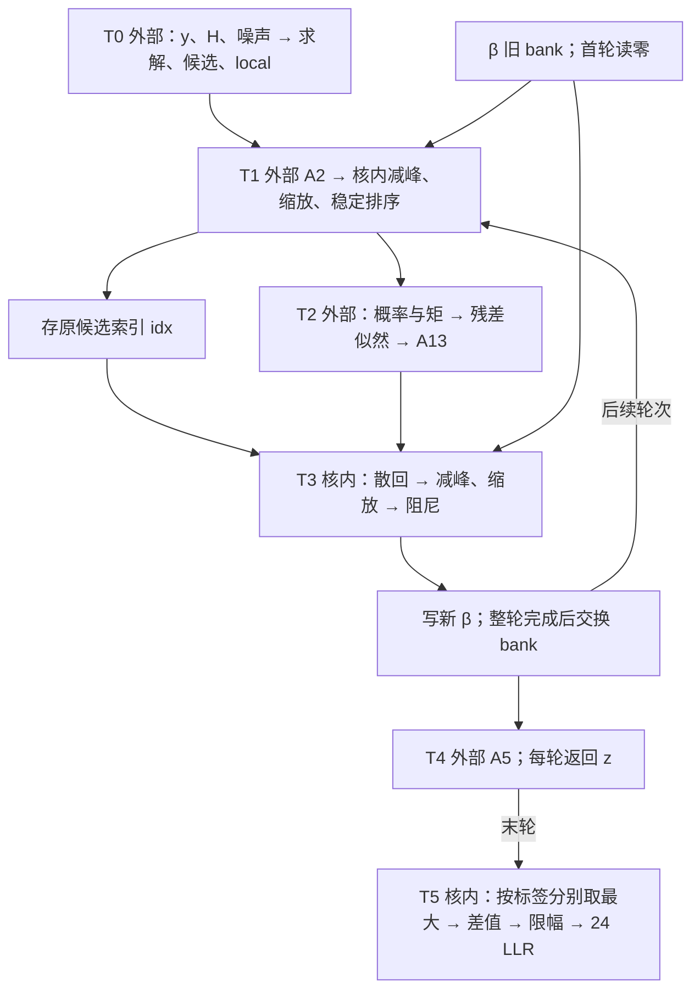

# MIMO v2｜从双精度 MATLAB 到首版 RTL 的阶段计划

**下一次上机的目标：取得一条可解释的证据链。** 选中一帧，从排序前 alpha 减一位开始，能追到这一拍应输出的 idx、三轮 β、最后 24 个 LLR，再指出这 1 位究竟影响哪个比较器、寄存器或接口。用它验通实验方法，再将同一流程扩到全核。[既有实验 SOP](10_MATLAB到FPGA定点量化重做SOP.md) · [现行边界与算术](09_边界与算术锁定.md)

## 1　先定边界与验收口径

以原始 float 为系统参考，以原始 fixed_mvm 和后续有序逐乘积/部分和模型为两条不同的矩阵算术对照。冻结部署包摘要、矩阵顺序、增益、候选与 Gray 标签次序、同分排序、阻尼及舍入饱和规则。控制器负责减峰、稳定排序、散回、反馈和末轮 LLR；前端、三组 MVM 及统计/似然按外部服务建模。硬件分区可以以后单独比较，首轮实验保持一致。

正式搜宽前填四个数值规格：① 每个背景 SNR 允许的配对 ΔBER 上界及置信水平；② 最低持续吞吐；③ 最大首入到末出时延；④ 器件、允许资源与外部带宽。有译码链时另定 ΔBLER。尚未签定数值时可以跑探索集，结论标作候选。5 pJ/bit 暂按完整检测链、每向量 24 bit 定义，即 120 pJ/向量；片上控制器单独计账，硬件能耗待实现。

## 2　两条时间轴：一帧何时计算，工程何时做决定

### 一帧的计算流图



箭头表示数据依赖；首版控制按阶段屏障发起操作。反馈箭头表示下一轮对 β 的依赖，每轮 A5 仍按参考协议完成。外部等待单独计数。

|阶段|规模和运算分类|首版结构、状态及周期核算|
|---|---|---|
|T0 每向量一次|8×4 复信道，4×4 求解；4 路各从 64 点选 9 点。涉及复乘加、距离、似然、筛选。|外部提供 local、候选与 36×6 位标签；把输入及就绪时刻录成可回放事务。前端时延记 Tfront。|
|T1 每轮|[β,local] 216 项 → A2 → 180 项；900 个非零项。20 口各做 9 项减峰和稳定排序。|单口 9 个分数寄存器及 9 个 4 位索引。无反压、每拍一项且每层比较一拍时，收数取峰 9 + 减峰 9 + 奇偶交换 9 + 发送 9 = 36 拍/口，720 拍/轮。与 A2 传输重叠的拍只计一次。|
|T2 每轮|8×4×9 个候选残差似然；288 项 λ 与 180 项 ai 拼为 468 项；A13 用 828 个非零项输出 180 项。|外部统计、exp/log、复数乘加与稀疏 MVM。接口固定 MATLAB 展平顺序、轮号、端口、候选号，反压期间保持载荷。|
|T3 每轮|180 项散回、归一化与阻尼；307·raw 和 717·旧β 对齐后求和、除以 1024。|idx RAM 180×4=720 bit；β 双 bank 共 360Wβ bit。每口先 9 次散回写并取峰，再发起 9 次更新。第二段若 II>1，从首次到末次发起相隔 8×II 拍，另加最后写回延迟及无法重叠的 RAM 读延迟。|
|T4 每轮|[β,local] 216 项 → A5 → 36 项，216 个非零项。|外部 MVM，记录请求与末个返回的握手；先保留所有轮次事务。|
|T5 末轮一次|4 路×9 候选×6 标签；两组最大值差、限幅 ±20、负值判 1。|若 6 个比特分组并行，每流读 9 个候选；记录末项进入、差值形成、最后 LLR 送出的三个时间点。缺组按参考代码对拍。|

三轮矩阵部分共 3×(900+828+216)=5832 个非零乘加项。该数是工作量；算几拍还需外部实例数、II、累加依赖和读带宽。架构比较同时报每帧首末握手的差、连续帧首入间隔、核忙拍和等待拍。吞吐按 24×时钟频率/连续帧平均间隔计。

### 工程实施顺序

|里程碑|在哪里做、控制什么|交付与进入下一步的条件|
|---|---|---|
|P0 建账|本机。按 T0–T5 为每条边登记生产者/消费者、形状、展平顺序、W/F、舍入点、跨轮寿命、RAM 端口；标“源码确定/范围估计/待选”。|部署接口表、数据流图、精度与时序预算。每个候选量化点都能回到 MATLAB 函数。|
|P1 基线与一条边|MATLAB 工作站。复现种子 1105 的 80 帧；alpha 固定 9 个含符号整数位，只改小数位。|交基线及四档单边报告，保留逐帧指标。补上逐轮排序前值、idx、β 跟踪，重放首次分歧；没有分歧也记录覆盖范围。|
|P2 搜宽与回退|工作站。先只选 alpha、raw、β；冻结其中每条线的整数位和量化位置，完成 E2-M 的 64 点对照。再让 E3-H 在相同网格及预算下试探。|统一/逐边/启发式最佳可行配置、失败邻点及回退原因。用同一标准逐步扩至其他接口、阻尼乘积与和、LLR；不得把各处单独最窄值直接拼作最终格式。|
|P3 微架构与时序闭环|本机搭周期模型，必要时对目标器件做独立算子综合。固定格式，先对比两个常系数专用单元与单个可选系数单元。再联合比较格式×绑定。|每个实例的输入输出格式、L/II、每拍占用、MUX/暂存、RAM 读写冲突表。覆盖同分、首轮清零、轮末交换、复位、连续帧、外部反压；慢接口有明确超时或系统时限假设。|
|P4 冻结 RTL 输入|工作站用预留种子复验。本机用同一组整数码、候选索引与事务序列核对周期模型。|受控版本的定点规格、黄金向量、接口协议和周期预算；资源/能量估算标明证据等级。满足下列门槛后进入首版 RTL。|

## 3　第一次 MATLAB 上机：现有入口与需要补的观测量

从工程的 experiments 目录运行。先另存实验 3 原 result 目录；run_wire_range 会写入该目录。以下命令只做回归与现有单边试验。

```matlab
addpath(pwd, fileparts(pwd));
run_wire_range();
cases = make_cases(20, 1105);
formats = [21 12; 19 10; 17 8; 15 6];
runs = exp_sort('alpha', formats, cases);
```

[范围脚本](../../experiments/run_wire_range.m)启用有序 MAC 观测；[单边入口](../../experiments/exp_sort.m)走 [run_edge_experiment](../../experiments/run_edge_experiment.m)，默认调用 run_quantized 的浮点矩阵路径。两者的矩阵算术口径须写入报告；若改用逐部分和量化，另起实验版本。已有入口写逐帧误码差、LLR 最大偏差和饱和数。首次 idx 分歧需在 [mimo_instrumented.m](../../experiments/mimo_instrumented.m) 的 alpha 量化前后、sort 后、散回和 β 写回处增加可关闭的逐项 trace；关闭量化并打开 trace 时先验证数值输出一致。复核基线应得浮点分 SNR 错 190/61/5/0，每档 480 bit。该集合用于回归和定位；独立验收另定样本量。

## 4　第一条能直接画成 RTL 的路径

对 T3 的一个候选，依次标注读出 raw 和旧 β → 对齐 → 两路常数乘 → 求和 → 右移舍入饱和 → 写新 β。若两输入已经对齐为同一有符号 W/F，保守自然宽分别为 W+9、W+10；因两系数非负且和为 1024，和用 W+10 足够。若上游仍有缩放增益，先另算增益乘积及对齐后的宽度。候选输出必须与旧 bank 同地址对应。在周期表逐行填 frame/round/port/candidate、实例号、读地址、输入有效拍、写回有效拍。逐候选提交与整轮换 bank 分开控制。

文献使用顺序：用[四](../../../../参考文献/FPGA/定点化方法_文献/借鉴文献四.md)建范围、局部量化与整链验收，用[八](../../../../参考文献/FPGA/定点化方法_文献/借鉴文献八.md)区分平滑扰动与排序跳变；用[二](../../../../参考文献/FPGA/定点化方法_文献/借鉴文献二.md)、[一](../../../../参考文献/FPGA/定点化方法_文献/借鉴文献一.md)制定多字长和选边规则，用[七](../../../../参考文献/FPGA/定点化方法_文献/借鉴文献七.md)校准小网格；最后用[三](../../../../参考文献/FPGA/定点化方法_文献/借鉴文献三.md)、[六](../../../../参考文献/FPGA/定点化方法_文献/借鉴文献六.md)、[十](../../../../参考文献/FPGA/定点化方法_文献/借鉴文献十.md)核算共享、重排与联合代价。每篇支撑一个工程决定，论文器件的资源系数和 BER 门限须由本项目重新建立。

## 5　开始写首版 RTL 的门槛

- 有可回放的浮点和定点模型。每条片上数据线注明 W/F、范围来源、量化规则和消费者；对外部端口也注明字序、缩放和有效条件。
- 至少一套联合格式在已约定工况下有可追溯的精度结果。证据不足项、特别是 BLER 和低 BER 区，列明后续验收条件；若先写探索 RTL，应标为原型。
- 首轮、轮间、末轮能在周期表走通。能回答每个 bank 何时可覆盖、谁负责反压、最后一个 LLR 何时有效，以及据什么外部延迟预算满足实时性。
- 准备正常与边界黄金向量及预期整数码。实现后再以 RTL 仿真、布局布线和活动功耗兑现时序与 5 pJ/bit 目标。此文件为设计计划，未产生新仿真结果。


当前精度验收点和实时预算见[首版原型验收规格](14_首版原型BER吞吐与延迟规格.md)。
