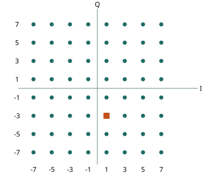

# 无线通信中的调制与载波技术综述

**从模拟载波到四流 64-QAM 基带检测**

## 摘要

无线调制的发展贯穿三个问题：用何种载波参数承载消息，如何在噪声中区分符号，以及如何在有限带宽内并行传输。本文从 AM、FM 和 PM 出发，比较 FSK、BPSK、QPSK 与方形 QAM 的判决方式，并说明 OFDM 如何利用频域正交性承载多个调制符号。结合四发八收检测器，本文追踪一个六位 Gray 标签从星座映射到软判决的过程，区分调制阶数、接收候选数与定点字长，说明候选分数的量化误差如何经排序和迭代反馈影响最终比特判决。

**关键词**　载波调制；正交振幅调制；64-QAM；正交频分复用；MIMO 检测；软判决

## 1 引言

发送端手里有六个比特，天线却只能辐射连续变化的电磁波。这六个比特怎样变成波？接收机又凭什么从带噪声的波中找回它们？沿着这两个问题，可以把无线通信的发展读成三个设计选择：用载波的哪个量传信息，一个符号允许取哪些值，以及怎样让多个符号同时通过信道。64-QAM 回答第二个问题；OFDM 和多天线传输把第三个问题分别放到频率和空间上。

## 2 模拟载波调制：振幅、频率与相位

设射频信号为 **s(t) = A(t) cos[2πfct + φ(t)]**。如果振幅 A 和附加相位 φ 都固定，接收端只会看到一个规则振荡。让它们随消息 m(t) 变化，振荡就能传声。频率和相位还有一层关系：瞬时频率等于 fc + φ′(t)/(2π)。这解释了为什么调频和调相都叫角度调制，又为什么同一个声音会产生两种不同的波形。

| 模拟调制 | 把一段恒定的正输入送进去，会看到什么？ | 接收端读什么？ |
|---|---|---|
| AM 调幅 | 常规带载波 AM 的包络升高，波峰间距保持不变。 | 在包络不翻转时，包络检波后去掉直流即可恢复消息。幅度扰动也会进入输出。 |
| FM 调频 | 瞬时频率持续上移，波峰间距缩短，额外相位随时间累积。 | 鉴频器测相位变化率。在适当信噪比下，宽带 FM 可用较大频偏和带宽换取较低的解调噪声。 |
| PM 调相 | 输入跳到新值时相位移动，此后保持相位偏移，频率回到载频。 | 相对于参考载波估计相位。相位变化越快，瞬时频偏越大。 |

广播语音首先要求听众能还原连续声压变化。AM 使接收电路容易实现；随着接收质量成为目标，如何压低干扰就成了另一条研究路线。Armstrong 在 1936 年的论文中给出了宽带 FM 系统及其与调幅系统的噪声比较。这一成果依赖带宽和接收条件，解释了同一种业务为什么会选择不同的调制。[1](https://bh.hallikainen.org/uploads/ArmstrongPaper1936.pdf)

## 3 数字键控：从音调判决到正交投影

数字通信把时间分成符号间隔。发送端在每个间隔选择一个约定波形，接收端比较有限个假设。若有 M 个等概率、按固定长度标记的状态，每个符号可映射 log₂M 个比特。于是每秒发多少个符号（波特）和每秒映射多少个比特有了区别。

**FSK（频移键控）**把离散选择放在频率上。二进制 FSK 可以约定 0 发 f₀，1 发 f₁。接收机在一个符号间隔内分别计算两个频率分支的能量，非相干接收也能判决。与连续改变频偏的模拟 FM 相比，FSK 的接收任务是识别发送端选了哪个音调。扩大正交音调集合可以携带更多比特，同时要留出更多频率空间。

**BPSK（二进制相移键控）**在同一频率上选两个相差 π 的相位。相干接收机把信号投影到参考余弦上，正负两个结果分别指向两个符号。**QPSK（四相相移键控）**再引入相差四分之一周期的参考正弦。两次投影给出 I（同相）和 Q（正交）坐标。将四点放在四个象限，每个坐标的正负各承载一个比特，每符号就有两比特。在相同符号率、脉冲成形和滚降系数下，QPSK 与 BPSK 的占用带宽相近，原始映射比特率加倍。

相干检测需要接收机掌握载波相位。相位误差会让整幅星座旋转，定时误差会使采样点偏离符号中心。后文的星座图取的是同步、下变频和匹配滤波之后的符号采样值。射频波形在整个符号期间仍连续变化。

## 4 正交振幅调制与 64-QAM 星座

正交振幅调制（QAM）给 I 和 Q 各自的载波分量分配多个幅度。一个符号写为 x = I + jQ，对应的带通信号可写成 I cos(2πfct) − Q sin(2πfct)，此处略去脉冲成形。一个复数就是同一载频上两次正交投影的简写。1962 年 Campopiano 与 Glazer 描述的相干数字幅相调制，正是用两路同频、相差 90° 的载波独立传送幅度，再由接收端分离。[2](https://doi.org/10.1109/TCOM.1962.1088634)

方形 16-QAM 每轴取 4 个电平，4 × 4 = 16 点，每符号 4 bit。项目的 64-QAM 每轴取 −7、−5、−3、−1、+1、+3、+5、+7，8 × 8 = 64 点，故每轴 3 bit、每符号 6 bit。等概发送时，一轴平方均值为 (1+9+25+49)/4 = 21，两轴合计 42。代码把每点除以 √42，就得到平均符号能量为 1 的星座。

图 1　按项目代码画出的 64-QAM 星座。两轴标的是归一化前的电平，实际坐标同除以 √42。橙色方点的六位标签为 **110 011**。

**跟着六个比特走一次。**项目在两轴上从低到高都用 Gray 标签 000、001、011、010、110、111、101、100。先看 I 的 110，查得 +1；再看 Q 的 011，查得 −3。发送符号就是 (+1 − 3j)/√42。如果均衡后的采样点略向右移动并越过 +2/√42 的判决边界，在等概、白高斯噪声、单流最近点检测下，它会被判成 (+3 − 3j)/√42，对应 111 011。此次相邻点误判只翻了一位。Gray 标记减轻了这种近邻误判的比特代价；多步跳点仍可能错多位。不同系统可以约定不同位序，复现实验要使用本工程的标签表。

密集星座提高了每个符号的载荷，也缩小了判决余量。单位平均符号能量下，方形 64-QAM 的最近距离为 2/√42，16-QAM 为 2/√10。因此在相同符号率和平均发射功率下，64-QAM 通常需要更好的信噪比和射频线性度来维持同等误码表现。上述 6 bit 是调制比特，纠错编码、导频和保护间隔都会影响净信息速率。

## 5 OFDM 的正交子载波与数字实现

高速单载波缩短了符号时间。多径带来的延迟副本可能越过符号边界，均衡变得困难。OFDM（正交频分复用）把高速数据拆到多条低速子载波上，使每条子载波的符号时间变长。设有效时间为 Tᵤ，子载波间隔取 1/Tᵤ；相邻子载波在这一窗口内恰好多转一圈，理想同步时交叉投影积分为零，因此频谱可以重叠。

发射端先在每个数据子载波上放入一个 QPSK 或 QAM 符号，用 IFFT 合成时域采样，再在块首复制末尾一段作为循环前缀。当前缀覆盖有效信道记忆、块内信道近似不变且同步充分时，接收端去前缀、做 FFT，每个子载波上的卷积可化为乘法。前缀占用时间；多个子载波同相叠加又会形成高峰值，对功放回退提出要求。频偏和快速时变也会破坏正交性，这一点在考虑星地多普勒时尤其重要。

1971 年 Weinstein 与 Ebert 给出了用离散傅里叶变换实现频分复用的数字收发结构。今天可在 3GPP NR 物理层规范中并排看到符号映射与 OFDM 波形生成两个步骤。例如“64-QAM + OFDM”就是先把六比特映射为一个复数，再把这个复数放进一个数据子载波。[3](https://doi.org/10.1109/TCOM.1971.1090705) [4](https://www.etsi.org/deliver/etsi_TS/138200_138299/138211/18.08.00_60/ts_138211v180800p.pdf)

## 6 四流 64-QAM 的基带检测与定点实现

频率可以提供多条并行通道，天线也可以提供空间维度。多天线研究表明，当传播环境提供足够独立的空间方向，收发阵列可以提高容量。实际增益取决于信道矩阵的秩、条件数和信噪比。对于视距占主导的星地链路，天线数本身不足以保证能分离四流。项目现阶段从同步后的离散复基带接口出发，输入是给定的 H 和 y；若上游使用 OFDM，可以对接一个子载波上的观测，当前检测模型本身也可用于适当的窄带平坦信道。[5](https://doi.org/10.1023/A:1008889222784)

**把 y = Hx + n 读成一句话。** 一次发送四个 64-QAM 点，组成 x 的四个分量。第 r 个接收端看到 yᵣ = Hᵣ₁x₁ + Hᵣ₂x₂ + Hᵣ₃x₃ + Hᵣ₄x₄ + nᵣ。八个接收端给出八个复观测，因此 H 是 8 × 4。每个观测里都混着四流，直接把 yᵣ 吸附到某个星座点会忽略其余三流。

**64 → 9。**四流联合穷举有 64⁴ = 16,777,216 个符号组合。工程先用信道和接收样本形成每流的估计，再对该流的 64 点计算候选分数，兼顾比特标签覆盖后留下 9 点。这里的 9 是接收算法的搜索预算，发送端仍可发全部 64 点。留下的 4 × 9 个候选进入三轮消息更新；20 个内部消息端口组织计算，不能把它们当成 20 根天线。

**9 → 6 → 24。**末轮给每个候选一个分数。对某一位，把候选按标签 0 或 1 分组，分别找出两组最高分。项目用“0 组最高分减 1 组最高分”构造近似对数似然比（LLR），并限幅到 ±20。例如两组最高分为 4.2 和 3.8，输出 +0.4，硬判为 0，但两种解释仍很接近。对一流六个位各做一次，四流便得到 24 个软值。一个 LLR 的存储字长可以多于一位，吞吐统计仍把它看作一个待判决比特。

**为什么要研究字长？**发送端的六位标签决定“哪个星座点”，接收机的定点字长决定“候选分数能分得多细”。如果两个很近的分数在舍入后同分，稳定排序保留的先后关系可能与浮点排序不同；索引还参与散回，此差异可能经过反馈改变末轮 LLR。项目同时跟踪首次索引变化、逐轮 LLR 与逐信噪比误码，才能判断少用一位是否值得。这把从天线上传来的波，连接到了 FPGA 中的一次比较。

## 7 结论

64-QAM 的设计收益是每个符号可映射六位，其代价是固定平均能量下相邻点更近。OFDM 的子载波正交性和 MIMO 的空间可分性分别取决于同步条件和信道特性。落实到本项目，四流发送的 24 个调制比特决定输出规模，每流九个候选决定检测搜索范围，而分数格式决定接收机能分辨多小的度量差异。评估一次减位，应在同一输入上追踪排序、末轮软值与误码的变化。

## 参考文献

1. E. H. Armstrong（1936），*A Method of Reducing Disturbances in Radio Signaling by a System of Frequency Modulation*，Proceedings of the IRE。关注作者怎样比较频偏、带宽和噪声。[论文扫描件](https://bh.hallikainen.org/uploads/ArmstrongPaper1936.pdf)

2. C. N. Campopiano、B. G. Glazer（1962），*A Coherent Digital Amplitude and Phase Modulation Scheme*，IRE Transactions on Communications Systems。关注收发机怎样分离两路正交分量。[论文 DOI](https://doi.org/10.1109/TCOM.1962.1088634)

3. S. B. Weinstein、P. M. Ebert（1971），*Data Transmission by Frequency-Division Multiplexing Using the Discrete Fourier Transform*，IEEE Transactions on Communication Technology。[论文 DOI](https://doi.org/10.1109/TCOM.1971.1090705)

4. 3GPP TS 38.211，Release 18，v18.8.0，*NR; Physical channels and modulation*。可对读 §5.1 的调制映射与 §5.3 的 OFDM 基带信号生成。[ETSI 标准原文](https://www.etsi.org/deliver/etsi_TS/138200_138299/138211/18.08.00_60/ts_138211v180800p.pdf)

5. G. J. Foschini、M. J. Gans（1998），*On Limits of Wireless Communications in a Fading Environment when Using Multiple Antennas*，Wireless Personal Communications。关注多天线容量结论所依赖的衰落环境。[论文 DOI](https://doi.org/10.1023/A:1008889222784)

项目对照入口：[MIMO.m](../../MIMO.m)。第 40–41 行定义电平、归一化和 Gray 位序，第 52–54 行由候选分数组成 24 个 LLR；前端筛选与迭代路径另见[项目计算流程图](12_MIMO原始代码计算流程.html)。
