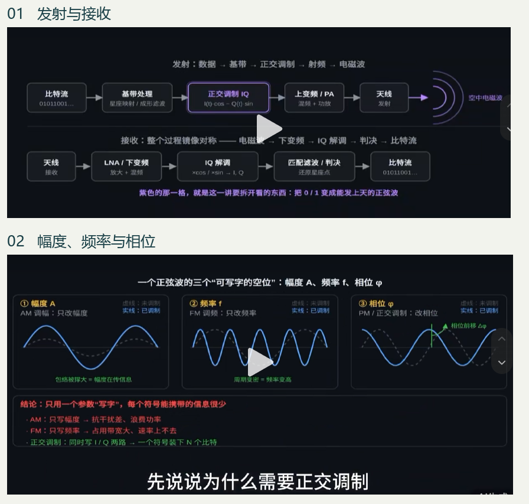
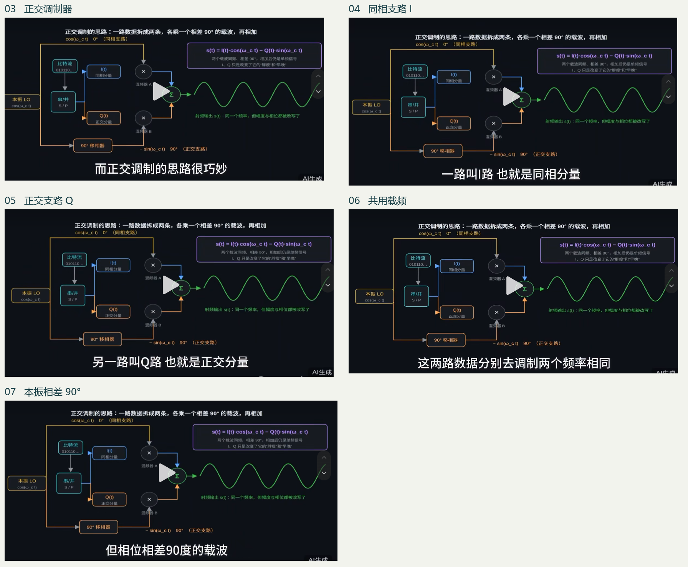
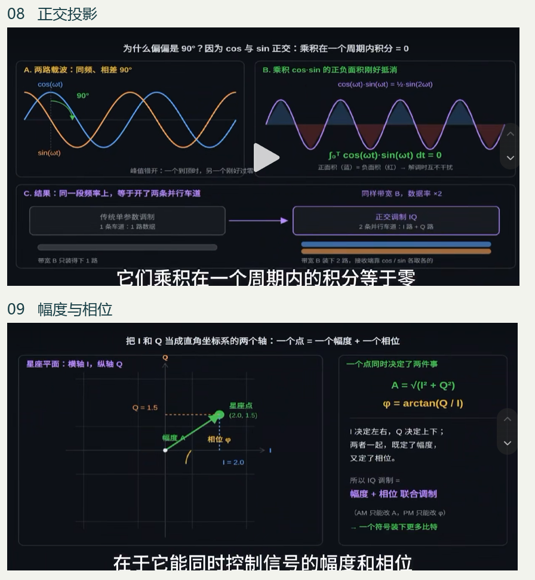
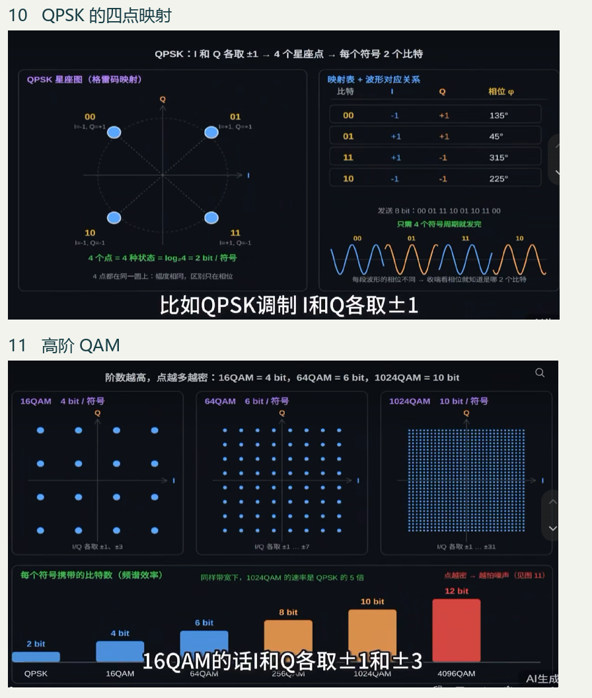
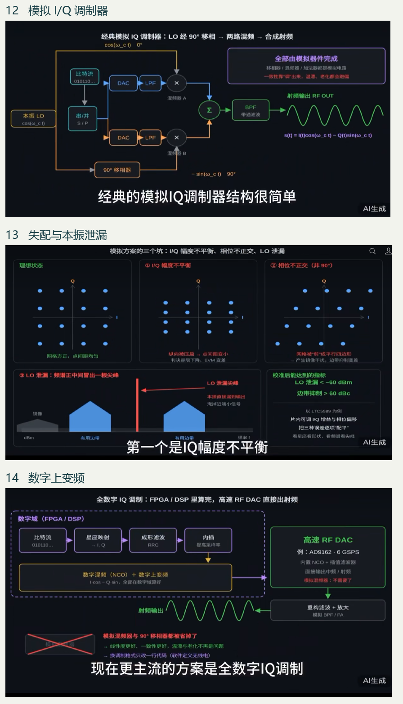
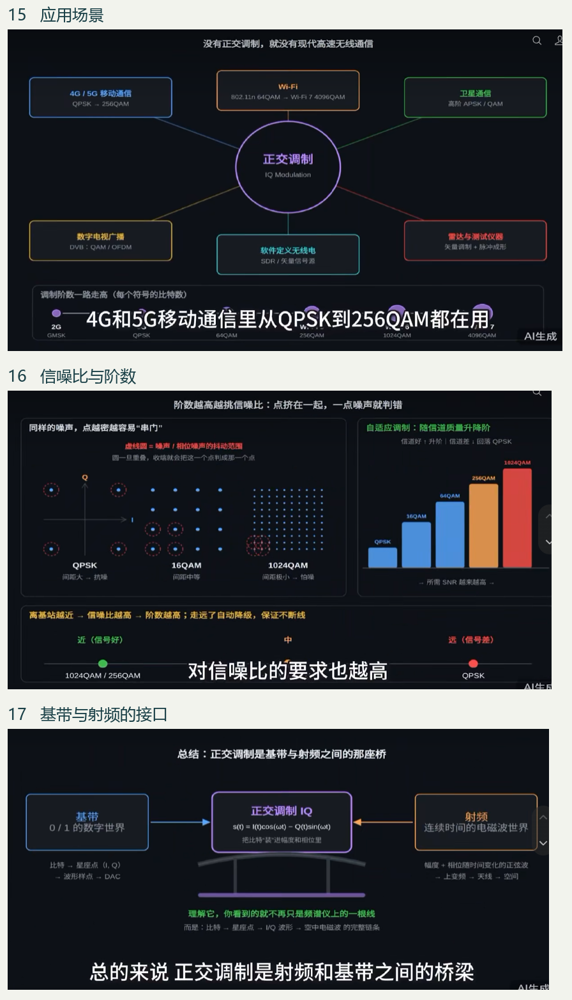

# 正交调制的技术演进与收发实现

**综述 2 · 从载波波形、I/Q 电路到四流 64-QAM 检测**

## 摘要

无线电发射机只能向天线送出实值电压，接收机却能从一段波形中恢复两个坐标。正交调制利用同频余弦与正弦在接收窗口内可分离的性质，把这一对坐标变成可传输的符号。本文将所附 17 幅教学截图拼成六组图版，依次讨论正交基、星座映射、收发硬件及链路自适应。结合原始论文、卫星通信标准和射频器件资料，追踪一个持续存在的工程问题：当星座点越来越密，接收端如何保持足够准确的幅度、相位和候选分数，从而读出正确的比特？

**关键词**　正交调制、复基带、相干检测、64-QAM、射频数模转换、多天线检测

## 1　从天线倒推：接收机究竟要恢复什么？

**图版一｜先看 01 的紫框，再看 02 的三种波形。** 一串 0 和 1 先被分组成符号，成形滤波器把连续几个符号连成平滑的基带波形，调制器再把它搬到适合发射的频段。接收端经过放大、下变频、同步和匹配滤波，在符号时刻估计发送点。沿图 01 的下排读，有三个不同对象：天线端的连续电压、下变频后的 I/Q 样本、判决后的比特。本项目从已经同步的复基带观测开始。

写成 $s(t)=A(t)\cos[2\pi f_ct+\phi(t)]$，常规 AM 让包络随消息改变；PM 让附加相位随消息改变；FM 则让瞬时频偏随消息改变。频偏等于附加相位对时间的导数除以 $2\pi$。图 02 的三格因此有一个容易忽略的联系：若调频输入保持正值，波峰持续变密，相对参考波的相位差就会不断累积。1936 年 Armstrong 用宽带 FM 对付无线电噪声，展示了带宽、接收条件与解调质量之间的取舍。数字 FSK 将频率限定为若干离散音调，接收机判断一个符号周期里发了哪一个。图中对带宽和速率的概括，要结合符号率、频偏、功率与误码目标理解。[Armstrong，1936](https://bh.hallikainen.org/uploads/ArmstrongPaper1936.pdf)

## 2　一根天线上怎样同时传 I 和 Q？

**图版二｜03 看全图，04–05 沿两条数据线读，06–07 沿本振线读。** 输入比特经映射后得到两个带符号数。蓝色支路用 $I$ 乘余弦，橙色支路用 $Q$ 乘负正弦，两者在求和节点合成一路实值输出。两个混频器取自同一本振（LO），频率相同，参考相位相差四分之一周期。图 03–07 是同一电路的连续字幕，因此五帧合读只对应一种结构。

$$
s(t)=I(t)\cos(2\pi f_ct)-Q(t)\sin(2\pi f_ct)
=\operatorname{Re}\{[I(t)+jQ(t)]e^{j2\pi f_ct}\}.
$$

例如在一个符号内取 $I=1,Q=0$，发射波形是余弦；取 $I=0,Q=1$，波形变为负正弦。接收机由此得到两把已知的“尺”。1956 年 Weaver 已用正交支路相加与抵消来选择单边带；1962 年 Campopiano 与 Glazer 用两条正交载波独立传送数字幅度。两项工作的电路有亲缘关系，前者解决边带选择，后者解决一个符号中怎样承载多个离散状态。[Weaver 原文](https://picture.iczhiku.com/resource/eetop/sYKGqTAWaySFGMNc.pdf) · [Campopiano 与 Glazer 原文](https://doi.org/10.1109/TCOM.1962.1088634)

**图版三｜08 解释接收机为何能分开，09 解释分开后读到什么。** 为看清数学，设符号内 $I,Q$ 恒定，观测窗 $T$ 覆盖整数个载波周期。在理想同步下，把 $s(t)$ 乘余弦后积分：余弦平方的积分是 $T/2$，余弦与正弦的乘积积分为零，故结果为 $IT/2$。改乘负正弦则得 $QT/2$。在实际成形系统中，相应操作由相干下变频、低通和匹配滤波完成。载频或定时偏差会破坏理想分离。图 08 的“两倍”可用同符号率的 BPSK 与 QPSK 理解：每个符号从一位变为两位；达到指定误码率还要核算功率和噪声。

图 09 取 $(I,Q)=(2,1.5)$，合成幅度为 2.5，相位约为 36.87°。程序应使用 $\operatorname{atan2}(Q,I)$ 确定象限。例如同时把两个坐标取负，普通比值 $Q/I$ 不变，实际相位却转了半圈。这个几何事实把电路图上的两条线与接收机屏幕上的一个点联系起来。

## 3　从四点到六十四点：增加了哪些信息，又失去了多少余量？

**图版四｜先数每轴电平，再数平面上的点。** BPSK 用两个反相点表示一位。图 10 的 QPSK 让两轴各取 ±1，得到四个等幅点与四种相位，每符号两位。图中的标签是一种约定。图 11 的方形 QAM 扩展每轴电平数：4×4、8×8、32×32 分别得到 16、64、1024 点，对应 4、6、10 bit/符号。只有两端使用同一套映射，接收点的坐标才会变回原来的位串。

比较星座前要固定平均符号能量。对等概方形 64-QAM，每轴八个电平为 ±1、±3、±5、±7，一轴平方均值为 21。项目将复数除以 $\sqrt{42}$，使平均能量为 1；相邻点距离为 $2/\sqrt{42}$。从某个内部点向最近的水平判决边界移动，只需走 $1/\sqrt{42}$。这给图 16 的“点挤在一起”一个可计算的含义。保持符号率和编码率时，阶数提高会增加原始映射速率；能否提高成功交付的数据量还取决于误码和重传。

## 4　相同的调制公式，怎样落到两代硬件里？

**图 12 到图 13：看一个理想方格怎样变形。** 在模拟正交上变频器中，两路 DAC 和低通滤波器先产生基带电压，模拟混频器再乘本振，求和后滤出目标频带。若 Q 路增益偏小，星座会沿纵轴压扁；若两路夹角偏离 90°，坐标轴就会歪斜，并产生镜像分量。若本振泄漏到射频端，即使基带期望输出为零，也可能在载频处看到窄谱线。工程上分别看星座误差矢量幅度（EVM）、镜像抑制和本振泄漏；图中 dBm 是绝对功率，dBc 是相对载波的功率比，两者口径不同。具体数值应随器件、频率、输出功率与校准条件报告。

**图 14：沿数字样本一直走到模拟输出。** 在数字上变频方案里，映射器、成形滤波、插值和数控振荡器（NCO）生成数字通带样本，再交给高速 RF DAC。图中的 AD9162 是可核查的实物例子：它集成插值滤波和 NCO，支持最高 6 GSPS 数据速率，部分模式的有效 DAC 更新率可到 12 GSPS。数字混频改善两路系数与相位的一致性，时钟抖动、DAC 杂散、输出滤波及功放非线性仍会进入射频误差预算。术语“全数字”在此描述调制计算所在的位置。它不意味着本项目的接收控制器包含 RF DAC。[Analog Devices，AD9161/AD9162 数据手册](https://www.analog.com/media/en/technical-documentation/data-sheets/ad9161-9162.pdf)

## 5　为什么卫星、蜂窝与 Wi‑Fi 会选不同的星座？

**图 15 看系统，图 16 看取舍，图 17 看接口。** 多种系统共用 I/Q 表示，但信道与射频约束决定可用星座。卫星转发器的功放效率与幅相失真关系密切，DVB-S2 给出了 QPSK、8PSK、16APSK、32APSK 等模式；APSK 把点安排在若干圆环上。蜂窝 NR 则分别规定调制映射与 OFDM 基带信号生成：先把一组比特映为一个复数，再把许多复数安排在不同子载波，用 IFFT 合成波形。Wi‑Fi 采用高阶 QAM 时同样需要足够的链路质量。由此可见，仅凭“星地通信”四个字无法确定调制阶数或复用方式。[DVB-S2 标准](https://www.etsi.org/deliver/etsi_en/302300_302399/302307/01.02.01_60/en_302307v010201p.pdf) · [3GPP TS 38.211，§5.1、§5.3](https://www.etsi.org/deliver/etsi_TS/138200_138299/138211/18.08.00_60/ts_138211v180800p.pdf)

图 16 把离基站远近画成横轴，可以当作路径损耗改变的例子。实际链路还会受遮挡、同频干扰、衰落、接收机估计误差影响。链路自适应根据可用的质量估计、反馈与目标错误率选择调制和编码组合。若从 QPSK 升到 64-QAM，每符号映射位数从 2 增到 6；同一条低信噪比链路若为此频繁重传，提高阶数反而可能降低有效吞吐。

## 6　技术演进节点：时间、代表性论文与工程事件

下表按可以核查的发表、版本或发布事件排序。器件资料的修订年份给出实现例证，不能据此推断某项技术的发明年份。

| 时间 | 代表性论文、标准或事件 | 当时解决的问题，以及与图版的联系 |
|---|---|---|
| 1936 | E. H. Armstrong，*A Method of Reducing Disturbances in Radio Signaling by a System of Frequency Modulation*。[原文](https://bh.hallikainen.org/uploads/ArmstrongPaper1936.pdf) | 从噪声和带宽权衡理解宽带 FM，对应图 02。 |
| 1956 | D. K. Weaver，*A Third Method of Generation and Detection of Single-Sideband Signals*。[原文](https://picture.iczhiku.com/resource/eetop/sYKGqTAWaySFGMNc.pdf) | 在单边带收发机中使用正交混频与支路相消，可与图 03、08 对读。 |
| 1962 | C. N. Campopiano、B. G. Glazer，*A Coherent Digital Amplitude and Phase Modulation Scheme*。[论文](https://doi.org/10.1109/TCOM.1962.1088634) | 同频正交载波各带离散幅度，接收端相干分离，对应图 03–11 的主线。 |
| 1971 | S. B. Weinstein、P. M. Ebert，*Data Transmission by Frequency-Division Multiplexing Using the Discrete Fourier Transform*。[论文](https://doi.org/10.1109/TCOM.1971.1090705) | 用离散傅里叶变换组织多载波收发，使图 15 中的 QAM 与 OFDM 有了清楚的分工。 |
| 1998 | G. J. Foschini、M. J. Gans，*On Limits of Wireless Communications in a Fading Environment when Using Multiple Antennas*。[论文](https://doi.org/10.1023/A:1008889222784) | 研究多天线衰落信道的容量，从频率和星座维度进一步引向本项目的空间检测。 |
| 2009 年 8 月 | ETSI 发布 DVB-S2 标准 EN 302 307 V1.2.1。[标准](https://www.etsi.org/deliver/etsi_en/302300_302399/302307/01.02.01_60/en_302307v010201p.pdf) | 模式表将星座与编码率配对，给图 15、16 的卫星应用提供具体参照。 |
| 2016–2019 | AD9161/AD9162 数据手册的版本记录，Rev. D 给出 RF DAC 架构与工作模式。[手册](https://www.analog.com/media/en/technical-documentation/data-sheets/ad9161-9162.pdf) | 数字插值、NCO 与高速 DAC 可集成在一条发送路径，对应图 14。 |
| 2025 年 7 月 22 日 | IEEE 802.11 工作组记录 IEEE Std 802.11be-2024（EHT）正式发布。[工作组发布记录](https://grouper.ieee.org/groups/802/11/) | 图 15 将 Wi‑Fi 7 作为高吞吐无线局域网实例。标准名称中的 2024 与正式发布日期应分别记录。 |

## 7　回到本项目：图 17 的接收端再往后是什么？

对本工程，一次检测接收八个复数观测。第 $r$ 个观测满足 $y_r=\sum_{u=1}^{4}H_{ru}x_u+n_r$，其中每个 $x_u$ 都是一个 64-QAM 点，每个 $H_{ru}$ 同时描述幅度与相位变化。图 09 中一个干净的星座点，到这里已经与另外三流混合。检测器利用已知的 $H$ 与噪声参数来区分候选；上游的本振校准、定时恢复和信道估计属于不同的系统环节。

举一个能在代码中查到的例子：标签 **110 011** 表示 I 取 +1、Q 取 −3，发送点为 $(1-3j)/\sqrt{42}$。接收机不知道发了哪个标签，先为每流的 64 点评分，结合标签覆盖留下 9 点，再做三轮反馈。末轮对每一位比较“标签为 0 的最高分”和“标签为 1 的最高分”，二者之差形成软判决。四流各六位，最终得到 **24 个 LLR**。射频失配会改变观测，定点舍入会改变内部候选分数；定位误码时应记录差异首次出现在哪一层。这也是图版中的射频 EVM 与本工程的逐轮排序、LLR 和 BER 需要分别观测的原因。[项目实现 MIMO.m](../../MIMO.m) · [综述 1：无线通信中的调制与载波技术](无线通信调制与载波技术综述.md)

**图源说明。** 六幅图版按提交顺序收录用户提供的全部 17 张教学截图，原图编号 01–17；相关字幕保留。历史节点与器件参数以正文链接的论文、标准和厂家资料为依据。
